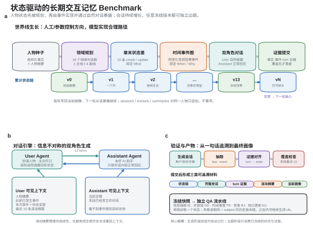
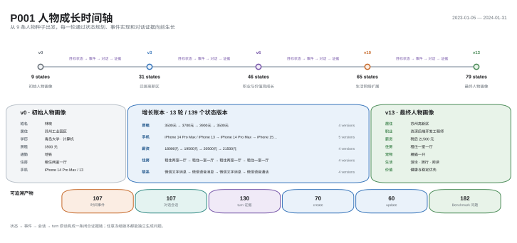

# 状态驱动的长期交互记忆 Benchmark

**State-Driven Long-Term Interactive Memory Benchmark — 可控人物演化 × turn 级证据溯源**

面向**单用户—AI 个性化助手**场景，以版本化状态链驱动同一位用户在数月乃至更长周期内与助手持续交互。人物的居住、工作、资产、关系、偏好与生活习惯按规划演化，每项变化均落实为自然对话并锚定到具体 turn。系统可重建任意版本的结构化人物画像，并基于冻结快照统一生成长期记忆评测问题。

| 初始事实 | 当前状态 | 状态版本 | 时间事件 | 会话 | Turns | Turn 级证据 | 问题 |
|:-:|:-:|:-:|:-:|:-:|:-:|:-:|:-:|
| 9 | 79 | 139 | 107 | 107 | 1,284 | 130 | 182 |

<sub>P001 参考样例，v0 → v13</sub>

## 研究动机

现有长期记忆 Benchmark 在数据构造上各有侧重，但均难以对**同一人物的状态演化**进行精确控制：

- **[LongMemEval](https://arxiv.org/abs/2410.10813)** 覆盖信息抽取、多会话推理、时间推理、知识更新与拒答，并提供证据 session。其对话历史围绕目标问题与证据陈述合成，经人工编辑后混入 filler session，核心单元是**问题—证据实例**，擅长检验 memory system 的长程检索能力，但不刻画人物世界状态的连续演化。
- **[LoCoMo](https://arxiv.org/abs/2402.17753)** 由两个带 persona 的 LLM Agent 依据时间事件图跨 session 交谈，再经人工校订长期一致性，对话自然、跨度长。但事件图仅约束“发生什么”，缺少显式的状态差量来约束“人物最终变成什么”，属性更新、领域覆盖与最终画像均难以精确控制。

本项目在两者之间建立**状态可控、证据可溯、世界线可续写**的数据构造范式：

| 设计原则 | 实现方式 |
|---|---|
| 交互对象 | 一位用户与其 AI 助手的长期关系，而非多角色社交对话 |
| 生成顺序 | 先演化人物世界线，再统一出题，避免围绕预设题目反向拼接 |
| 演化控制 | 每轮先规定状态差量，再由模型编排合理事件与自然表达 |
| 证据血缘 | 状态、事件、会话、原文与问题共享同一条可追溯链路 |
| 持续扩展 | 在 `v13` 出题后仍可续写 `v14`、`v15`，并得到新的当前画像 |

“单用户”指任务场景而非数据规模。扩展时可生成 P002、P003 等相互独立的人物世界线，每条世界线各自模拟一位用户与助手的长期关系；仓库中的 P001 用于验证完整的生成—出题闭环。

## 系统架构



每轮从 16 个生活领域中选定 **1 条主线与 4 条副线**，规划 **10 条** `create` / `update` 状态差量，并编排为带日期的时间事件。对话由信息不对称的双 Agent 生成，原话覆盖目标状态后，才连同事实、事件与 turn 级证据一并提交。

状态链、事件图与人物画像按版本累积；sessions、extracts 与 summaries 仅追加、不重写。QA 流水线与人物演化解耦，只读取指定版本的冻结快照，因此可在任意版本出题后继续续写世界线。

## 核心设计

### 1. 版本化状态模型

人物状态按四级结构组织：

```text
domain → subcategory → subject → versions[]
```

覆盖 16 个生活领域，支持四类状态操作：

| 操作 | 语义 |
|---|---|
| `create` | 新增事实 |
| `update` | 以新值替换旧值 |
| 集合型 `update` | 增加或移除集合中的单个元素 |
| 置空 | 标记某一状态终止 |

旧值不做覆盖删除，而是保留为历史版本，使数据同时支撑“当前是什么”“过去是什么”以及“何时发生变化”三类查询。

### 2. 全链路领域标签

`domain / subcategory / subject` 从状态规划阶段注入，贯穿目标状态、事件 `goal_state`、对话事实抽取与 QA candidate，而非在出题阶段事后推断。领域覆盖因此可规划、数据分布可统计，问题也可直接继承来源领域。

> 当前生成链路已完整保留领域标签；最终问题 JSONL 尚未将其序列化至 `QuestionRecord.meta`。

### 3. 信息不对称的双 Agent 对话

| 角色 | 可见信息 |
|---|---|
| **User Agent** | 人物摘要、历史事件、本次事件与状态变化、最近 10 条滚动摘要 |
| **Assistant Agent** | 仅当前日期与已发生的对话，不可见事件图与目标状态 |

状态变化须经由求助、分享、吐槽、回忆等自然动机逐步暴露，避免双方依据同一剧本照本宣科。

### 4. 证据校验后提交

每个事件生成一段 12 turns 的对话，随后抽取用户事实、事件、滚动摘要及各状态变化对应的 turn 级原话。若原话未覆盖目标状态，仅重新生成当前会话；校验通过后才追加 session、extract 与 summary，形成 `state → event → session → turn → 原文` 的完整证据闭环。

### 5. 画像与问题均由状态链计算

各状态链的最新版本共同构成指定轮次的人物画像。该画像并非对全部对话的模糊概括，而是**可计算、可比较、可追溯**的结构化快照。

对话流水线负责人物演化，QA 流水线仅消费冻结版本的状态链、会话与证据，题型设计不会反向干预人物生成。

## 人物演化示例



P001 由 **9 条初始事实**出发，经 13 轮演化形成 **79 个当前状态、139 个状态版本、107 个时间事件、107 段会话与 130 条 turn 级证据**，并据此生成 **182 道单跳与多跳问题**。

房租、手机、薪资、住房与联系方式等事实可多次变更，每个版本均可回溯至事件、会话、具体 turn 与原始文本，使 Benchmark 同时具备当前画像、知识更新、时间推理与证据核验能力。

## 快速开始

安装：

```bash
pip install -e .
```

模型、接口地址与密钥默认读取 `AZURE_OPENAI_MODEL`、`OPENAI_BASE_URL`、`OPENAI_API_KEY`。

```bash
# 查看可选领域
ltm list-domains

# 从 v0 持续生成至 v13
ltm dialogue --to-round 13

# 基于 v13 冻结快照生成单跳问题
ltm qa --planning-round v13 --hop single --limit 40

# 生成多跳问题
ltm qa --planning-round v13 --hop multi --model deepseek-v4-pro --limit 40
```

也可通过 Python API 调用：

```py
from longterm_memory_benchmark import run_dialogue, run_qa
```

`ltm` 对应 `cli.py` 中的 `main`，亦可使用 `python -m longterm_memory_benchmark`；`--planning-round 13` 会自动规范为 `v13`。

## 产出物

### 对话与人物材料

`run_dialogue` 按版本迭代，每轮依次完成人物画像、目标状态、时间窗口、事件图、对话生成、事实抽取与摘要更新。

| 文件 | 内容 |
|---|---|
| `{person}_v{n}_profile_data.json` | 该轮最终人物画像 |
| `{person}_v{n}_planning_state.json` | 截至该轮的全部状态链 |
| `{person}_v{n}_target_state.json` | 本轮需实现的状态差量 |
| `{person}_v{n}_time_event_graph.json` | 截至该轮的完整事件图 |
| `{person}_dialogue_sessions.json` | 该人物的全部会话 |
| `{person}_dialogue_extracts.jsonl` | 事实、事件与 turn 级证据 |
| `{person}_dialogue_summaries.jsonl` | 全部滚动摘要 |

### Benchmark 问题

`run_qa` 读取指定轮次的冻结材料，生成附带标准答案、推理过程与证据引用的问题。结果逐条增量写入 `{person}_{hop}_questions.jsonl`，同一 `question_id` 仅保留最新记录，支持中断后续跑。

| 题型 | 考察能力 |
|---|---|
| `information_extraction` | 单跳：事实读取；多跳：聚合同一状态链的历史版本 |
| `open_domain` | 人物记忆与外部常识的联合推理 |
| `temporal` | 基于 session 时间解析相对时间表达 |
| `reject` | 目标信息不存在于记忆中时正确拒答 |
| `knowledge_update` | 从多个历史版本中识别当前有效值 |

多跳问题当前默认生成 `information_extraction` 与 `knowledge_update`。`query_time` 表示提问时刻，`session_time` 表示历史对话的发生日期。

## 项目结构

```text
longterm_memory_benchmark/
├── cli.py                          # dialogue、qa、list-domains
├── run_dialogue.py                 # 人物与对话生成入口
├── run_qa.py                       # Benchmark 问题生成入口
├── llm_client.py                   # OpenAI 兼容接口
├── src/
│   ├── dialogue_gen/
│   │   ├── step0_0_0_person_profile.py
│   │   ├── step1_0_0_target_state.py
│   │   ├── step1_1_0_time_plan.py
│   │   ├── step2_0_0_time_event_graph.py
│   │   ├── step3_0_0_dialogue_generate.py
│   │   ├── step3_1_0_dialogue_extract.py
│   │   ├── step3_2_0_dialogue_summary.py
│   │   ├── step3_3_0_dialogue_orchestrate.py
│   │   └── dialogue_prompt/                     # 画像、状态、事件与对话提示词
│   ├── qa_gen/
│   │   ├── base.py                              # 题型生成基类
│   │   ├── materials.py                         # 加载出题原料
│   │   ├── models.py                            # 候选、证据与问题记录
│   │   ├── step1_0_gen_basic_qa.py              # 信息抽取（IE）
│   │   ├── step1_1_gen_open_qa.py               # 开放域（OD）
│   │   ├── step1_2_gen_temporal_qa.py           # 时间推理（TR）
│   │   ├── step1_3_gen_reject_qa.py             # 拒答（RJ）
│   │   ├── step1_4_gen_knowledge_update_qa.py   # 知识更新（KU）
│   │   └── qa_prompt/                           # IE、OD、TR、RJ、KU 提示词
│   └── utils/
├── data/
│   ├── persons/                    # 初始人物画像
│   ├── output/                     # 状态、事件、会话与证据
│   └── qa/                         # 问题 JSONL
└── docs/                           # 架构图与人物数据卡片
```

## 当前边界与后续计划

- 单轮覆盖一个自然月，规划 10 条状态差量。
- 单段会话固定 12 turns；状态覆盖校验失败时最多重试 3 次。
- 领域标签已贯穿状态、事件、抽取与 QA candidate，最终问题记录尚未序列化该字段。
- 多跳的开放域、时间推理与拒答题型尚在规划中。

## 参考文献

- [LoCoMo: Evaluating Very Long-Term Conversational Memory of LLM Agents](https://arxiv.org/abs/2402.17753)
- [LongMemEval: Benchmarking Chat Assistants on Long-Term Interactive Memory](https://arxiv.org/abs/2410.10813)
