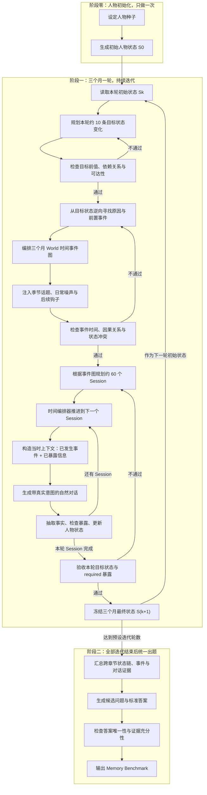
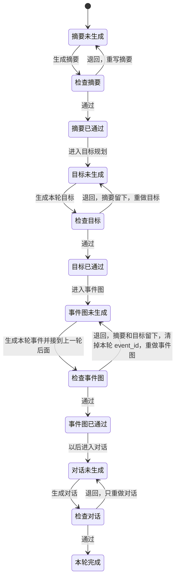

## 项目架构设计

1.设定人物种子，基于人物种子生成一个人3个月内的10条信息更新链变化，作为目标状态实现。例如：

- change_id: CH‑03
path: "belongings.car.ownership"
from: "none"
to: "owned"
op: create
causal_deps: []
exposure: required
need_causal_exposure: false
note: "资产：无车 → 拥有汽车"
- change_id: CH‑04
path: "commute.mode"
from: "public_transit"
to: "drive_car"
op: supersede
causal_deps: ["CH‑03"]
severity: medium
exposure: optional
need_causal_exposure: false
note: "通勤：公共交通 → 自驾"

---

2.章节设计（3个月事件图，60session） 基于人物当前状态及需要达到的目标更新链编排事件时间图：

根据当前时间事件图，从需要达到的目标往前找可用于构造该关系的事件，基于人物初始状态构造事件时间图,先从人物状态确定主要的重大事件变化影响，构思一个合理的主线，其他细节作为副线，编排事件时间图。 -注入季节钩子噪声，引入时间性的话题。

1. -初步确认好时间事件图，注入钩子事件(某个事件比如卖车给了小王，钩子事件，后面与他产生车子的纠纷，可用于信息抽取问题)钩子事件制备允许存在编排好事件图后，基于当前的事件在本章节时间端插入，这是为了避免前后冲突及可控性的规划。
  .session设计 -依据时间事件图 此为world时间线 -设定时间编排器，到达某个时间节点时，user只知道该时间线前发生过的事情，用带意图的方式透露给assitant,比如时间线公司破产。那么user的编排是问助手通知邮件怎么写，然后透露公司破产了。又比如时间线总是加班犯困，因此老喝咖啡提神。 user编排应该是，身体最近不舒服，加班吃不消，总是心悸，什么情况。然后assitant就引导问具体原因，user在透露最近加班犯困，跟总喝咖啡来提神是否有关，然后assitant给出解决方法。 -每个session提交都需要抽取事实，检查状态目标是否被透露达到，已发生事件时间节点是否实现，更新人物状态。

---

## 目前的架构

一条流水线，四个节点按顺序走：人物档案、目标规划、事件图、检查器。前三个负责生成并保存，检查器只读已经保存的对象，判断通不通过。检查不通过就退回那个节点重做，它后面已经生成的结果全部作废。对话还没做，以后加在事件图后面，检查器再加一节，退回规则不变。

每个版本是一个断点。`v0` 是初始事实，没有三个月窗口。从 `v1` 起，每一轮覆盖三个月，问题只覆盖到这个断点为止已经成立的状态。

### 人物档案

输入是 `person.json`。一条事实是 `domain`、`subcategory`、`subject`、`mutable`、`value`。`subject` 是事实名称，`value` 是内容，两者连起来能读成一句话。档案里的 `value` 用字符串列表装着。

`PersonProfile` 持有这份档案、结果目录和模型客户端。它根据档案写第三人称摘要，保存两份结果：

- `{person_id}_{round_id}_profile_data.json`：档案对象
- `{person_id}_{round_id}_person_profile.txt`：人物摘要

这一步只在 `v0` 做一次。后面的目标规划和事件图都读这分摘要，不再回读原始档案来重写人物。

### 目标规划

`TargetState` 持有人物档案、累计状态、模型客户端和保存目录。

第一轮没有累计状态，传入一个空的 `PlanningState`。`initial_target_state` 把档案里的事实抄成 `v0` 的状态链，每条链上是 `version 0`、`op` 为 `initial`。从第二轮起，用 `load_planning_state` 读上一轮已经保存的累计状态，再往上追加。

`cumulative_state` 规划本轮三个月。随机定 1 条主线和 2 条副线，主线不选身份与基础信息、纪念日、兴趣爱好。模型在这三个领域里写 20 条变化。只有 `mutable` 为真的事实能改。能更新就更新，新建少用，也不把摘要里已经有的事实再新建一遍。

`update` 保持 `subject` 不变，用模型返回的完整 `value` 换掉旧值。单项是字符串，多项是一维字符串列表。增、删、改都算一次变化。`create` 是一条新的 `subject`。

一轮保存两个文件：

- `{person_id}_{round_id}_planning_state.json`：累计状态，这条人物到本轮为止的全部状态链
- `{person_id}_{round_id}_target_state.json`：本轮目标，只含这 20 条必须完成的变化

`load_planning_state`、`load_target_state`、`load_round` 按人物和轮次把文件装回对象。`planning_state_file`、`target_state_file` 只负责拼路径。

### 事件图

`TimeEventGraphPlanner` 持有模型客户端、本轮累计结果、保存目录，以及上一轮的 `TimeEventGraph`。第一轮没有事件图，这个参数为空。

生成时读三样东西：人物摘要、上一轮完整事件图、本轮目标变化。模型只写本轮的新事件，不改写旧事件。事件是已经发生的事，用来解释状态为什么变成现在的 `value`。`value` 是已经完成的最终状态。一件事要写明少了哪一项、多了哪一项、换成了什么。

模型返回的 `goal_state` 是 `change_id`。代码按编号把本轮目标里的 `domain`、`subcategory`、`subject`、`op`、`value` 整份抄进事件，保存时不留编号。每条变化只进一个事件。日期由时间窗口决定：从本轮窗口起点开始，按模型给出的先后，每隔固定天数放一个事件。`v0` 只有时间节点，没有事件窗口。

新事件写完后，接到上一轮完整事件图的末尾，得到从最早到本轮结束的完整对象，再保存：

- `{person_id}_{round_id}_time_event_graph.json`

同时把本轮事件的 `event_id` 写回累计状态里对应版本，并覆盖保存本轮的 `planning_state`。上一轮已经写过的 `event_id` 不动。`event_graph_file` 拼路径，`load` 把文件装成 `TimeEventGraph`，下一轮把它作为上一轮事件图传进去。

### 对话生成

1.人物摘要-提供给大模型要扮演的人设
2.滚动摘要-每个session的对话摘要，加进摘要列表，提供大模型上下文信息。取最新的20条。
3.需要暴露的事件及状态
4.过往事件信息
5.需要暴露的事件检索到的之前对话中提取的相关事实，取10条
6.evidence抽取及标注，未满足状态变化实现的则对话重新生成。

### 检查器

检查器单独一个类，只检查，不生成。它按顺序读已经保存的摘要、本轮目标和本轮事件图。某一节不通过，就返回这个节点和原因，后面的节不再查。重新生成仍交给 `PersonProfile`、`TargetState`、`TimeEventGraphPlanner`。

检查看的是节点之间是否对得上。摘要要盖住档案里的事实。本轮每条目标变化都要能从摘要里找到由来，并且 `value` 是已经完成的最终值。本轮新增的事件要正好盖住这些变化，接在上一轮事件后面，同一件事不能再写成还没做的计划。生成器内部已经做过的格式校验，检查器不再做一遍。

用模型判断内容是否合理时，每个节点有重试上限。到了上限就停，不再无限重来。

对话以后是下一节。检查对话时，前面三份已经通过的结果都留下，只重做对话。

### 检查器的状态机

四个节点按固定顺序排列：人物摘要、本轮目标、本轮事件图，以后再加对话。每个节点有三种状态：未生成、已通过、已退回。

合法动作只有两个。

- 通过：当前节点变成已通过，下一节点才能生成。
- 退回：当前节点变成已退回，它和它后面的结果都清掉，从当前节点的输入重新生成。

退回的起点是这个节点自己的输入，不是每次都从人物档案重来。

| 失败节点   | 留下           | 清掉并重做         |
| ------ | ------------ | ------------- |
| 人物摘要   | 人物档案         | 摘要、本轮目标、本轮事件图 |
| 本轮目标   | 人物档案、摘要      | 本轮目标、本轮事件图    |
| 本轮事件图  | 人物档案、摘要、本轮目标 | 本轮事件图         |
| 对话（以后） | 前面三份已通过的结果   | 对话            |

事件图退回时要多做一步：本轮规划状态里刚写上的 `event_id` 也要清掉。否则重做事件图时，这些版本会带着旧编号。

