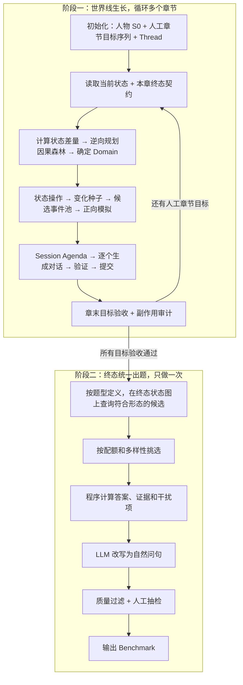
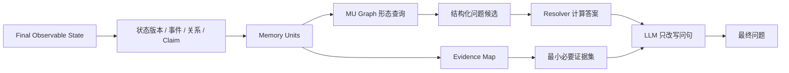

# 长期记忆 Benchmark 构造方案 v4：章节终态约束 + 终态统一出题

> 本文是第四版方案，前几版文件都保持不变。
>
> v4 的核心判断有两个：**生成阶段和出题阶段彻底分开；人物发展方向由人工给定的章节终态约束，LLM 只负责寻找合理的实现路径。**
>
> - **生成阶段**：先由人工给出人物初始状态，以及每章结束时必须达到的若干状态更新；LLM 再逆向规划因果链、生成事件并将其编排成自然对话。这个阶段不出题，也不为题目加锁。
> - **出题阶段**：全部对话完成后，以最终的状态链和对话证据为依据，一次性批量生成几百道题。
>
> 人工章节目标只规定 **What**：哪些资产、属性或关系在章末变成什么状态，不规定具体事件、原因和对话。题型也不会在生成阶段被“触发”。只要人工规划了足够多且足够多样的状态变化，所需题目素材会随世界线自然产生；生成阶段只做目标验收，不设置素材库存或库存达标条件。

---

## 0. 总览

### 0.1 两个阶段



### 0.2 六条原则

1. **人工定方向，LLM 定路径。** 人工规定章末状态差量，LLM 不得改写目标，只能构造达到目标的合理因果路径。
2. **状态可以变化，但必须由事件驱动。** 有车 → 破产 → 卖车，是合法的状态链。
3. **已经发生的事不能否认。** 说过去过日本，之后就不能说“从来没去过日本”。
4. **不设计意外矛盾。** 只有在规划中登记过的“设计冲突”才允许存在，未经登记的矛盾一律回滚。
5. **出题只看终态的状态链和证据。** 答案由程序计算，LLM 只负责改写问句。
6. **题型是插件。** 每个题型只声明它需要的状态形态和答案规则，不反向控制生成流程。

---

## 1. 状态模型：用一套通用原语支撑所有题型

要让题型能够灵活扩展，状态模型就不能为某一种题型量身定做，而要提供一组**通用原语**。之后新增的题型，也用这些原语组合出来。

### 1.1 三层结构

| 层 | 说明 | 例子 |
|---|---|---|
| 世界层（World） | 世界中真实发生过什么、真实状态是什么 | 2025-08 买了一辆特斯拉；2026-05 卖掉 |
| 说法层（Claim） | 用户或其他来源在对话中**说了什么** | S05 用户说“我那辆特斯拉……”；S22 用户说“车已经卖了” |
| 暴露层（Exposure） | 某条世界事实是否已经被说出、在哪个 turn 被说出 | “有车 v0”由 S05-t3 暴露 |

世界层和说法层必须分开。这样才能支持“用户说错、后来纠正”“朋友转述与用户说法不一致”等情况，这些情况也是后续“冲突”类题型的基础。

### 1.2 七种原语

#### ① 事件 Event

```yaml
event_id: EV-041
date: 2026-05-12
type: state_transition
description: 公司破产后，小林卖掉了车
caused_by: [EV-038]          # 因果边：EV-038 = 公司破产
writes:
  - {path: belongings.car, op: end, value: 特斯拉 Model 3}
details:                      # 事件细节槽位
  buyer: 同事老周
  price: 12 万
  feeling: 有点舍不得
```

#### ② 属性版本 Version

同一属性按时间形成版本序列，版本序列就是**状态链**：

```json
{
  "path": "belongings.car",
  "class": "mutable_state",
  "versions": [
    {"v": 0, "value": "无", "from": "S0", "to": "2025-08"},
    {"v": 1, "value": "特斯拉 Model 3", "from": "2025-08", "to": "2026-05-12",
     "source_event": "EV-015"},
    {"v": 2, "value": "无（已卖）", "from": "2026-05-12", "to": null,
     "source_event": "EV-041", "caused_by": ["EV-038"]}
  ]
}
```

#### ③ 作用域 Scope

作用域用于说明一个事实在什么条件下成立，例如“出差去过日本”和“没去日本旅游过”可以同时成立。

#### ④ 实体 Entity 与关系 Relation

人物、地点、物品都有唯一的 `entity_id`。不同 session 中出现的不同称呼，例如“阿杰”和“那个做海外的同事”，都要映射到同一实体。多跳题正是基于实体之间的连接构造的。

#### ⑤ 说法 Claim

```json
{
  "claim_id": "CL-S22-t2-01",
  "turn": "S22-t2",
  "speaker": "user",
  "source": "self",
  "path": "belongings.car",
  "value": "已卖",
  "matches_world": true,
  "corrects": null,
  "designed_conflict": null
}
```

`source` 可以是 `self`（用户本人）、`third_party`（用户转述他人的说法）或 `assistant`（助手的说法）。

`matches_world` 表示这条说法是否与世界事实一致。一般情况下必须为 `true`；只有在设计冲突时，才允许为 `false`。

#### ⑥ 保留空白 Reserved

保留空白是指世界中有值，但永不暴露的属性或细节，用于拒答题。

#### ⑦ 扩展标注 Annotation

任何原语都可以附加扩展标注，例如 `certainty`（用户是否确定）、`emotion`（情绪）、`privacy`（隐私等级）。新题型需要新维度时，优先在这里扩展，而不修改核心结构。

### 1.3 Memory Unit：连接状态、对话证据和题目的原子单位

只有属性版本还不够。事件中的“卖给谁”“多少钱”“为什么卖”等细节未必适合作为长期状态，却仍然可以成为问题答案。因此，v4 增加 **Memory Unit（MU）**，作为最终出题和证据追踪的最小单位。

MU 不是一段文本，而是一条规范化命题。它分为四类：

| MU 类型 | 来源 | 例子 |
|---|---|---|
| `state_version` | 属性时间线中的一个版本 | `belongings.car@v2 = 已卖` |
| `event_detail` | 事件的原子细节 | `EV-041.buyer = 老周` |
| `relation` | 实体之间的关系 | `老周 --colleague_of--> 小林` |
| `claim_only` | 只存在于说法层、不改变世界状态 | “老周听说部门要搬家”、一条后来被纠正的错误说法 |

一个事件通常拆成多个 MU：

```yaml
event_id: EV-041
description: 公司破产后，小林把车卖给同事老周
memory_units:
  - mu_id: MU-4101
    type: state_version
    path: belongings.car
    value: 无（已卖）
    valid_from: 2026-05-12
  - mu_id: MU-4102
    type: event_detail
    predicate: sold_to
    subject: 小林的特斯拉
    object: 老周
  - mu_id: MU-4103
    type: event_detail
    predicate: sale_price
    value: 12 万
  - mu_id: MU-4104
    type: event_detail
    predicate: sale_reason
    object_event: EV-038
  - mu_id: MU-4105
    type: event_detail
    predicate: feeling
    value: 舍不得
```

MU 必须满足以下要求：

1. 一条 MU 只表达一个值或一条关系；
2. 必须指向来源事件、属性版本或说法；
3. 必须有时间和作用域；
4. 如果用于出题，必须至少关联一条通过验证的 Evidence；
5. 如果值发生变化，不能覆盖原 MU，而要新建 MU 并通过 `supersedes` 连接。

### 1.4 Evidence：精确到 turn 和文本片段

Evidence 不是整个 session，而是一个 MU 在对话中的具体证据片段：

```json
{
  "evidence_id": "EVD-S34-T1-02",
  "mu_id": "MU-4102",
  "claim_id": "CL-S34-T1-02",
  "session_id": "S34",
  "turn_id": "S34-T1",
  "speaker": "user",
  "char_span": [8, 15],
  "text_span": "车卖给老周了",
  "evidence_role": "support",
  "exposure_style": "incidental",
  "asserted_at": "2026-05-18",
  "event_time": "2026-05-12",
  "certainty": "confirmed",
  "validation_status": "accepted"
}
```

`evidence_role` 可以是：

- `support`：支持当前或历史事实；
- `stale`：支持已经失效的旧版本，是知识更新题的干扰证据；
- `cause`：支持状态变化原因；
- `bridge`：连接两个实体或事件，用于多跳题；
- `contradict`：与另一说法冲突，仅用于设计冲突；
- `correction`：纠正之前的错误说法。

同一 MU 可以有多条 Evidence，例如首次暴露、再次确认和后来回顾。最终出题时应选最小必要证据集，而不是把全部相关 turn 都标为答案证据。

### 1.5 最终世界状态不等于最终可知状态

全部对话完成后同时保存两种状态：

```text
Final World State：
  时间事件图真实推导出的最终状态，生成器知道。

Final Observable State：
  截至最后一个 session，已经被用户有效暴露并通过验证的最新状态，memory 系统应该知道。
```

最终可回答问题必须以 `Final Observable State` 和 Evidence 为依据。`Final World State` 用于：

- 验证对话是否与世界一致；
- 判断某个事实是否尚未暴露；
- 构造拒答题；
- 检查模拟用户是否提前泄漏未来事件。

例如，小林已经在世界中搬到苏州，但从未在对话中告诉助手，那么不能问“他现在住哪里”并把苏州作为可回答答案；只能问成拒答题，或安排后续 session 暴露搬家事实。

---

## 2. 题型如何被状态满足

### 2.1 题型 = 状态形态 + 答案规则

每个题型都由三部分组成：

```text
形态查询（shape）：终态状态图上满足什么条件的结构可以出这类题
答案规则（resolver）：如何从该结构计算答案
干扰来源（distractor）：错误答案从哪里来，例如旧版本、相似实体
```

出题时，程序在终态上执行形态查询，把找到的结构作为候选题。题型定义不反向控制章节生成；章节生成只服从人工终态契约。

### 2.2 现有题型的状态形态

以下按截图中的配额整理：

| 题型 | 单跳 / 多跳 | 需要的状态形态 | 答案规则 | 干扰来源 |
|---|---|---|---|---|
| 信息抽取 | 多跳 27 | ① 一个实体在 ≥2 个 session 中分别暴露不同属性（桥接）<br>② 一个事件的多个细节分散在不同 session<br>③ 同一类别下有多条暴露记录（聚合） | 沿实体连接取值；计数或取并集 | 相似实体、同类别的其他记录 |
| 时间 | 多跳 21 | 两个都有明确日期的已暴露事件；或者状态链加上一个时间点；或者带相对时间表达（“上周”）的说法 | 计算日期差、判断先后、取时间点对应的版本 | 相邻事件的日期 |
| 开放域 | 单跳 5 / 多跳 11 | 已暴露的状态或约束，并且可以与常识结合推理 | rubric：必须包含的要点、不能出现的错误 | 忽略约束后的常见回答 |
| 拒答 | 单跳 2 / 多跳 2 | 单跳：保留空白<br>多跳：事件已暴露但细节保留，或者问题前提与事实不符 | “未提及”加上已知部分 | 可能被编造的值 |
| 知识更新 | 单跳 34 / 多跳 34 | 状态链中 ≥2 个版本都已暴露<br>多跳还需要：原因事件已暴露，或 ≥3 个版本，或与另一事实组合 | 单跳：取最终版本<br>多跳：取前一版本、变化原因、组合推理 | **旧版本** |
| 个性化推荐 | 单跳 34 / 多跳 34 | 单跳：1 个已暴露偏好或约束<br>多跳：偏好发生过变化，或者偏好 + 约束 ≥2 条 | rubric：必须满足最终偏好和约束；**不得**按旧偏好推荐 | **旧偏好**、被忽略的约束 |

**关于“终态出题”的一个重要细节：**

状态变化后，旧版本不会消失，而是变成“历史事实”。因此，同一条链可以同时服务多种题型：

```text
belongings.car：无 → 特斯拉（2025-08）→ 已卖（2026-05，原因：公司破产）

知识更新（单跳）：小林现在有车吗？        → 没有，已经卖了（干扰：有特斯拉）
知识更新（多跳）：小林为什么把车卖了？     → 公司破产后需要用钱
信息抽取（多跳）：小林以前开的车卖给了谁？ → 同事老周（车型信息 + 交易细节）
时间（多跳）：    小林买车后多久卖掉的？   → 约 9 个月
个性化推荐：      “周末想去郊外，怎么去方便？” → 不应默认他能自驾
```

因此，生成阶段不需要为每种题型分别制造素材，关键是**状态链要足够多、足够长，并且每个版本和原因都要在对话中说出来**。

### 2.3 配额只约束出题，不约束生成

同一个结构不能被无限复用，否则题目会高度重复。建议上限如下：

```text
每条状态链：最多出 3 道题，且题型或问法各不相同
每个实体：最多参与 3 道题
每个偏好维度：最多出 3 道题
```

204 道题的题型配额只在终态出题时用于候选筛选和分配，不换算成生成阶段的库存指标，也不构成世界线的完工标准。人工在设计 `G1...Gn` 时直接保证状态变化数量和领域多样性；系统只负责逐章验证这些目标是否被正确实现。

### 2.4 单跳和多跳的操作定义

- **单跳**：只需要 1 条关键说法即可作答，干扰项可以另外存在。
- **多跳**：需要 ≥2 条关键说法，并且它们位于不同 session；缺少任何一条，都无法作答。

出题时要做消融检查：逐条删除关键证据，确认题目确实无法作答。

---

## 3. 初始化

沿用原方案的步骤 0–3，只补充以下要求：

- **属性本体**：为每个属性标注 `class`（身份、过去事件、可变状态、偏好、约束、计划、关系）、允许的变化操作，以及风险等级。
- **S0 与 C0 历史**：S0 之前的重要经历要作为事件写入时间事件图，包括否定事实，例如“从未去过欧洲”。
- **人工章节目标序列**：在生成前给出 `G1...Gn`。每个目标只声明该章结束时必须发生的状态更新、保持不变的状态和允许的副作用预算，不写具体事件、原因、Domain 或对话。目标可以在对应章节开始前人工调整，但已经生成并提交的历史不能反向修改。
- **长期话题线程**：提供人物的长期生活方向，例如工作、居住、出行、健康、爱好、社交和财务。**线程数量要多一些，建议 6–10 条**，因为状态链需要分布在不同生活领域。
- **保留空白**：一开始就选定 4–8 个保留空白。

### 3.1 领域、Topic、Thread、Event 和 Session 的层级

“话题”不能只是一张扁平列表。建议使用五层结构：

```text
Domain 领域
  └─ Topic 主题
      └─ Thread 具体长期线程
          └─ Event 世界事件
              └─ Session 对话承载
```

各层职责如下：

| 层级 | 生命周期 | 作用 | 示例 |
|---|---|---|---|
| Domain | 整条世界线 | 控制覆盖面 | 工作与职业、财务、居住、旅行、健康、饮食、关系、爱好、学习、数字生活 |
| Topic | 多章 | 描述可反复讨论的主题 | 工作领域下的“远程办公”“公司经营”“职业发展” |
| Thread | 1–多章 | 一条具体、可推进的故事线 | T-work-02：公司融资困难 → 裁员 → 破产 → 求职 |
| Event | 某个日期或时间段 | 推动世界状态变化 | EV-038：公司宣布破产 |
| Session | 某次交互 | 自然暴露事件、状态或回访 | 用户请助手修改告别邮件，顺带说公司破产 |

推荐的 Domain 与 Topic 示例：

```yaml
domains:
  career:
    topics: [current_job, work_mode, colleague, promotion, job_search, company_status]
  finance:
    topics: [income, budget, debt, investment, large_purchase, consumption_style]
  residence:
    topics: [current_city, housing, moving, neighborhood, commute]
  travel:
    topics: [trip_history, destination_preference, travel_style, companion, budget]
  health:
    topics: [allergy, chronic_condition, exercise, sleep, diet]
  relationship:
    topics: [family, friend, colleague, partner, pet]
  leisure:
    topics: [book, movie, music, game, outdoor_activity]
  learning:
    topics: [course, language, certificate, skill_goal]
  digital_life:
    topics: [device, software, subscription, privacy, assistant_preference]
```

每个 Thread 需要维护阶段，而不是每章重新生成：

```yaml
thread_id: T-work-02
domain: career
topic: company_status
status: active
phase: crisis                 # setup → developing → crisis → resolution → follow_up
started_in: C2
last_event: EV-038
linked_threads: [T-finance-01, T-commute-01]
open_loops:
  - 是否找到新工作
  - 收入下降后如何调整支出
```

跨领域因果必须显式记录。例如：

```text
career.company_status = 破产
    → finance.income = 暂停
    → belongings.car = 已卖
    → commute.mode = 地铁
    → pref.consumption = 更看重性价比
```

这种跨 Domain 的链条既让人物生活自然，也会为最终多跳、时间、知识更新和个性化推荐题提供素材。

### 3.2 Topic 的选择规则

章节规划时，不是先随机抽 Domain 或 Topic，再为它们寻找剧情。顺序应当是：

1. 本章有哪些人工 `hard_goals`，每个更新需要哪些前置条件；
2. 哪些现有 Thread 能自然承载这些条件和变化；
3. 候选因果路径分别会涉及哪些 Domain 和 Topic；
4. 在都能达到目标的路径中，哪些更自然、能复用既有实体，并保持领域多样性；
5. 当前时间是否适合该 Topic，例如五一适合旅行，年底适合预算和计划；
6. 人物性格、职业和生活阶段是否合理；
7. 哪些活跃 Thread 尚未完成，是否适合推进、暂停或回访。

因此，Domain 是目标因果路径的结果，不能为了制造某类素材而添加与章节目标无关的人生巨变。

一章建议包含：

- 1 条主 Thread：发生明显推进；
- 1–2 条副 Thread：小幅推进或回访；
- 2–4 个普通任务型 Topic：只承载对话自然性和干扰；
- 不超过 2 个新 Thread，避免世界线迅速失控。

---

## 4. 阶段一：由章节终态约束世界线生长

每章固定覆盖约 3 个月人物时间，建议包含 8–12 个 session。人工控制章末必须达到的状态，LLM 控制三个月内如何自然达到这些状态。

### 4.1 章节终态契约与规划

严格流程是：

```text
当前状态 S(k-1) + 人工章节终态契约 Gk
  → 计算必须完成的状态差量 Δk
  → 逆向寻找前置条件和候选因果路径
  → 合并为因果森林并由路径确定 Domain / Thread
  → 正向模拟并生成事件
  → 对话暴露
  → 验收实际章末状态 Sk 是否满足 Gk
```

#### 4.1.1 章节终态契约

终态契约只写状态，不写事件。推荐结构如下：

```yaml
chapter: C4
time_range: 2026-04-01 ~ 2026-06-30
start_state_ref: C3.final_state

hard_goals:
  - goal_id: G-C4-01
    path: career.employment_status
    op: supersede
    expected_before: employed
    expected_after: unemployed
    exposure: required

  - goal_id: G-C4-02
    path: belongings.car.ownership
    op: supersede
    expected_before: owned
    expected_after: sold
    exposure: required

  - goal_id: G-C4-03
    path: finance.liquidity
    op: supersede
    expected_before: low
    expected_after: medium
    exposure: optional

invariants:
  - {path: residence.current_city, must_remain: 苏州}
  - {path: relationship.marital_status, must_remain: single}

side_effect_budget:
  max_extra_state_updates: 3
  max_new_threads: 1
  max_major_events: 4
  allowed_paths: [commute.mode, pref.consumption]
```

`hard_goals` 是人工真正控制的章节终态；`invariants` 防止实现过程中误改关键设定；`side_effect_budget` 允许合理的派生变化，但限制 LLM 为了圆故事无限扩张世界状态。契约中禁止出现具体事件、原因、Domain、Topic、买家姓名或 Session 内容，这些都属于后续规划结果。

`exposure` 只规定目标状态是否必须进入对话，不规定怎样说。世界层已经达到目标但未暴露的状态，不能作为普通可回答题的答案。

#### 4.1.2 目标可达性检查

生成任何剧情前，程序先检查：

1. `expected_before` 是否与上一章实际终态一致；
2. 本体是否允许该属性执行指定操作；
3. 多个目标之间是否互斥，是否违反 `invariants`；
4. 三个月时间和事件预算是否足以完成最短实现路径；
5. 本章目标是否破坏未来章节已声明目标的必要前置条件；
6. 目标是否触碰受保护属性或保留空白。

检查失败时返回结构化原因，请人工修改契约。系统不能静默改写目标，也不能先生成剧情再强行解释。

#### 4.1.3 从目标差量逆向规划因果森林

对每条 `hard_goal`，LLM 从目标值向前寻找：

```text
目标状态
  ← 直接产生该状态的 transition
  ← transition 所需的决策或条件
  ← 能自然产生这些条件的起因
```

先为每个目标生成多条候选路径，再按以下顺序选择和合并：

1. 优先复用已有 Thread、人物设定和 open loop；
2. 合并可以共享原因的路径，形成一条主因果链；
3. 无法自然连接的目标保留为副链，不强迫所有更新共享一个根因；
4. 从选中的路径反推出涉及的 Domain 和 Topic；
5. 多条路径同样可行时，再按自然性、人物一致性、领域多样性和事件密度排序。

最终结构是“因果森林”，而不是必须连成一条链。建议 60%–80% 的重要更新进入主链，其余变化可以属于副线，但每个状态写入都必须有可追踪的来源。

规划器使用以下操作目录把目标差量转换成可执行计划。凡是会写入新状态的操作，都必须来自某条 `hard_goal` 或登记为预算内的合理派生；只有解释、回访和旧版本提及等不改变状态的操作可以作为自由辅助操作。

| 操作 | 说明 | 规划角色 |
|---|---|---|
| `new_state` | 引入新的属性、物品或关系，例如买车、养猫、加入羽毛球群 | 目标操作 |
| `advance_chain` | 已有状态由事件驱动发生变化，例如卖车、换工作、猫被送给父母 | 目标操作 |
| `explain_change` | 让变化的原因被说出 | 辅助操作 |
| `reveal_preference` | 通过经历隐式流露偏好 | 目标暴露 |
| `shift_preference` | 偏好发生变化，并给出原因 | 目标操作 |
| `add_constraint` | 出现预算、时间、身体状况等约束 | 目标操作或允许派生 |
| `revisit_entity` | 在新 session 中提到旧实体的新信息 | 辅助操作 |
| `timed_event` | 为目标事件设置明确日期 | 事件调度 |
| `stale_mention` | 回顾旧版本，例如“以前开车上班时……” | 辅助操作 |
| `designed_conflict` | 有意设计的说法冲突，见第 7 节 | 人工登记要求 |

规划输出必须显式说明目标覆盖关系：

```yaml
chapter: C4
goal_coverage:
  G-C4-01: [OP-C4-01]
  G-C4-02: [OP-C4-02]
  G-C4-03: [OP-C4-03]

causal_forest:
  main_chain:
    operations: [OP-C4-01, OP-C4-02, OP-C4-03]
    induced_domains: [career, finance, belongings, commute]
  side_chains: []

operations:
  - operation_id: OP-C4-01
    source_goal: G-C4-01
    op: advance_chain
    target: career.employment_status
    change: employed → unemployed
  - operation_id: OP-C4-02
    source_goal: G-C4-02
    op: advance_chain
    target: belongings.car.ownership
    change: owned → sold
    depends_on: [OP-C4-01]
  - operation_id: OP-C4-03
    source_goal: G-C4-03
    op: advance_chain
    target: finance.liquidity
    change: low → medium
    depends_on: [OP-C4-02]

planned_side_effects:
  - path: commute.mode
    change: car → metro
    class: allowed_derived
```

程序必须验证：

- 每个 `hard_goal` 至少被一条操作覆盖，且最终写入值唯一；
- 所有计划外状态写入都登记为副作用，并落在允许路径和数量预算内；
- 同一属性相邻两次变化之间至少间隔一章，除非存在明确且可验证的即时因果；
- 不修改 `invariants`、受保护属性或保留空白；
- Domain 都能追溯到因果路径，不能先选 Domain 再强行添加无关变化。

#### 4.1.4 区分“目标操作”“辅助操作”和“状态写操作”

由 `hard_goals` 编译出的操作是**目标操作**，负责保证章节到达人工终态。`revisit_entity`、`stale_mention` 等是**辅助操作**，负责在不改变目标方向的前提下完成自然暴露和回访。两者都只是规划意图，不会直接写数据库。

事件通过检查后，才会转换成以下**状态写操作**：

| 写操作 | 语义 | 是否产生新版本 | 例子 |
|---|---|---:|---|
| `create` | 该属性或实体第一次出现 | 是 | 首次拥有一辆车 |
| `supersede` | 新值替代旧值，旧值保留为历史 | 是 | 北京 → 苏州 |
| `end` | 某个持续状态结束，当前没有替代值 | 是 | 有车 → 已卖、当前无车 |
| `append` | 向集合增加一项，不替代旧项 | 是 | 新增一次旅行经历 |
| `remove` | 从当前集合移除一项，历史仍保留 | 是 | 取消一个订阅 |
| `strengthen / weaken` | 偏好方向不变，强度变化 | 是 | “有点喜欢”→“非常喜欢” |
| `confirm` | 再次确认已有值 | 否，只增加 Claim 和 Evidence | 再次说现在住苏州 |
| `correct_claim` | 纠正历史说法，世界状态不变 | 否，只更新 Claim 图 | 把说错的生日纠正过来 |
| `schedule / complete / cancel` | 推进计划状态机 | 是 | 考虑买车 → 已安排 → 完成/取消 |

严格的数据流是：

```text
人工章节终态契约
  → 状态差量与可达性检查
  → 因果森林
  → 目标操作 + 可选辅助操作
  → 变化种子（可能的自然发展路径）
  → 事件（世界中实际发生什么）
  → 状态写操作（怎样更新属性时间线）
  → MU（可以被记忆和提问的原子事实）
  → Session / Claim / Evidence（用户怎样告诉助手）
```

这样既避免把“章节需要多一些知识更新素材”直接等同于“强行修改某个属性”，也避免 LLM 在没有人工约束时自行决定人物的人生方向。

### 4.2 从操作到事件

沿用原方案的流程：

```text
章节目标 → 目标操作/辅助操作 → 变化种子 → 候选事件池
→ 正向状态模拟 → 冲突与副作用检查 → 并入时间事件图 → 排期
```

一个 `advance_chain` 通常会展开为 2–4 个事件：原因、决策、执行和反馈。每个事件都要带 3–6 个细节槽位，因为最终的信息抽取题主要来自这些细节。

#### 4.2.1 状态操作的完整结构

状态操作不是一句自然语言意图，而是一条可校验的结构化指令：

```yaml
operation_id: OP-C4-02
op: advance_chain
source_goal: G-C4-02
domain: belongings
topic: car_ownership
thread: T-finance-01
target:
  path: belongings.car.ownership
  entity_id: CAR-P01-01
read_set:
  - career.employment_status@current
  - finance.cashflow@current
expected_before:
  value: owned
proposed_after:
  value: sold
transition_reason:
  source_operation: OP-C4-01
  description: 失去工作后需要增加现金储备
constraints:
  earliest_date: 2026-05-03
  latest_date: 2026-06-15
  must_follow: [EV-038]
  must_not_cooccur: [购买新车]
desired_exposure:
  current_version: required
  reason: required
  old_version_callback: optional
side_effect_class: hard_goal       # hard_goal / allowed_derived / auxiliary
```

其中：

- `read_set`：操作需要读取哪些当前状态；
- `expected_before`：执行前必须是什么值；
- `proposed_after`：想把状态变成什么；
- `transition_reason`：为什么改变；
- `constraints`：时间窗口和依赖；
- `desired_exposure`：哪些内容最终必须在对话中说出。
- `source_goal`：该操作覆盖哪个人工目标；
- `side_effect_class`：它是目标本身、允许的派生变化，还是只增加素材且不改目标方向的辅助操作。

#### 4.2.2 操作先变成变化种子

变化种子是“对人物世界线的提案”，它补充自然语言原因和可能路径，但还没有确定具体日期：

```yaml
change_seed_id: CS-C4-02
source_operation: OP-C4-02
thread: T-finance-01
target_path: belongings.car.ownership
transition: owned -> sold
motivation: 失去工作后需要增加现金储备
possible_paths:
  - 直接卖给熟人
  - 通过二手平台出售
  - 先考虑出售，几周后成交
preferred_path: 先考虑，再卖给同事老周
required_chain_roles: [cause, deliberation, transition, follow_up]
```

#### 4.2.3 变化种子展开为事件链

一个变化种子不等于一个事件。应先生成候选事件链：

```text
EV-038 公司裁员，小林失去工作（cause）
   ↓ causes
EV-039 小林开始缩减开支，并考虑卖车（deliberation）
   ↓ enables
EV-041 小林把车卖给老周（transition）
   ↓ causes
EV-044 小林重新乘地铁通勤（follow_up）
```

事件边至少支持：

- `causes`：A 导致 B；
- `requires`：B 发生前必须有 A；
- `enables`：A 使 B 成为可能，但不必然导致；
- `conflicts_with`：两个候选事件不能同时选；
- `same_episode`：同一生活片段中的事件；
- `cross_thread`：连接不同 Thread。

候选因果图完成后，必须从 `S(k-1)` 开始按拓扑顺序正向模拟。每执行一个候选事件，都检查其前置条件、读写集合和副作用；模拟到章节末后，逐条断言所有 `hard_goals` 成立、所有 `invariants` 保持不变、额外写入没有超出预算。只有通过模拟的事件图才能进入排期。逆向规划负责“找到路”，正向模拟负责证明“这条路真的走得通”。

#### 4.2.4 事件拆成状态写入和 MU

事件必须把“发生了什么”拆成三类结果：

```yaml
event_id: EV-041
world_time: 2026-05-12
preconditions:
  - belongings.car.ownership == owned
  - career.employment_status == unemployed
writes:                         # 会改变属性时间线
  - path: belongings.car.ownership
    op: supersede
    before: owned
    after: sold
  - path: commute.mode
    op: create_pending          # 可能稍后才确认，不在本事件直接提交
    candidate_value: metro
memory_units:                   # 可以被提问的原子事实
  - MU-4101: car ownership = sold
  - MU-4102: buyer = 老周
  - MU-4103: price = 12 万
  - MU-4104: reason = 失去工作后需要增加现金储备
  - MU-4105: feeling = 舍不得
exposure_policy:
  required: [MU-4101, MU-4104]
  optional: [MU-4102, MU-4103, MU-4105]
  hidden: []
```

`writes` 和 `memory_units` 不能混为一谈：卖车会写入“当前无车”状态；价格和买家只是事件细节 MU，不需要长期占据“当前状态”。

#### 4.2.5 候选事件并入时间事件图

候选事件通过检查后，调度器完成以下工作：

1. 按依赖边做拓扑排序；
2. 在允许时间窗内分配日期；
3. 检查同一天是否出现不合理的高密度人生变化；
4. 检查跨 Thread 的因果是否按顺序发生；
5. 检查事件读取的是哪个属性版本；
6. 为每个事件设置 `world_status`：
   - `scheduled`：已经进入世界线，尚未到日期；
   - `occurred_unexposed`：世界中已发生，对话尚未说出；
   - `occurred_exposed`：已发生且至少一条关键 MU 已暴露；
   - `cancelled`：计划被取消，需要保留取消事件和原因。

#### 4.2.6 时间事件图和对话不是一一对应

必须允许以下映射：

```text
一个事件 → 多个 session：
  S31 说公司破产；S34 说卖车；S40 回忆以前开车通勤。

多个事件 → 一个 session：
  用户在咨询预算时，同时提到公司破产、卖车和改坐地铁。

一个 session → 没有世界事件：
  用户只请助手解释 Excel 公式。
```

因此，需要一个单独的 `session_event_links.jsonl`：

```json
{
  "session_id": "S34",
  "links": [
    {"event_id": "EV-041", "relation": "reveal", "mu_ids": ["MU-4101", "MU-4102", "MU-4103"]},
    {"event_id": "EV-038", "relation": "callback", "mu_ids": ["MU-3801"]}
  ]
}
```

### 4.3 冲突检查：区分“变化”和“矛盾”

v4 中不再使用题目锁，只检查世界线逻辑是否一致：

| 情况 | 判定 | 处理 |
|---|---|---|
| 状态被事件改变，旧版本保留在链中 | 合法变化 | 通过 |
| 状态改变了，但没有驱动事件 | 无因翻转 | 回滚，或补充原因事件 |
| 否认已经发生的过去事件 | 矛盾 | 回滚 |
| 修改过去事件的细节，例如把车卖给的人从老周改成别人 | 矛盾 | 回滚 |
| 同一时间段内，同一属性有两个值 | 矛盾 | 回滚 |
| 暴露保留空白 | 违规 | 回滚 |
| 说法与世界事实不符，但已在 `designed_conflict` 中登记 | 设计冲突 | 通过，并登记冲突对 |

### 4.4 生成对话与验证

沿用原方案第 12–13 节的双 Agent 逐 session 生成方式，并补充以下要求。

#### 4.4.1 Session Agenda：明确预期状态增量

每个 Session Agenda 至少包含：

```yaml
session_id: S34
date: 2026-05-18
domain: finance
topics: [budget_adjustment, car_sale]
threads: [T-finance-01, T-commute-01]
task_frame: 用户请助手重新制定未来三个月预算
linked_events:
  - {event_id: EV-041, relation: reveal}
expected_units:
  required:
    - {mu_id: MU-4101, style: incidental, preferred_position: early}
    - {mu_id: MU-4104, style: explicit, preferred_position: middle}
  optional:
    - {mu_id: MU-4102, style: incidental}
    - {mu_id: MU-4103, style: explicit}
expected_state_delta:
  - path: belongings.car.ownership
    operation: expose_existing_version
    version: 2
allowed_emergent:
  categories: [short_term_emotion, low_risk_routine]
  max_units: 2
forbidden:
  - future_events_after: 2026-05-18
  - reserved_paths
  - new_high_risk_entity
must_preserve:
  - EV-015 过去确实买过车
  - EV-041 买家是老周
turn_budget: {min: 6, max: 12}
```

`expected_state_delta` 说明本 session 预计如何影响可知状态。它可能是：

- `expose_existing_version`：暴露世界中已经发生但助手尚不知道的版本；
- `create_and_expose`：事件与对话同时发生，例如用户当场决定以后改坐地铁；
- `confirm_existing`：再次确认已有版本；
- `correct_claim`：纠正旧说法，但不改变世界状态；
- `no_state_change`：纯任务对话。

#### 4.4.2 生成前的上下文包

给 User Simulator 的上下文包应包含：

- 人物表达风格；
- session 日期和 task frame；
- 相关属性的当前版本和历史版本；
- 与本 session 的 Domain、Topic、Thread、事件和实体相关的全部已暴露说法；
- 全部否定事实和唯一性事实；
- agenda 中的 `expected_units`、`allowed_emergent`、`forbidden`；
- 一份简短的未来边界：只说明“不得说出哪些未来内容”，不泄露未来剧情细节。

为防止 LLM 无意扩写新事实，应要求 User Simulator 每轮先输出内部控制字段，再生成自然语言：

```json
{
  "planned_mu_ids": ["MU-4101"],
  "new_personal_fact_intended": false,
  "utterance": "车已经卖给老周了，现在出门又得坐地铁。"
}
```

内部控制字段不进入最终 benchmark。

#### 4.4.3 Session 中允许新增状态，但必须走“晋升”流程

真实对话里，session 可能自然产生 agenda 未预设的新状态。例如助手询问通勤方式后，用户说：

```text
“车卖了以后我打算先坐地铁，以后就不考虑开车通勤了。”
```

这可能创建 `commute.mode = metro`。不能简单丢掉，也不能未经检查直接写入状态。验证器要将它提取为 **Emergent State Proposal**：

```json
{
  "proposal_id": "ESP-S34-01",
  "source_turn": "S34-T3",
  "path": "commute.mode",
  "operation": "supersede",
  "before": "car",
  "after": "metro",
  "effective_time": "2026-05-18",
  "reason_event": "EV-041",
  "risk": "medium",
  "status": "pending"
}
```

处理规则：

| 类型 | 例子 | 处理 |
|---|---|---|
| 现有事件的合理派生，且属性本体允许变化 | 卖车后改坐地铁 | 晋升：新建派生事件和 MU，再提交 |
| 低风险、短期状态 | 今天有点累、这周很忙 | 可登记为临时 MU；默认不进入长期状态链 |
| 新偏好，但证据只有一次含糊表达 | “这家店还行” | 登记候选偏好，`confidence=weak`，不立刻替换当前偏好 |
| 新高风险事实 | 新疾病、新亲属、新旅行经历、突然结婚 | 默认回滚；除非重新规划当前 agenda 后重试 |
| 与历史矛盾 | “我从来没买过车” | 回滚 |
| 提前泄漏未来事件 | 尚未破产时说“公司已经倒闭” | 回滚 |

晋升成功时，系统自动创建：

```text
Emergent Claim
  → Derived Event（EV-D-S34-01）
  → 新 MU
  → 属性时间线新版本
  → Evidence（精确到 S34-T3）
  → session_event_link
```

这样，每个 session 都可以自然增加状态，但任何新增状态都有来源、检查记录和可追踪链条。

#### 4.4.4 逐 turn 断言抽取

每个用户 turn 都要抽取：

```yaml
- subject / entity_id
- path 或 predicate
- value / object
- polarity
- scope
- event_time
- asserted_at
- certainty
- quantifier: never | first | always | only | none
- source: self | third_party | assistant
- text_span
- relation_to_agenda: expected | optional | emergent | irrelevant
```

同一个 turn 可以抽取多条 Claim。例如：

```text
“车卖给老周了，12 万。公司破产后手头太紧，只能先这样。”
```

至少抽取：

1. 当前车辆状态为已卖；
2. 买家是老周；
3. 价格为 12 万；
4. 卖车原因是公司破产后现金紧张。

#### 4.4.5 Claim 到 MU 的对齐

每条 Claim 依次做：

1. **实体链接**：老周是否为已有实体；
2. **时间归一化**：上周换算成日期区间；
3. **MU 匹配**：是否与计划 MU 相同；
4. **状态操作识别**：是重复确认、创建、替换、结束、纠正还是冲突；
5. **证据角色判定**：support、stale、cause、bridge、contradict 或 correction。

输出 `claim_mu_alignment.jsonl`：

```json
{
  "claim_id": "CL-S34-T1-02",
  "matched_mu": "MU-4102",
  "match_type": "exact",
  "evidence_role": "support",
  "confidence": 0.98
}
```

#### 4.4.6 Session 验证清单

验证器必须逐项检查：

1. required MU 是否全部被表达；
2. 对应文本片段是否能精确定位；
3. 表达的值、时间、作用域是否与事件和属性时间线一致；
4. expected state delta 是否实现；
5. 是否遗漏了状态变化原因；
6. optional MU 是否与世界一致；
7. emergent state 是否完成风险分级和晋升判断；
8. 是否出现禁止信息、未来泄漏或保留空白；
9. 是否无意否认过去事件；
10. assistant 是否把推测当成用户事实，user 是否错误附和；
11. session 日期和相对时间表达是否可解析；
12. 实体指代是否一致。

#### 4.4.7 验证报告

每次生成尝试都保存报告，包括失败尝试：

```json
{
  "validation_id": "VAL-S34-A2",
  "session_id": "S34",
  "attempt": 2,
  "agenda_id": "AG-S34",
  "required_units": {
    "expected": ["MU-4101", "MU-4104"],
    "found": ["MU-4101", "MU-4104"],
    "missing": []
  },
  "claims_extracted": 6,
  "alignments": [
    {"claim": "CL-S34-T1-01", "mu": "MU-4101", "result": "MATCH"},
    {"claim": "CL-S34-T3-01", "proposal": "ESP-S34-01", "result": "EMERGENT_ACCEPT"}
  ],
  "checks": {
    "world_consistency": "pass",
    "temporal_consistency": "pass",
    "entity_consistency": "pass",
    "reserved_leak": "pass",
    "future_leak": "pass",
    "evidence_spans_valid": "pass"
  },
  "state_delta": [
    {"path": "commute.mode", "before": "car", "after": "metro", "source": "ESP-S34-01"}
  ],
  "decision": "commit",
  "review_flags": []
}
```

失败报告要说明具体 turn、冲突对象和建议重试方式。例如：

```json
{
  "decision": "rollback",
  "error": "PAST_EVENT_DENIAL",
  "turn": "S34-T3",
  "new_claim": "从来没有买过车",
  "conflicts_with": ["EV-015", "MU-1501", "EVD-S05-T2-01"]
}
```

检测“从来没”“第一次”“一直”等全称或唯一性说法时，需要结合实体层级表，例如“大阪 ⊂ 日本 ⊂ 国外”。

#### 4.4.8 原子提交顺序

只有验证报告为 `commit` 时，才执行一次原子提交：

```text
1. 保存最终 session turns
2. 保存全部 Claim 和 char span
3. 保存 Claim → MU 对齐
4. 晋升已接受的 emergent proposal：创建派生事件、MU 和状态版本
5. 更新属性时间线
6. 写入 Evidence 与 Exposure
7. 写入 session_event_links
8. 更新 Thread 阶段和 open_loops
9. 生成新的 Current State Snapshot
10. 保存 validation report
```

任一步失败都整体回滚，不能出现“对话已保存但状态没更新”的半提交。

### 4.5 暴露的完整性

最后出题依赖“链上每个版本都被说出”。因此，每章结束时要检查：

- 本章 `exposure: required` 的目标、原因和细节是否都已经暴露；缺失时本章不能通过目标验收，必须在本章重排或重生成 Session。只有 optional 内容可以留到下一章回访；
- 世界中已经发生、但用户一直没提的变化，可以保留，但要标记为 `unexposed`。它不能作为普通可回答题的答案。若问题涉及“现在”，应转为“根据已有对话无法确认最新状态”的拒答题；只有在任务明确评测“助手最后一次已知信息”时，才能回答最后暴露的版本，并显式标注 `answer_policy=last_known_value`。

### 4.6 章节目标验收

每章结束后，程序将实际章末状态 `Sk` 与冻结的 `goal_contract.yaml` 逐项比较。只有全部 `hard_goals` 达到目标值、全部 `invariants` 保持不变、计划外写入未超过副作用预算，并且要求暴露的目标都已有 Evidence，本章才能提交。这里不统计素材库存，也不根据题型配额决定是否继续生长。

### 4.7 章节末全量审计

逐 session 检查仍可能漏掉跨 session 问题，因此每章结束后还要：

1. 对每个 `hard_goal` 断言实际章末值等于 `expected_after`；
2. 检查全部 `invariants` 未变化，额外状态写入未超过副作用预算；
3. 检查每个目标能否沿 `source_goal → operation → event → write` 完整追踪；
4. 对每个属性链重新检查有效时间是否重叠；
5. 对每个实体聚合全部 Claim，检查名称和身份是否漂移；
6. 对全部否定、全称、首次和唯一性说法重新做冲突检查；
7. 检查每个状态版本是否有来源事件；
8. 检查每条可用于出题的 MU 是否有精确 Evidence；
9. 检查事件日期、session 日期和文本相对时间是否一致；
10. 检查 required MU 和 `exposure: required` 的目标是否全部暴露；
11. 检查设计冲突和意外冲突是否被正确区分；
12. 检查跨 Domain 因果链是否闭合。

目标值、`invariants` 或副作用预算验收失败时，不能提交章节，应退回因果规划或事件生成阶段。仅暴露不完整且能定位到单个 session 时，可以只回滚并重生成该 session 及其后受影响的 session；如果时间事件图本身有问题，则回到事件调度阶段重排本章。

---

## 5. 何时停止生长

满足以下条件时，停止生成对话，进入出题阶段：

```text
所有人工章节目标均已完成并通过验收
```

是否结束世界线只由人工目标序列决定，不由题型数量或候选结构数量决定。建议人工规划目标时遵守以下总体上限：

- 单个人物不超过 40–50 个 session；
- 时间跨度不超过 18 个月；
- 冲突回滚率不能持续高于 30%。

多个人物分别完成各自的目标序列后，一起进入终态出题阶段。

---

## 6. 阶段二：终态统一出题

### 6.1 流程

```text
1. 执行每个题型插件的形态查询，得到候选结构列表
2. 分配配额：按“题型 × 跳数”挑选，并满足多样性约束：
     - 每条链、每个实体、每个偏好维度的使用次数都有上限
     - 证据距离均衡：近、中、远各占一定比例
     - 话题领域均衡：不能大部分题都来自同一领域
     - 人物均衡
3. 答案计算：由题型插件的 resolver 从终态计算答案、证据 turn 和干扰 turn
4. 改写问句：LLM 把结构化问题改写成自然问句；个性化推荐题写成第一人称请求
5. 质量过滤
6. 人工抽检
```

### 6.2 从状态到 MU、Evidence，再到问题

终态出题不是让 LLM 阅读所有对话自由发挥，而是一个确定的追踪过程：



#### 6.2.1 MU Graph

出题器先建立 MU 图。节点是 MU，边包括：

| 边 | 含义 | 例子 |
|---|---|---|
| `supersedes` | 新状态版本替代旧版本 | 无车 v2 替代有车 v1 |
| `caused_by` | 一个状态或事件由另一事件导致 | 卖车由公司破产导致 |
| `about_entity` | MU 描述某个实体 | 卖给“老周” |
| `same_event` | 属于同一事件 | 买家、价格、原因都属于 EV-041 |
| `before/after` | 时间先后 | 买车早于卖车 |
| `supports` | Claim/Evidence 支持 MU | S34-T1 支持“车已卖” |
| `contradicts` | 两条说法冲突 | “不能吃辣”与“随便吃辣” |
| `corrects` | 后一说法纠正前一说法 | 5 月 18 日纠正 5 月 8 日 |

题型插件的 `shape` 实际上是在 MU 图上匹配子图，而不是直接扫描文本。

#### 6.2.2 所有题型共用的候选结构

形态查询命中后，先形成结构化候选，不立即生成自然语言：

```json
{
  "candidate_id": "QC-KU-018",
  "template": "KU-reason",
  "answer_time": "FINAL",
  "bindings": {
    "current_mu": "MU-4101",
    "previous_mu": "MU-1501",
    "cause_mu": "MU-3801"
  },
  "answer_struct": {
    "value": "公司破产后需要现金",
    "resolver": "cause_of_transition"
  },
  "evidence_candidates": {
    "support": ["EVD-S34-T1-01"],
    "cause": ["EVD-S31-T2-01"],
    "stale": ["EVD-S12-T4-01"]
  }
}
```

然后执行 resolver、最小证据集选择、去重和质量检查，最后才交给 LLM 改写问题文本。

#### 6.2.3 信息抽取题的追踪

信息抽取多跳题不能只从一个最终属性直接问值，它需要 MU 图中存在跨 session 连接。

**桥接实体模板：**

```text
MU-A：EV-008.companion = ENTITY-阿杰
  Evidence：S05-T2 “上次和阿杰去大阪见客户”

MU-B：relation.阿杰.position@v1 = 总监
  Evidence：S07-T3 “阿杰升总监了”

图路径：EV-008 --companion--> 阿杰 --current_position--> 总监
问题：和小林一起去大阪出差的同事现在是什么职位？
答案：总监
必要证据：S05-T2 + S07-T3
```

**事件细节组合模板：**

```text
MU-A：EV-041.item = 小林以前开的特斯拉
MU-B：EV-041.buyer = 老周
问题：小林以前开的那辆特斯拉后来卖给了谁？
```

只有当定位事件所需的 MU 和答案 MU 分布在不同 session 时，才计为多跳；如果同一 turn 已经同时说出“特斯拉卖给老周”，就只能算单跳候选，不能为了满足配额强行标成多跳。

#### 6.2.4 时间题的追踪

时间题读取事件的 `world_time` 和 Evidence 中的 `asserted_at`，二者不能混淆：

```text
EV-015 买车：world_time = 2025-08-10
  Evidence S05-T2：asserted_at = 2025-08-15

EV-041 卖车：world_time = 2026-05-12
  Evidence S34-T1：asserted_at = 2026-05-18

问题：小林买车后大约多久把车卖掉？
Resolver：difference(EV-041.world_time, EV-015.world_time)
答案：约 9 个月
证据：S05-T2 + S34-T1
```

如果问题问“用户什么时候告诉助手卖车”，才使用 `asserted_at`。插件必须声明它使用 `event_time` 还是 `asserted_at`。

#### 6.2.5 知识更新题的追踪

知识更新题从同一状态链读取至少两个**已暴露版本**：

```text
Chain belongings.car：
  v1 = owned，MU-1501，Evidence S05-T2、S12-T4，valid_to 2026-05-12
  v2 = sold， MU-4101，Evidence S34-T1，valid_from 2026-05-12

终态 active MU：MU-4101
stale MU：MU-1501
```

对应模板：

| 模板 | 读取 MU | 答案 | Evidence 角色 |
|---|---|---|---|
| `KU-current` | 终态 active MU | 现在没有车 | v2=support，v1=stale |
| `KU-previous` | active + previous | 卖车前有一辆特斯拉 | v1 + v2 |
| `KU-reason` | active + caused_by | 因公司破产需要现金 | v2 + cause |
| `KU-chain` | ≥3 个已暴露版本 | 完整变化顺序或最终值 | 各版本最小证据 |

这里“信息抽取”和“知识更新”的边界是：如果属性只有一个已暴露版本，就不是知识更新；如果存在旧版本，但问题只问一个不随状态变化的历史细节，则属于信息抽取。

#### 6.2.6 个性化推荐题的追踪

个性化推荐只读取最终可知的 active 偏好和约束，同时把旧偏好列为 `must_not` 的来源：

```text
Active MU：
  pref.travel.style@v2 = 安静自然
  constraint.leave_days = 3 天
  residence.current_city@v1 = 苏州
  budget.travel = 中等

Stale MU：
  pref.travel.style@v1 = 城市观光

请求：下个月想出去玩几天，帮我安排一下。
Rubric.must：安静自然、3 天内、从苏州出发、中等预算
Rubric.must_not：以城市观光为主要卖点；使用已失效偏好；超出 3 天
```

偏好如果只有一次弱证据、`confidence=weak`，不能单独作为硬性推荐条件。至少需要：

- 一次明确确认；或
- 两次独立的隐式证据；或
- 一次隐式证据加一个与之匹配的行为事件。

#### 6.2.7 开放域题的追踪

开放域题由“已暴露 MU + 外部规则”组成。外部规则不能由 LLM 临时编造，需要登记 `rule_id`：

```text
MU：health.allergy.cat_dander = true
Rule：COMMON-HEALTH-017，猫毛过敏者不适合长期接触高掉毛猫
问题：小林适合在家养一只长毛猫吗？
答案 rubric：不太适合；需要说明猫毛过敏风险
```

多跳开放域题需要多个 MU，例如当前没有车、住在苏州、只有一天时间，再结合公共交通规则给出建议。

#### 6.2.8 拒答题的追踪

拒答题不是“找不到答案就算拒答”，而是必须能证明缺失：

```text
Reserved MU：EV-008.client_name = 某客户
World：存在值
Exposure：none
Coverage Manifest：所有与 EV-008 相关的 session 已扫描，均未暴露该槽位

问题：小林去大阪出差时拜访的客户叫什么？
答案：对话只提到去大阪拜访客户，没有提到客户姓名。
相关证据：S05-T2（证明事件存在）
缺失证明：reserved_id + chapter audit
```

错误前提型拒答题则需要一条反证 MU，例如实际地点是大阪，问题却问东京。

#### 6.2.9 冲突题的追踪

冲突题读取的是 Claim 图，而不是把错误说法写进世界状态：

```text
World MU：生日 = 5 月 18 日
Claim A：S06-T1，生日 = 5 月 8 日，matches_world=false
Claim B：S19-T2，生日 = 5 月 18 日，corrects=Claim A

问题：小林的生日到底是哪天？
答案：5 月 18 日；他之前把日期说错成了 5 月 8 日。
```

未解决冲突没有唯一世界答案时，resolver 返回“信息冲突，需要确认”，不能默认采用最新说法。

#### 6.2.10 Evidence 最小化与题目去重

候选题生成后需要：

1. 找到能支撑答案的最小 Evidence 集；
2. 删除其中一条后重新运行 resolver；
3. 如果删除后仍能得出答案，该 Evidence 不是必要证据；
4. 多跳题必须保留至少两个不同 session 的必要 Evidence；
5. 两道题如果绑定相同 MU 集、相同 resolver、相同答案，只保留一道；
6. 同一条状态链最多出 3 道题，并且模板必须不同。

### 6.3 质量过滤

| 检查 | 方法 | 不通过时的处理 |
|---|---|---|
| 不看历史也能答对 | 不给历史，直接让模型作答 | 丢弃 |
| 多跳是否真实 | 逐条删除关键证据 | 降为单跳，或丢弃 |
| 答案是否唯一 | 在终态中检查是否有其他候选值 | 增加限定条件 |
| 问句是否泄露答案 | 检查问句文本 | 重新改写 |
| 证据是否可定位 | 每条关键证据都能对应到 turn | 丢弃 |
| 干扰是否存在 | 知识更新题有旧版本；推荐题有旧偏好 | 改为其他题型，或丢弃 |
| Observable 一致性 | 答案依赖的 MU 是否都已暴露 | 转拒答或丢弃 |
| 时间口径一致 | 是否混淆 event_time 和 asserted_at | 修正或丢弃 |
| 状态/历史边界 | 当前状态题是否误用了旧版本，历史题是否被误判为更新题 | 重新分类 |

### 6.4 题目记录

```json
{
  "query_id": "Q-0137",
  "persona_id": "P02",
  "type": "knowledge_update",
  "hop": "multi",
  "template": "KU-reason",
  "question": "小林后来为什么把车卖了？",
  "answer": "他所在的公司破产了，需要用钱，就把车卖给了同事老周。",
  "answer_mode": "rubric",
  "rubric": {"must": ["公司破产", "卖车"], "must_not": ["车坏了", "换了新车"]},
  "evidence": [
    {"evidence_id": "EVD-S31-T2-01", "turn": "S31-T2", "mu": "MU-3801", "role": "cause"},
    {"evidence_id": "EVD-S34-T1-01", "turn": "S34-T1", "mu": "MU-4101", "role": "support"}
  ],
  "stale_evidence": [
    {"evidence_id": "EVD-S12-T4-01", "turn": "S12-T4", "mu": "MU-1501"}
  ],
  "trace": {
    "domains": ["career", "finance", "belongings"],
    "threads": ["T-work-02", "T-finance-01"],
    "chain": "belongings.car",
    "versions": [1, 2],
    "events": ["EV-038", "EV-041"],
    "memory_units": ["MU-3801", "MU-4101"],
    "claims": ["CL-S31-T2-01", "CL-S34-T1-01"]
  }
}
```

### 6.5 世界线延长后的重新出题

如果以后要扩充数据，流程是：继续生长新章节 → 在新的终态上**整体重新出题**。

由于答案完全由程序从状态链计算，重新出题是确定性的：

- 结构没有变化的题，保持原样；
- 结构发生变化的题，例如“现在有车吗”的答案变了，会自动得到新答案。

每次发布都记录题集版本号，以及与上一版的差异。

---

## 7. 题型扩展机制

### 7.1 题型插件定义

每个题型都是一个独立的配置文件，放在 `question_types/` 目录下：

```yaml
type_id: knowledge_update
templates:
  - template_id: KU-current
    hop: single
    shape:                       # 形态查询
      chain:
        min_exposed_versions: 2
    resolver: latest_exposed_version
    distractor: previous_versions
    question_pattern: "{subject}现在{attribute_phrase}？"
  - template_id: KU-reason
    hop: multi
    shape:
      chain:
        min_exposed_versions: 2
        cause_event_exposed: true
    resolver: cause_of_latest_transition
    answer_mode: rubric
quota: {single: 34, multi: 34}
```

题型插件只服务终态候选查询、答案计算和配额分配，不向生成阶段发送素材需求，也不干预章节目标规划。因此，新增题型时不需要修改生成流程。

### 7.2 新增题型的步骤

```text
1. 定义题型：说明它考什么能力，以及标准答案是什么
2. 表达形态：用已有原语（事件、版本、作用域、实体、说法、保留空白、扩展标注）描述它需要的结构
     - 能表达   → 直接写插件
     - 不能表达 → 在扩展标注中增加字段；需要新的状态操作时，再加入操作目录
3. 在现有世界线上试运行形态查询，统计已有候选数量
4. 在终态上整体重新出题
```

其中，第 3 步只用于了解该题型能生成多少候选，不回写或延长已经验收完成的世界线。若下一版数据希望增加这类题目，由人工在新的人物或新章节目标序列中增加相应状态变化，而不是让题型插件驱动当前世界线继续生长。

### 7.3 示例：新增“冲突”题型

“冲突”可能有不同含义。每种含义都可以用现有原语表达，只是需要新增一个状态操作 `designed_conflict`。

#### 子类型 A：用户记错后纠正（纠错冲突）

```text
世界层：生日是 5 月 18 日
S06 说法：“我生日是 5 月 8 号”          matches_world: false
S19 说法：“之前说错了，是 5 月 18 号”   corrects: CL-S06
问：小林的生日是哪天？      答：5 月 18 日（干扰：5 月 8 日）
问：小林之前把生日说成了哪天？答：5 月 8 日
```

所需形态：两条说法指向同一属性，后一条通过 `corrects` 指向前一条。

它和知识更新的区别在于：知识更新是**世界状态真的变了**；纠错冲突中，世界状态没有变，只是说法变了。

#### 子类型 B：信息来源冲突

```text
S14 说法（source: third_party，老周转述）：“听说部门下个月要搬去杭州”
S20 说法（source: self）：“确认了，部门不搬，还在苏州”
问：小林的部门会搬去杭州吗？答：不会；这是老周听说的，后来小林确认不搬
```

所需形态：同一属性上有不同来源的说法，并且之后出现了确认说法。

#### 子类型 C：未解决冲突

```text
S08：“我不太能吃辣”
S27：“川菜我可以随便吃”
（两条说法之间没有解释，也没有纠正）
问：小林能吃辣吗？答：说法前后不一致，应向用户确认，而不是直接选一个
```

所需形态：两条说法矛盾，且没有后续说法对它们进行解释或纠正。

这一类题测试 memory 系统能否识别冲突，而不是盲目采用最新说法。

#### 冲突题型如何接入生成流程

1. 在状态操作目录中加入 `designed_conflict`，并包含子类型：`correction`、`source_conflict`、`unresolved`。
2. 冲突检查器识别 `designed_conflict` 登记：已登记的冲突对放行；未登记的矛盾仍然回滚。这样可以把**设计好的冲突**和**意外产生的污染**严格分开。
3. 若人工希望世界线包含设计冲突，应在章节契约中显式登记，并把“冲突是否按计划暴露”纳入该章目标验收；题型插件不向生成阶段下发数量要求。
4. 在验收完成的世界线上运行形态查询，从自然存在或人工登记的冲突中生成候选题。

### 7.4 其他可扩展题型示例

| 题型 | 所需形态 | 是否需要新原语 |
|---|---|---|
| 计划追踪（计划最终是否完成） | `plan` 类状态链：计划 → 完成或取消 | 不需要 |
| 助手说过的内容（助手曾推荐过什么） | `source: assistant` 的说法 | 不需要 |
| 隐私边界（不应主动提及的信息） | 扩展标注 `privacy: sensitive` | 增加一个标注字段 |
| 情绪变化 | 扩展标注 `emotion` + 状态链 | 增加一个标注字段 |
| 人际关系变化（朋友变同事、分手） | `relation` 类状态链 | 不需要 |

---

## 8. 完整示例：一条链从生长到出题

人工先给出状态目标，不给出以下买车、破产或卖车事件。例如：

```text
C1 hard_goals：belongings.car none → owned；commute.mode metro → car
C4 hard_goals：career.company_status operating → bankrupt；belongings.car owned → sold
C4 allowed side effects：finance.liquidity、commute.mode、pref.consumption
```

规划器再生成下面这条具体实现路径。本节只展开与车辆链有关的内容，其他章节目标和副线省略：

```text
C1（2025-08）new_state：买车
  S05 用户：“刚提了辆特斯拉 Model 3，以后上班不用挤地铁了。”
      → 暴露 belongings.car v1、career.commute v1（开车）

C2 revisit_entity、stale_mention：无
  S12 用户：“今天开车去公司，路上堵了一个小时。”
      → 再次提及 v1（之后会成为知识更新的干扰证据）

C4（2026-05）advance_chain × 2（跨链因果）+ explain_change + revisit_entity
  EV-038 公司破产（05-02）
  EV-041 卖车给老周（05-12，caused_by EV-038）
  S31 用户：“公司真的撑不下去了，月初宣布破产。”
  S34 用户：“车卖给老周了，12 万。现在手头紧，先省着点。”
      → 暴露 belongings.car v2 及其原因、细节，以及 pref.consumption 变化的开端
  冲突检查：
      候选说法“我从来没买过车” → 否认过去事件 → 回滚

C5 stale_mention
  S40 用户：“以前开车上班多方便，现在又回到挤地铁了。”
      → 暴露 career.commute v2（地铁）

终态出题（这条链最多出 3 道）：
  KU-current（单跳）：小林现在有车吗？        答：没有，已卖掉（干扰：S05、S12）
  KU-reason（多跳）： 小林为什么卖车？         答：公司破产，需要用钱（S31 + S34）
  TR-interval（多跳）：小林买车后多久卖掉的？   答：约 9 个月（S05 + S34）
  作为约束，进入 PR 候选池：“周末想去郊外，怎么去比较方便？”
      rubric.must_not：默认他可以自驾
```

### 8.1 S34 内部到底发生了什么

上面的自然语言背后，需要完成以下事务：

```text
人工目标 G-C4-02：车辆状态 owned → sold
  ↓ 编译并完成可达性检查
章节操作 OP-C4-02：推进车辆状态链 owned → sold，source_goal=G-C4-02
  ↓
变化种子 CS-C4-02：因公司破产而考虑、完成卖车
  ↓
事件链 EV-038 → EV-039 → EV-041 → EV-044
  ↓
EV-041 拆成 MU-4101～MU-4105
  ↓
Agenda S34：必须暴露 MU-4101（已卖）和 MU-4104（原因）
  ↓
对话 S34-T1：“车卖给老周了，12 万。公司破产后手头太紧，只能先这样。”
  ↓
抽取 4 条 Claim
  ↓
Claim 分别对齐 MU-4101、MU-4102、MU-4103、MU-4104
  ↓
生成 4 条 Evidence，全部指向 S34-T1 的不同 char_span
  ↓
正向模拟和 Session 验证通过并提交
  ↓
章末 goal_acceptance：G-C4-02 已达到，invariants 未变，副作用未超预算
```

如果 S34-T3 又自然说：

```text
“以后先坐地铁吧，暂时不考虑再买车。”
```

验证器会产生 `ESP-S34-01`。只有 `commute.mode` 已列入本章 `allowed_paths` 且副作用数量仍在预算内，确认它是卖车事件的合理派生后，才可以：

```text
新建 EV-D-S34-01（决定改坐地铁）
新建 commute.mode@v2 = metro
新建 MU-D-3401
Evidence = S34-T3
连接 EV-041 --causes--> EV-D-S34-01
```

因此，这个新状态不是“对话里提过但后台没记录”，也不是“LLM 随口说一句就直接改状态”，而是经过抽取、检查、晋升和提交后成为可追踪的正式状态。

### 8.2 一条最终问题的完整追踪

```text
Q-0137：小林后来为什么把车卖了？
  ├─ template：KU-reason
  ├─ Final Observable State
  │    └─ belongings.car@v2 = sold
  ├─ 状态链
  │    ├─ v1 = owned，source EV-015
  │    └─ v2 = sold，source EV-041，caused_by EV-038
  ├─ MU
  │    ├─ MU-4101：车已卖
  │    └─ MU-3801：公司破产导致现金困难
  ├─ Claim
  │    ├─ CL-S34-T1-01
  │    └─ CL-S31-T2-01
  ├─ Evidence
  │    ├─ EVD-S34-T1-01：S34-T1 “车卖给老周了”
  │    └─ EVD-S31-T2-01：S31-T2 “公司真的撑不下去了”
  ├─ stale Evidence
  │    └─ EVD-S12-T4-01：S12-T4 “今天开车去公司”
  └─ Resolver
       └─ cause_of_transition(v1 → v2) = 公司破产后需要现金
```

任何一层缺失都不能发布这道题。例如存在状态链但没有 Evidence，说明用户没有在对话中说过；存在 Evidence 但没有对应 MU，说明断言抽取或规范化失败。

---

## 9. 数据文件

```text
config/
  ontology.yaml              属性类别、允许的变化操作、风险等级
  entity_hierarchy.yaml      实体层级
  domains_topics.yaml        Domain → Topic 分类和覆盖要求
  operations.yaml            状态操作目录（可扩展）
question_types/              题型插件，每个题型一个文件
  information_extraction.yaml
  temporal.yaml
  open_domain.yaml
  abstention.yaml
  knowledge_update.yaml
  personalized_recommendation.yaml
  conflict.yaml              新增题型直接放在这里

personas/P01/
  persona_seed.yaml
  s0.json                    冻结
  chapter_goals.yaml         人工给定的 G1...Gn、invariants 和副作用预算
  domains.json               本人物启用的领域及当前覆盖
  topics.json                Topic 定义
  threads.jsonl              Thread 阶段、open_loops、跨线程连接
  world/
    teg_events.jsonl         时间事件图事件节点（只追加，含 C0）
    teg_edges.jsonl          causes/requires/enables/conflicts 等边
    attribute_timeline.jsonl 状态链及版本
    state_snapshots/         每个 session 提交后的 St
    entities.jsonl           实体 ID、别名和类型
  units/
    memory_units.jsonl       state_version/event_detail/relation/claim_only
    unit_edges.jsonl         supersedes/caused_by/same_event/about_entity
  dialogue/
    sessions.jsonl           最终通过验证的对话
    claims.jsonl             每个 turn 抽取出的全部说法
    claim_mu_alignment.jsonl Claim → MU 对齐
    evidence.jsonl           MU → turn + char_span + evidence_role
    exposure_map.jsonl       每个 MU 的首次、再次和最后暴露
    session_event_links.jsonl Session 与 Event/MU 的关系
  reserved.json              保留空白及缺失证明
  chapters/Ck/
    goal_contract.yaml       从 chapter_goals.yaml 冻结的本章终态契约
    reachability_report.json 目标前值、本体、互斥和最短路径检查
    plan.yaml                目标覆盖、因果森林、Domain/Thread 及选择理由
    operations.jsonl         结构化状态操作
    change_seeds.jsonl       操作生成的变化种子
    candidate_events.jsonl
    conflict_report.jsonl
    agendas.jsonl
    generated_attempts/      每次生成尝试，含被回滚的版本
    emergent_proposals.jsonl Session 计划外状态提案及处理结果
    validation.jsonl         每次尝试的详细验证报告
    commit_log.jsonl         原子提交日志
    goal_acceptance.json     hard_goals、invariants 和副作用预算验收
    chapter_audit.json       章节末全量审计

questions/
  mu_graph_snapshot.json     本次出题使用的终态 MU 图版本
  candidates_v1.jsonl        形态查询得到的全部候选
  resolver_results_v1.jsonl  结构化答案和最小证据集
  queries_v1.jsonl           最终题目
  release_notes_v1.md        题集版本说明

release/
  sessions.jsonl
  queries.jsonl
```

---

## 10. 实施路线

1. **章节目标编译、状态模型与冲突检查**
   - 用 1 个人物、2 章人工终态契约打通流程：目标可达性检查 → 逆向规划 → 正向模拟 → 生成 → 验收 → 提交。
   - 对每章测试“目标全部达到、invariants 不变、额外写入不超预算”；对不可达目标必须在生成前拒绝。
   - 人为注入 10 个矛盾，例如否认去过日本，或把车卖给的人改成别人；同时注入 3 个合法变化，例如卖车。检查系统能否正确区分。
2. **题型插件与形态查询**
   - 先实现知识更新、个性化推荐、信息抽取三个插件；
   - 在第 1 步的世界线上试运行形态查询，确认候选结构、答案和 Evidence 追踪正确。
3. **扩充到全部题型，并完整生成 1 个人物**
   - 人工规划足够多且足够多样的章节状态变化，生长到约 30 个 session；
   - 进行一次终态出题，并人工抽检。
4. **量产**
   - 生成 4–6 个人物，目标全部验收后，从终态候选中按 204 道题的配额统一筛选。
5. **扩展验证**
   - 按第 7.3 节接入“冲突”题型：先在已有世界线上试运行，再追加章节补充素材，然后重新出题。

---

## 11. 与前几版的关系

| 部分 | 来源 |
|---|---|
| 人物种子、话题、变化种子、事件池、冲突检查、时间事件图、双 Agent 生成 | 原方案 |
| 说法抽取、上下文包、污染控制、实体层级 | v2 |
| 章节式生长 | v3 |
| **新增：** 人工章节终态契约；逆向因果规划与正向状态验收；副作用预算；生成与出题彻底分离；区分“变化”和“矛盾”；题型插件化；设计冲突 | v4 |
| **去掉：** 题目蓝图、每章出题、题目读取锁 | — |

---

## 参考

- LoCoMo（Maharana et al., ACL 2024）：[论文](https://arxiv.org/abs/2402.17753)。本方案参考了其时间事件图和分批迭代生成事件的方法。
- LongMemEval（Wu et al., ICLR 2025）：[论文](https://arxiv.org/abs/2410.10813)。本方案参考了其基于属性本体的设计、间接暴露证据的方式、turn 级证据标注，以及知识更新题和拒答题的定义。
- PersonaMem（Jiang et al., 2025）：[论文](https://arxiv.org/abs/2504.14225)。本方案参考了其偏好演化及原因结构、旧偏好干扰项，以及“不看历史也能答对”的过滤方法。
