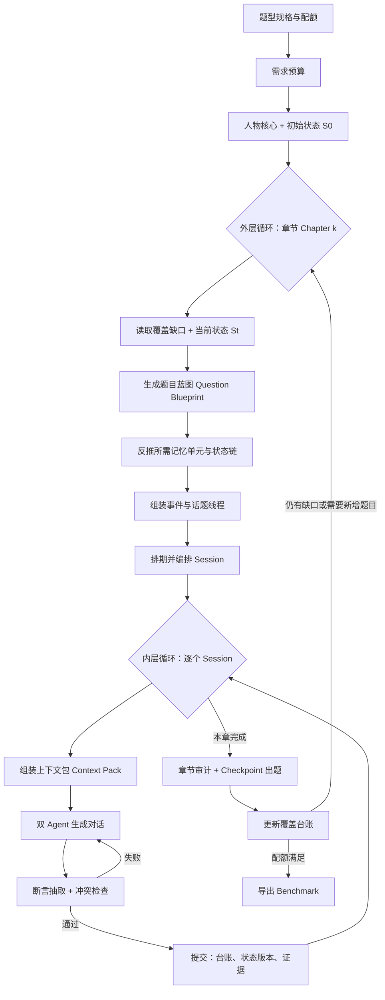
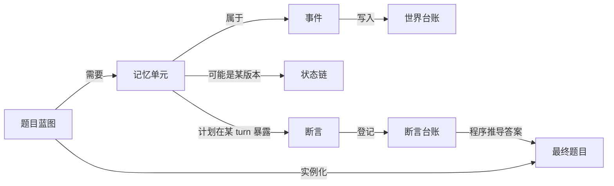
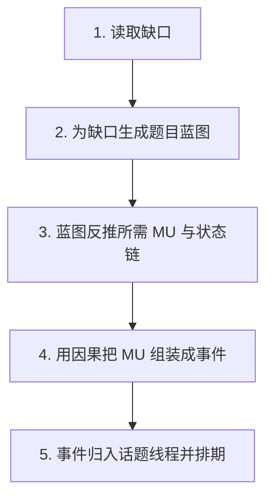
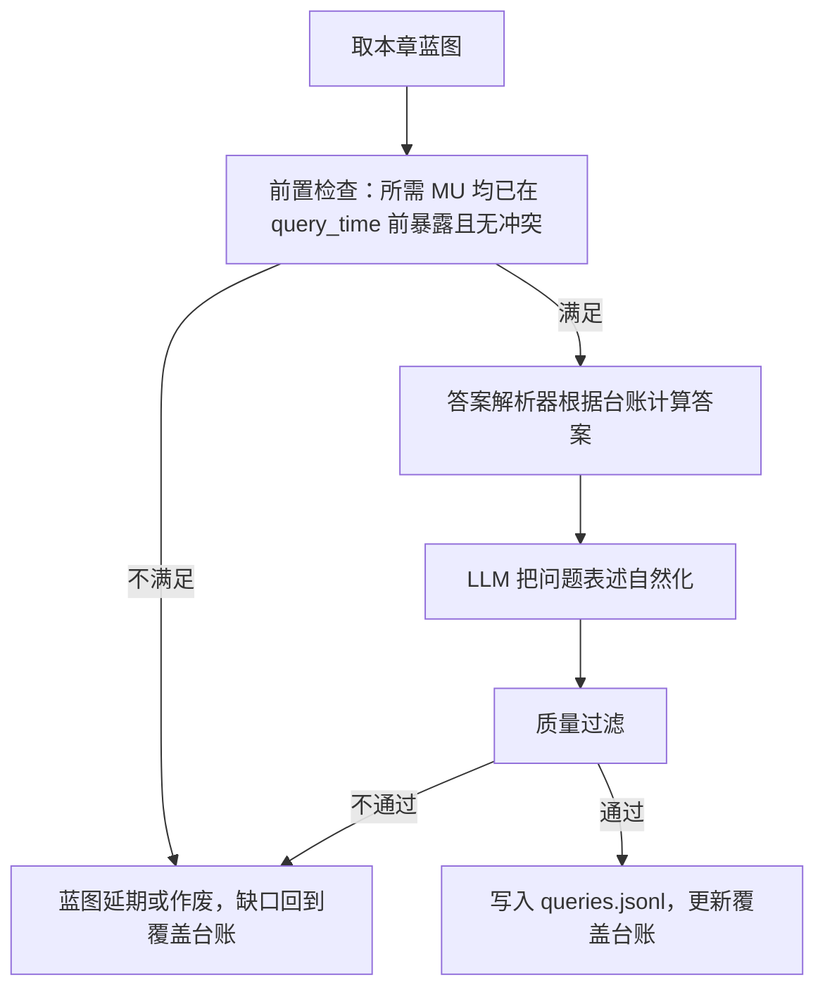

# 长期记忆 Benchmark 可控构造方案（v2）

> 本文是《Long-Term-Memory-Benchmark-Construction-Steps.md》的重写版，原文件保持不变。
>
> 旧版的思路是：人物 → 话题 → 变化 → 事件 → 对话 → 出题。它能生成连贯的人生故事，但**出题数量、题型分布、答案准确性都要到最后才知道**，并且对话越长越容易出现事实污染。
>
> v2 的思路改为：
>
> **先确定要考哪些题 → 推算需要多少条“可考察的记忆” → 规划这些记忆在世界线中如何产生和变化 → 生成对话把它们说出来 → 用台账逐条核对 → 在检查点基于台账出题。题不够时，从最新状态继续追加一个新章节。**

---

## 0. 一页看懂

### 0.1 三个关键改变

| 旧版 | v2 |
|---|---|
| 话题种子驱动，题型分布无法事先控制 | **题型配额驱动**，由缺口决定下一步生成什么 |
| 只记录“状态变化”，颗粒度不足以出题 | 以**记忆单元（Memory Unit）**为最小单位，事件拆成多个可提问的槽位 |
| 生成后只验证计划内事实 | **所有**用户说出的事实都进入**断言台账（Claim Ledger）**，与全部历史做冲突检查 |

### 0.2 两层循环



- **内层循环（Session 级）**：每生成一个 session，就立即验证和提交。这里只执行计划，不做规划。
- **外层循环（Chapter 级）**：每个章节开始时，根据“还缺哪些题”和“人物现在是什么状态”规划下一段人生。之后要加题时，只需要再追加章节。

### 0.3 六条硬规则

1. **题目只能从台账推导，不能从对话“读出来”再猜。** 标准答案由程序根据台账计算，LLM 只负责把问题表述自然。
2. **台账只追加，不改写。** 状态变化通过新增版本实现，旧版本标为 `superseded`，不能删除。
3. **初始状态 S0 永不修改。** 变化的是版本化的当前状态 `St`。
4. **对话中出现的每一个用户事实都必须登记。** 计划外事实也要登记，冲突事实必须回滚。
5. **题目绑定查询时间。** 每道题都有 `query_time`，其答案只由该时间之前已暴露的断言决定。
6. **拒答题依赖“保留空白”。** 拒答所需的“从未提到的信息”必须事先锁定，不允许后续对话意外补上。

---

## 1. 核心对象：先把词汇统一

以下对象是整套方案的骨架，后文都用这些名字。

```text
Persona Core   人物核心：不可变的身份、性格、表达风格
S0             初始世界状态：第一个 session 前的完整结构化状态
World Ledger   世界台账：世界中真实为真的事实（包括用户还没说出的）
Event          事件：世界中发生的一件事，包含若干记忆单元
Memory Unit    记忆单元（MU）：一条可以单独被提问的原子事实
State Chain    状态链：同一属性随时间的版本序列
Claim          断言：用户在某个 turn 中实际说出的一条事实
Claim Ledger   断言台账：所有已说出断言的总账
Question Blueprint  题目蓝图：计划要出的一道题的“配方”
Coverage Ledger     覆盖台账：各题型的目标数、已完成数、缺口
Chapter        章节：外层循环的一个规划单元，约 6–12 个 session
Checkpoint     检查点：出题的时间点，通常位于章节末尾
```

它们之间的关系：



### 1.1 世界事实、断言和暴露为什么必须分开

同一件事有三个层面：

| 层面 | 例子 | 用途 |
|---|---|---|
| 世界事实 | 小林 3 月去大阪出差 | 保证世界逻辑一致 |
| 断言 | S8 第 4 轮用户说“上次去大阪出差……” | 作为答题证据 |
| 暴露状态 | 截至 C2，助手已知“去过大阪出差” | 决定题目能否回答 |

- 世界中为真但**没有说出**的事实，不能出成可回答题，只能用于拒答题。
- 用户**说错后纠正**时，世界事实不变，但断言台账中出现两条断言，后一条以 `corrects` 指向前一条。
- 助手的推测只登记为 `assistant_claim`，**不会**改变用户事实。

---

## 2. 第一步：定义题型规格

这是 v2 最重要的一步。旧版把题型放在最后，v2 把题型放在最前面，并为每种题型写清楚**需要什么结构的数据才能出题**。

### 2.1 跳数的操作定义

必须先把“单跳”和“多跳”定义成程序可以检查的规则，否则标注会出现分歧：

- **单跳**：答案只需要 **1 条**关键断言（同一个 turn 或相邻 turn）。允许存在干扰断言。
- **多跳**：答案需要 **≥2 条**关键断言，并且这些断言位于 **≥2 个不同的 session**，缺少任何一条都无法得出答案。

出题后需要做**消融检查**：逐条删除关键证据，确认答案不再可得。如果删掉一条后仍然可以回答，说明它不是必要证据，需要降低跳数或重新出题。

### 2.2 题型配方表

以下配方与截图中的配额对应：

| 题型 | 单跳 | 多跳 | 合计 |
|---|---:|---:|---:|
| 信息抽取 | / | 27 | 27 |
| 时间 | / | 21 | 21 |
| 开放域 | 5 | 11 | 16 |
| 拒答 | 2 | 2 | 4 |
| 知识更新 | 34 | 34 | 68 |
| 个性化推荐 | 34 | 34 | 68 |
| **合计** | **75** | **129** | **204** |

每种题型都要定义“配方”：需要哪些 MU、MU 之间是什么关系、答案怎样计算。

#### A. 信息抽取（多跳）

**结构要求：** 两条或多条事实通过一个**桥接实体**相连。

```text
配方 IE-M-bridge：
  MU1（S_a）：实体 X 的属性 p1         例：同事阿杰负责海外市场
  MU2（S_b）：实体 X 的属性 p2         例：阿杰下个月调去新加坡
  问：负责海外市场的那位同事要调去哪里？
  答：新加坡（先由 p1 找到 X，再取 p2）

配方 IE-M-aggregate：
  MU1..MUn 分布在不同 session，属于同一类别
  问：小林一共提过几次去医院复查？ / 小林养过哪些宠物？
  答：程序对台账计数或取并集
```

**生成约束：**

- 桥接实体在两个 session 中的称呼可以不同，例如“阿杰”和“那个做海外的同事”，但必须在台账中登记为同一个 `entity_id`。
- 聚合题要求台账中该类别**完全枚举**。因此该类别的事实一律只能计划生成，禁止对话中随意冒出，否则计数会错。

#### B. 时间（多跳）

**结构要求：** 至少两个带时间锚点的事件，或者一个事件加上 session 时间戳。

```text
配方 TR-M-order：   事件 A、事件 B 分在不同 session → 问先后
配方 TR-M-interval：两事件都有可解析时间 → 问间隔多久
配方 TR-M-relative：用户说“上周”，要结合该 session 的日期换算 → 问具体日期或月份
配方 TR-M-at-time：状态链 + 时间点 → 问“5 月时小林住在哪里”
```

**生成约束：**

- 每个带时间的 MU 必须同时记录 `event_time`（事情发生的时间）和 `asserted_at`（用户说出的 session 时间）。
- 用户的相对时间表达，例如“上周”“前天”，必须能用 `asserted_at` 精确换算到 `event_time`。换算规则写在 MU 中，由程序校验。

#### C. 开放域（单跳 5 / 多跳 11）

**结构要求：** 记忆事实加上常识推理。答案不是原文复述，但**推理前提必须全部来自台账**。

```text
单跳：MU：小林对猫毛过敏
      问：小林适合在家里养一只长毛猫吗？
      答：不太适合，因为他对猫毛过敏（rubric 评分）

多跳：MU1：搬到苏州；MU2：改为远程工作；MU3：以前每天通勤 1.5 小时
      问：和去年相比，小林每天的时间安排可能发生了什么变化？
      答要点：省去通勤；每天多出约 1.5 小时（rubric）
```

**生成约束：** 开放域题答案采用 `rubric`，由必须命中的要点和禁止出现的错误组成，不使用唯一字符串。

#### D. 拒答（单跳 2 / 多跳 2）

拒答题最容易被后续对话**意外破坏**，因此必须提前规划“空白区域”。

```text
单跳 ABS-S-unmentioned：
  保留槽位：小林的血型（世界中存在，但从未暴露）
  问：小林是什么血型？
  答：历史中没有提到，无法回答

多跳 ABS-M-false-premise：
  MU1：小林去过大阪出差（已暴露）
  保留槽位：小林在大阪见过的客户姓名（从未暴露）
  问：小林在大阪出差时见的那位客户叫什么？
  答：只知道他去大阪出差，没有提到客户姓名

  或者前提错误：
  问：小林去东京出差时吃了什么？
  答：他提到的是大阪出差，没有提到东京
```

**生成约束：**

- 拒答依赖的槽位写入 `reserved_absent` 锁表。只要锁仍然有效，任何 session 都不得暴露该信息，检查器必须强制执行。
- 如果后续章节确实需要使用该槽位，必须先让依赖该槽位的拒答题**失效**（`valid_until = 当前 checkpoint`），再解锁。

#### E. 知识更新（单跳 34 / 多跳 34）

**结构要求：** 一条状态链至少包含 2 个版本，并且每个版本都有独立断言。

```text
单跳 KU-S-current：
  链：居住地 北京(S2) → 苏州(S14)
  问：小林现在住在哪里？
  答：苏州
  关键证据：S14；旧版本干扰：S2

多跳 KU-M-*：
  KU-M-previous：搬到苏州前住在哪里？（需要新版本定位 + 旧版本）
  KU-M-reason：为什么不再去原来的健身房？（需要更新 + 原因事件）
  KU-M-multi-version：链有 3 个版本，问当前值（需要跳过中间版本）
  KU-M-combined：现在住的城市离他老家远吗？（需要当前值 + 另一条事实）
```

**注意单跳和多跳的边界：** `KU-S-current` 只需要最新断言，但旧断言必须存在于历史中作为干扰，否则它就退化成普通信息抽取题。

#### F. 个性化推荐（单跳 34 / 多跳 34）

**结构要求：** 至少需要偏好或约束，再加上一个用户第一人称的**请求场景**。答案采用 rubric，包括必须满足、必须避免，以及可接受示例。

```text
单跳 PR-S：
  MU：小林喜欢安静、人少的地方（S6）
  请求：“周末想出去走走，有什么推荐吗？”
  rubric：
    must：推荐安静或人少的地点
    must_not：推荐热门商圈、网红打卡地

多跳 PR-M：
  MU1：偏好从“城市观光”更新为“安静自然”（S4 → S18）
  MU2：现在住苏州（S14）
  MU3：预算中等（S9）
  MU4：只能请 3 天假（S21）
  请求：“下个月想出去玩几天，帮我规划一下”
  rubric：
    must：自然景观；3 天内可完成；从苏州出发交通合理；中等预算
    must_not：以城市观光为主（旧偏好）；长途出境
```

**关键点：** 个性化推荐配额**不是**靠“多产生偏好类 topic”来满足，而是需要生产三类材料：

1. **偏好维度**：每个维度包括方向、强度和适用场景。
2. **约束条件**：预算、时间、地点、身体状况、同行人等。
3. **请求场景**：用户在某个场景中寻求建议。请求场景本身不能泄露偏好。

偏好的暴露方式应该多数是**隐式**的，例如“上次去那个网红街，人挤人，走了十分钟就想回去”，而不是“我喜欢安静”。PersonaMem-v2 的研究也表明，真实场景中大部分偏好是隐式流露的。

### 2.3 题型规格文件示例

```yaml
question_type: knowledge_update
hop: multi
recipe_id: KU-M-reason
required_mu:
  - role: new_version     # 状态链的新版本
  - role: old_version     # 状态链的旧版本
  - role: cause_event     # 导致更新的事件
constraints:
  min_session_gap: 3          # 证据之间至少间隔 3 个 session
  distinct_sessions: true
  exposure_style_mix: {explicit: 0.4, implicit: 0.6}
answer_mode: resolver+rubric
target_count: 12
```

---

## 3. 第二步：需求预算，从题量反推规模

有了配方，就能估算需要生产多少材料。下面以 204 题为例，数字供第一次规划使用，实际数值以试生产统计为准。

### 3.1 估算记忆单元需求

| 题型 | 题数 | 平均关键 MU 数 | MU 需求（含复用前） |
|---|---:|---:|---:|
| 信息抽取-多跳 | 27 | 2.5 | 68 |
| 时间-多跳 | 21 | 2.2 | 46 |
| 开放域 | 16 | 2.0 | 32 |
| 拒答 | 4 | 1.0 + 保留槽 | 4 + 4 槽 |
| 知识更新 | 68 | 2.3 | 156 |
| 个性化推荐 | 68 | 2.5 | 170 |
| **合计** | **204** | | **≈ 476** |

### 3.2 复用上限

同一个 MU 可以被多道题使用，但必须设置上限，否则题目会高度重复，评测结果也会被少数事实主导：

```text
单个 MU 最多被 3 道题引用
单条状态链最多派生 3 道题，并且这些题的问法必须属于不同配方
同一对 MU 组合只能出现在 1 道题中
```

假设平均复用系数为 1.6，所需的**独立 MU 约为 476 / 1.6 ≈ 300 条**。

### 3.3 估算 session 数量

```text
每个证据 session 计划暴露 2–3 个 MU（取 2.5）
→ 证据 session ≈ 300 / 2.5 = 120

干扰/日常 session 占 25%–35%
→ 总 session ≈ 120 / 0.7 ≈ 170
```

分配到人物世界线上：

```text
方案 A：5 个人物 × 约 34 个 session × 3 个章节
方案 B：8 个人物 × 约 21 个 session × 2 个章节
```

建议采用**多人物、每人中等长度**的方式。单个人物过长时，污染风险和审计成本会上升很快。

### 3.4 状态链与偏好维度需求

```text
知识更新 68 题：每链 ≤ 3 题 → 至少 23 条状态链，建议预留 30 条
个性化推荐 68 题：每个偏好维度 ≤ 3 题 → 至少 23 个维度
                 其中约 1/3 的维度应该发生过更新，用于提供“旧偏好”干扰
```

预算结果写入 `coverage_ledger.json` 作为初始目标。

---

## 4. 第三步：人物核心与初始状态 S0

### 4.1 人物核心（不可变）

```yaml
persona_id: P01
core:
  name: 小林
  birth_date: 1997-05-18
  hometown: 青岛
  personality: [谨慎, 务实, 不爱社交]
  speaking_style: 口语化，常用“其实”“还行”，很少直接表达喜好
protected_paths:        # 任何章节都不允许修改
  - identity.*
  - history.before_S0.* # S0 之前已经发生的人生经历
```

### 4.2 S0 必须包含“可变化的余地”

S0 不是越详细越好，而是要为后续**变化**和**拒答**预留空间：

```yaml
S0:
  residence.current_city: {value: 北京, since: 2023-07}
  career.company_type: {value: 互联网, since: 2021-06}
  career.work_mode: {value: on_site}
  pref.travel.style: {value: 城市观光, strength: 0.7}
  pref.food.spicy: {value: 喜欢, strength: 0.8}

  history.before_S0:           # 过去经历，一旦说出就不能被推翻
    - 2025-03 去大阪出差 3 天
    - 从未去过欧洲

  mutable_budget:              # 本人物允许发生变化的属性，供规划器选择
    - residence.current_city
    - career.work_mode
    - pref.travel.style
    - routine.fitness

  reserved_absent:             # 为拒答题预留，永不暴露（除非显式解锁）
    - identity.blood_type
    - relation.ex_partner.name
```

**关键点：** `history.before_S0` 必须写入**全局事实**，包括否定事实，例如“从未去过欧洲”。这样后续检查器才能拦截“我上次去巴黎……”这类污染。

### 4.3 S0 什么时候更新

**S0 永远不更新。** 人物状态按以下方式推进：

```text
S0（冻结）
 → Session 1 提交 → S1
 → Session 2 提交 → S2
 → ...
 → Chapter 1 结束：St 快照 = Chapter 2 的起点
```

每个 session 提交后，`St` 都会更新；每个章节开始时，读取最新的 `St` 进行规划。所谓“初始状态更新后多久重复这个过程”，在 v2 中表现为**每个章节重复一次规划**，而不是重新生成初始状态。

---

## 5. 第四步：章节规划，由缺口决定生成什么

这一步回答“初始状态怎么演变为话题”。v2 的回答是：**不是由初始状态演变出话题，而是由“题目缺口 + 当前状态”共同决定要发生什么，话题只是承载这些内容的外壳。**

### 5.1 章节规划的输入

```text
当前状态 St
覆盖台账（各配方还缺多少题）
已有断言台账（哪些 MU 已存在，可以作为回访或桥接对象）
锁表（reserved_absent、protected_paths）
人物核心（性格决定哪些变化合理）
```

### 5.2 规划的五个子步骤



#### 子步骤 1：读取缺口

```json
{
  "KU-S-current": {"target": 12, "done": 7, "gap": 5},
  "PR-M": {"target": 34, "done": 20, "gap": 14},
  "TR-M-interval": {"target": 7, "done": 7, "gap": 0}
}
```

每章只认领部分缺口，建议每章 20–40 道蓝图，防止单章过于密集、不自然。

#### 子步骤 2：生成题目蓝图

蓝图是“计划出的题”。此时只确定结构，不写最终问题：

```yaml
blueprint_id: QB-P01-C2-017
recipe: PR-M
intent: 用户请求旅行规划，需要结合已更新的偏好 + 新居住地 + 时间约束
required_mu:
  - pref.travel.style = 安静自然   (new, 待生成)
  - pref.travel.style = 城市观光   (old, 已存在于 S0 暴露记录)
  - residence.current_city = 苏州  (已存在，C1 已暴露)
  - constraint.leave_days = 3      (new, 待生成)
query_session_hint: 本章末尾或下章
```

**LLM 的作用：** LLM 负责提出蓝图草案，规则程序负责检查它是否满足配方约束、复用上限和锁表。

#### 子步骤 3：反推 MU 与状态链

把所有蓝图中标记为 `new` 的 MU 汇总，并合并重复项：

```text
新 MU 需求：
  pref.travel.style: 城市观光 → 安静自然   (需要一个“原因事件”)
  constraint.leave_days = 3
  ...
新状态链：
  pref.travel.style 增加版本 v2
```

#### 子步骤 4：用因果把 MU 组装成事件

MU 不能孤零零地出现，而是要放进一个合理的生活事件中。这一步是“状态变化”和“话题”真正产生的地方：

```text
需求：偏好从“城市观光”变为“安静自然”，需要原因
→ 生成事件 EV-031：五一去成都旅行，景点人太多，体验差
→ 生成事件 EV-035：之后去了一次莫干山，觉得很放松
→ EV-031 + EV-035 共同导致 pref.travel.style 更新
```

这里的 LLM 提示应该是“为这些 MU 设计合理的生活事件和原因”，而不是“为这个人物自由设想未来”。同时，事件必须通过规则检查：

- 事件的前置条件在 `St` 下成立；
- 不改动 `protected_paths`；
- 不碰 `reserved_absent`；
- 不与 `history.before_S0` 冲突。例如 S0 写明“2025-03 去过大阪”，就不能生成“第一次出国去日本”。

#### 子步骤 5：归入话题线程并排期

事件按主题聚成线程。线程决定对话自然地“聊什么”：

```text
线程 T-travel：EV-031 → EV-035 → 旅行规划请求（PR-M 的 query 场景）
线程 T-work：EV-028 → EV-033
```

排期时遵守：

- 因果顺序：原因事件早于结果事件；
- 多跳证据间隔：同一蓝图的证据分在不同 session，间隔 ≥ `min_session_gap`；
- 线程交错：同一线程不连续占用 3 个以上 session；
- 时间合理：session 日期单调递增，事件时间和 session 时间匹配。

### 5.3 规划产物

```text
chapter_plan_C2.json
  - blueprints: 本章认领的题目蓝图
  - new_mus: 新 MU
  - events: 新事件及因果边
  - threads: 话题线程
  - schedule: 事件 → session 排期
  - locks: 本章新增或释放的锁
```

---

## 6. 第五步：记忆单元的颗粒度规范

这一步回答“记录文件的颗粒度要多细”。

### 6.1 一个事件应该拆成多个 MU

只记录“小林去日本出差”，颗粒度不足以出题。一个事件应该拆成若干**槽位**，每个槽位都是一个 MU：

```yaml
event_id: EV-008
type: business_trip
summary: 2025-03 去大阪出差
mus:
  - mu_id: MU-081  slot: destination   value: 大阪
  - mu_id: MU-082  slot: time          value: 2025-03（持续 3 天）
  - mu_id: MU-083  slot: purpose       value: 拜访客户
  - mu_id: MU-084  slot: experience    value: 觉得当地一家店的虾料理很难吃
  - mu_id: MU-085  slot: companion     value: 同事阿杰
  - mu_id: MU-086  slot: feeling       value: 行程太赶，没时间逛
derived_facts:          # 由事件推出的全局事实，也进入冲突检查
  - visited(Japan) = true
  - visited(Osaka) = true
```

### 6.2 MU 的原子性标准

一个合格的 MU 必须满足：

1. **一句话可问**：可以直接对应一个问题，例如“小林去大阪做什么？”
2. **一个值**：只包含一个答案值，不能写成“去大阪出差并吃了难吃的虾”。
3. **有主体和作用域**：明确是谁的事实，在什么范围内成立，例如“出差”与“旅游”是不同作用域。
4. **有时间**：同时记录 `event_time` 和 `valid_from / valid_to`。
5. **有来源**：记录属于哪个事件，由哪个状态链版本产生。

### 6.3 MU 完整结构

```json
{
  "mu_id": "MU-084",
  "persona_id": "P01",
  "event_id": "EV-008",
  "subject": "user",
  "path": "experience.food.osaka_shrimp",
  "value": "很难吃",
  "polarity": "negative",
  "scope": {"context": "business_trip", "place": "大阪"},
  "event_time": "2025-03",
  "valid_from": "2025-03",
  "valid_to": null,
  "state_chain": null,
  "status": "planned",
  "planned_exposure": {"session": "S08", "style": "implicit"},
  "used_by_blueprints": ["QB-P01-C1-004"],
  "risk_level": "high"
}
```

`risk_level` 用于污染控制。以下类别属于**高风险**，因为它们最容易在无意中被提及并产生矛盾：地点和旅行经历、工作单位、家人和同伴、健康状况、宠物、所有物、首次或唯一性经历。

### 6.4 状态链记录

状态链把同一属性的多个版本串起来，每个版本都能追溯到事件和断言：

```json
{
  "chain_id": "CH-residence-P01",
  "path": "residence.current_city",
  "versions": [
    {
      "ver": 0, "value": "北京",
      "valid_from": "2023-07", "valid_to": "2026-06-10",
      "source": "S0", "exposed_by": ["S02-t3"],
      "status": "superseded"
    },
    {
      "ver": 1, "value": "苏州",
      "valid_from": "2026-06-10", "valid_to": null,
      "caused_by": ["EV-020 接受远程工作", "EV-024 比较苏州和杭州"],
      "transition_event": "EV-025 完成搬家",
      "exposed_by": ["S16-t2", "S20-t1"],
      "status": "current"
    }
  ],
  "questions_derived": ["Q-C2-011", "Q-C3-004", "Q-C3-019"]
}
```

这条链可以支持以下问题：当前值、旧值、变化时间、变化原因、某时间点的值。每种问法对应不同配方。

---

## 7. 第六步：Session 编排与普通交互设计

### 7.1 Session 类型

| 类型 | 作用 | 建议占比 |
|---|---|---:|
| 证据 session | 暴露计划中的 MU | 45%–55% |
| 回访 session | 引用已有 MU，推动线程发展，强化或更新 | 15%–20% |
| 请求 session | 放置个性化推荐或开放域题的请求场景（可选） | 5%–10% |
| 干扰 session | 与记忆无关的任务，例如写代码、翻译、解释公式 | 20%–30% |

**说明：** 个性化推荐题通常在 checkpoint 时由评测方以“新的用户请求”形式发出，不需要放进历史对话。请求 session 只在需要测试“助手在历史对话中是否已经正确运用偏好”时使用。

### 7.2 普通交互不能是空白

旧版的“普通交互种子”容易变成随机闲聊，也最容易产生污染。v2 为每个普通交互规定明确功能和写入权限：

```yaml
session_id: S12
type: distractor
task: 帮用户把一段周报改得更简洁
function: [dilute, style_signal]      # 稀释记忆密度 + 顺便体现回答风格偏好
allowed_new_claims: none              # 不允许产生新的人物事实
may_reference: [MU-031]               # 可以顺带提到“最近在远程办公”（已暴露）
forbidden_topics: [travel, health]    # 避开高风险领域
```

普通交互的功能分类：

| 功能 | 说明 |
|---|---|
| `dilute` | 拉开证据之间的距离，增加检索难度 |
| `callback` | 回访已有事实，形成“提过又提”的自然感 |
| `bridge` | 用同一实体连接两个线程，服务多跳题 |
| `distract_stale` | 故意提到旧版本信息，例如回顾“以前在北京时……”，作为知识更新干扰 |
| `near_miss` | 提到相似但不同的实体，例如同事“阿杰”和表弟“阿洁”，制造检索难度 |
| `style_signal` | 隐式体现用户对回答风格的偏好 |

干扰 session 可以部分复用公开数据，例如 ShareGPT 和 UltraChat 中的通用任务对话，LongMemEval 就采用了这种做法。但复用前必须过滤掉所有含第一人称个人事实的内容。

### 7.3 Session Agenda 结构

```yaml
session_id: S18
date: 2026-05-12
type: evidence
thread: T-travel
task_frame: 用户想让助手帮忙整理五一旅行的照片说明文字
expose:
  - mu: MU-311   # 五一去成都，景点人太多
    style: implicit
    position: middle
  - mu: MU-312   # 以后想去人少的地方
    style: explicit
    position: late
callback:
  - mu: MU-204   # 已搬到苏州（已暴露），可以自然提及
forbidden:
  - 任何关于日本、大阪的新细节
  - reserved_absent 中的全部槽位
allowed_incidental:
  categories: [天气, 情绪, 对照片的评价]   # 允许随口补充的低风险细节
max_turns: 12
```

**关键点：**

- 暴露方式 `style` 分为 `explicit`（直接说）、`implicit`（通过经历或行为流露）和 `incidental`（在谈别的任务时顺带提到）。LongMemEval 采用顺带提到的方式来提高难度，本方案也建议隐式和顺带提到合计 ≥50%。
- `position` 用于控制证据在 session 中的位置，避免总是在开头。

---

## 8. 第七步：生成对话，用上下文包约束 User Simulator

### 8.1 User Simulator 的上下文包

污染的根本原因是：生成当前 session 时，LLM 不知道以前说过什么，只好随意编造。所以每次生成前，都需要从台账中组装一个**上下文包（Context Pack）**：

```text
[人物核心] 性格、说话风格
[当前状态摘要] 由 St 生成，只包含与本 session 相关的属性
[相关已说事实] 从断言台账中检索：
    - 与本 session 线程相关的全部断言
    - 与 agenda 中实体相关的全部断言（例如提到旅行，就要带上所有旅行经历）
    - 全部高风险类别中的否定事实和唯一性事实（例如“从未去过欧洲”）
[本次任务] agenda 的 task_frame
[必须表达] expose 列表及方式
[禁止] forbidden 列表 + reserved_absent
[允许随口说的] allowed_incidental 类别
[规则] 除允许类别外，不要引入任何新的个人经历、人物、地点、日期
```

检索“相关已说事实”时，不能只用向量相似度，还要按以下方式**结构化召回**：

- 同一 `path` 前缀，例如 `travel.*`；
- 同一实体，例如“日本”“大阪”“阿杰”；
- 同一上位类别，例如日本属于“出国”，出国属于“旅行”；
- 全部 `risk_level = high` 的否定事实和唯一性事实。

### 8.2 Assistant 的输入

Assistant 只能看到对话历史或 memory 系统的检索结果，**不能**看到台账。它的回复中如果提到用户事实，只登记为 `assistant_claim`。

如果助手说错了用户事实，例如“你之前住在上海吧”：

- 用户模拟器必须按人物真实情况纠正，或者本轮重新生成；
- 用户不得附和错误说法，否则就相当于用户确认了一条假事实。

### 8.3 生成时的自引用

参考 PersonaMem 的做法，要求 User Simulator 在每一轮先输出**内部引用**：本轮打算表达哪个 MU，或者本轮不表达新事实。该引用不进入最终数据，但可以用于验证和定位。

---

## 9. 第八步：验证与提交，重点处理污染

这一步回答“前面说去过日本出差，后面又说从来没去过日本”这类问题。

### 9.1 断言抽取

每个 session 生成后，对**每个用户 turn** 进行断言抽取，抽取出所有关于用户或其相关人物的事实，而不仅仅是计划中的 MU：

```json
{
  "claim_id": "CL-S08-t4-02",
  "turn_id": "S08-t4",
  "subject": "user",
  "path": "experience.food.osaka_shrimp",
  "value": "很难吃",
  "scope": {"context": "business_trip", "place": "大阪"},
  "event_time_expr": "上次出差",
  "quantifier": null,
  "derived": ["visited(Osaka)=true", "visited(Japan)=true"]
}
```

`quantifier` 是专门用来识别危险表达的字段，常见取值包括：

```text
never（从来没/从未） always（一直/每次） first（第一次） only（唯一/就这一次）
```

这些全称或唯一性表达**对历史事实最具破坏力**。例如“我从来没去过日本”，会与任何一次日本经历冲突。

### 9.2 四类判定

每条抽取出的断言都与台账比对，并归入以下四类之一：

| 判定 | 含义 | 处理 |
|---|---|---|
| `MATCH` | 与计划中的 MU 一致 | 提交，并把该 MU 状态改为 `exposed` |
| `CONSISTENT_NEW` | 计划外的新事实，不与任何事实冲突 | 按策略处理，见 9.4 |
| `CONFLICT` | 与世界台账或已说断言矛盾 | **回滚**，携带冲突报告重新生成 |
| `UPDATE` | 计划中的状态更新 | 验证新旧版本和原因后，建立 supersede 链 |

### 9.3 冲突检测的三道关

只靠 LLM 判断“是否矛盾”，漏检率较高。建议采用三道关叠加：

**第一关：结构化键值比对（确定性）**

```text
同一 path + 同一 scope + 同一有效时间 → 值不同 → CONFLICT
```

例如在 `residence.current_city` 的当前有效期内，出现了另一个城市，就可以直接判定冲突。

**第二关：全称量词规则（确定性）**

```text
新断言带 never/first/only → 在台账中查找同一实体或上位实体的任何正向事实
  “从来没去过日本” vs visited(Japan)=true (EV-008) → CONFLICT
  “第一次出国” vs visited(Japan)=true → CONFLICT

新正向断言 → 查找已有 never 事实
  “上次去巴黎” vs “从未去过欧洲” → CONFLICT
```

这需要一个轻量的**实体层级表**，例如“大阪 ⊂ 日本 ⊂ 亚洲 ⊂ 国外”。

**第三关：语义 NLI（LLM 判定）**

召回同一实体或同一类别的已有断言，让 LLM 逐对判断“蕴含、中立、矛盾”，并要求给出理由。只有矛盾判断的置信度高时才自动回滚，其余情况进入人工抽检队列。

### 9.4 计划外新事实的三种策略

计划外的“随口一提”在真实对话中很常见，完全禁止会让对话显得僵硬。建议按风险分级：

| 风险 | 例子 | 策略 |
|---|---|---|
| 低 | “今天有点累”“那张照片光线不好” | 允许，登记为 `incidental`，**不用于出题** |
| 中 | “我周末一般睡懒觉” | 允许，登记后加锁，后续不得矛盾；人工确认前不用于出题 |
| 高 | 新的旅行经历、新人物、新健康状况、新工作经历 | **默认拒绝并回滚**；只有 agenda 明确允许时才能出现 |

也就是说，原文中的“工作话题里提到去过日本出差”只有两种合法情况：

1. 这件事本来就在世界台账中，并且 agenda 允许它作为 callback 或 incidental 提及；
2. 这件事是计划外新事实，但属于高风险类别，因此被拒绝，本 session 重新生成。

无论哪种情况，只要“去过日本”进入了台账，后续旅游话题中的“我从来没去过日本”都会在第二关被拦截。

### 9.5 作用域不是“免死金牌”

有些看似冲突的说法，可以通过作用域共存：

```text
“去过大阪出差” + “从来没去日本旅游过” → 可共存（出差 ≠ 旅游）
```

但是，**不能允许 LLM 事后通过发明作用域来“圆回去”**。规则是：

- 作用域必须在断言原文中**明确说出**，例如“旅游”这个词必须出现在原句中；
- 共存的两条断言都要登记作用域，出题时答案必须体现作用域。例如问“小林去过日本吗？”，答案应为“去过，是出差”。

### 9.6 提交内容

验证通过后，一次性原子提交以下内容：

```text
1. 对话 turns（带 turn_id）
2. 断言台账新增条目（每条关联 turn_id）
3. MU 状态：planned → exposed，并记录 exposed_by
4. 状态链新版本（如有）
5. 世界台账新增事实（incidental 事实也要进入）
6. 当前状态 St → St+1
7. 锁表更新
8. 验证报告
```

提交失败时整体回滚，不留下部分写入。每个 session 最多重试 N 次，例如 3 次；超过次数就标记为人工处理，或者调整 agenda，例如减少本次需要暴露的 MU。

### 9.7 章节末审计

单个 session 的检查只能对比当时已有的台账。章节结束时，还要再做一次**全量审计**：

- 对每个实体，把它的全部断言按时间排列，重新做一次冲突检测；
- 检查所有 `reserved_absent` 槽位是否仍未暴露。可以做关键词和语义双重扫描，防止被换一种说法提到；
- 检查计划中的 MU 是否全部暴露。遗漏的 MU 在下一章补上，或者撤销相关蓝图；
- 检查时间线：event_time 与 session 日期是否矛盾，“上周”换算是否正确。

---

## 10. 第九步：Checkpoint 出题

### 10.1 出题流程



### 10.2 答案解析器（Resolver）

标准答案**由程序计算**，不由 LLM 回忆：

| 配方 | 解析规则 |
|---|---|
| KU-S-current | 取状态链中 `valid_from ≤ query_time` 且未失效的最新**已暴露**版本 |
| KU-M-previous | 当前版本的前一个已暴露版本 |
| TR-M-interval | 两个 MU 的 `event_time` 差值，并按问题粒度取整 |
| TR-M-at-time | 状态链中覆盖该时间点的版本 |
| IE-M-bridge | 按实体 ID 连接两条 MU |
| IE-M-aggregate | 对某一类别的全部已暴露断言取计数或并集 |
| ABS-* | 检查槽位在 query_time 前确实未暴露；答案为“未提及”并说明已知部分 |
| PR-* / OD-* | 由程序汇总必需 MU，生成 rubric 的 `must` 与 `must_not`；`must_not` 自动加入旧版本偏好 |

注意“最新**已暴露**版本”：如果世界中已经搬家，但用户还没告诉助手，那么正确答案仍然是旧城市。这类“世界已变、助手未知”的情况，可以专门出成有难度的题。

### 10.3 质量过滤

| 检查 | 方法 | 不通过时 |
|---|---|---|
| 无历史可答 | 不提供历史，让 2 个模型作答；答对则说明题目靠常识即可回答 | 丢弃（参考 PersonaMem） |
| 跳数真实 | 消融：逐条删除关键证据后重新作答 | 降级为单跳，或丢弃 |
| 答案唯一 | 台账中是否存在其他满足条件的候选 | 修改问题，增加限定 |
| 问题泄露 | 问题文本是否包含答案或关键线索 | 改写 |
| 证据可定位 | 每个关键断言都能对应到 turn_id | 丢弃 |
| 干扰存在 | KU 题是否确实有旧版本，PR 题是否确实有可能误导的旧偏好 | 降级为 IE 或丢弃 |
| 人工抽检 | 每种配方抽 10%–20% | 按错误率决定是否回溯 |

### 10.4 题目记录

```json
{
  "query_id": "Q-P01-C2-011",
  "persona_id": "P01",
  "checkpoint": "C2",
  "query_time": "2026-07-01",
  "type": "knowledge_update",
  "hop": "multi",
  "recipe": "KU-M-reason",
  "question": "小林现在为什么不去以前那家健身房了？",
  "answer": "他搬到苏州了，原来那家健身房在北京公司附近，现在不方便去。",
  "answer_mode": "rubric",
  "rubric": {
    "must": ["提到搬到苏州", "提到原健身房在北京或离得太远"],
    "must_not": ["称健身房倒闭", "称其不再健身"]
  },
  "evidence": [
    {"claim": "CL-S20-t1-01", "turn": "S20-t1", "role": "new_version"},
    {"claim": "CL-S03-t2-03", "turn": "S03-t2", "role": "old_context"},
    {"claim": "CL-S22-t1-02", "turn": "S22-t1", "role": "cause"}
  ],
  "stale_evidence": ["S03-t2"],
  "blueprint": "QB-P01-C2-006",
  "trace": {
    "mus": ["MU-204", "MU-033", "MU-221"],
    "chain": "CH-residence-P01",
    "events": ["EV-025", "EV-026"]
  },
  "valid_until": null
}
```

通过 `trace`，可以从题目一路追溯到事件、状态链、MU、断言和原始 turn；反过来，也可以从任意一条断言查到它被哪些题目使用。

---

## 11. 滚动延伸：按需加题

这是 v2 可控性的关键：**数据集可以随题目需求增长，而不需要推倒重来。**

### 11.1 延伸的基本操作

需要新增 N 道题时：

```text
1. 在覆盖台账中增加目标，例如 PR-M +20，KU-M +10
2. 选择人物世界线：
   - 优先延伸已有人物，复用其历史，更容易构造跨章节多跳题
   - 如果人物已经过长（例如 > 40 session），则新建人物
3. 从最新状态 St 开始，规划新章节（第 5 节流程）
4. 生成、验证、提交新 session（只追加）
5. 在新 checkpoint 出题
```

### 11.2 延伸时旧题怎么办

旧题都绑定了自己的 `query_time`，因此后续新增章节不会影响旧题答案：

```text
Q-C1-003：“小林现在住在哪里？” query_time = C1 → 北京（仍然正确）
Q-C3-004：“小林现在住在哪里？” query_time = C3 → 苏州
```

评测时 runner 需要按 checkpoint 截断历史：回答 C1 的题时，只能向 memory 系统输入 C1 之前的 session。这也是在线记忆评测的标准方式。

**只有两种情况会让旧题失效：**

1. 新章节解锁了某个拒答题的 `reserved_absent` 槽位。解决方法是把该拒答题的 `valid_until` 设为解锁前的 checkpoint。
2. 评测设置为“只在最终时间点提问”。这时所有涉及“当前值”的旧题都要用 resolver 重新计算答案；题目本身的结构仍可复用。

### 11.3 延伸是“新增素材”，也是“升级旧素材”

新增章节时，要优先利用旧素材构造更难的题：

| 延伸方式 | 例子 | 产出题型 |
|---|---|---|
| 给旧属性加新版本 | 苏州 → 杭州 | KU-M-multi-version（三版本链） |
| 回访旧事件 | 半年后又提起大阪出差 | IE-M-bridge、TR-M-interval（跨章节长距离） |
| 旧偏好在新场景中应用 | 旧的“不吃辣”偏好 + 新请求“推荐聚餐餐厅” | PR-M |
| 旧计划的结局 | C1 计划买电脑 → C3 买了或放弃 | KU、TR |

### 11.4 什么时候停止延伸一个人物

满足以下任一条件时，就不再延伸该人物，而是创建新人物：

- session 数超过上限，例如 40–50 个；
- 台账中高风险事实过多，导致每次生成的冲突回滚率超过 30%；
- 可变属性已基本用完，继续变化会显得不合理，例如一年搬家四次；
- 人物生活时间跨度超过设定上限，例如 18 个月。

---

## 12. 完整追踪示例：一条链从头到尾

下面用一条旅行偏好链演示所有对象如何关联。

```text
[S0]
  pref.travel.style = 城市观光（strength 0.7）
  history: 2025-03 大阪出差（EV-008）

[C1 规划] 缺口：KU-S 12、PR-S 10、…
  蓝图 QB-C1-004（IE-M-bridge）：大阪出差的同伴 + 同伴现在的职位
  → MU-085（同伴阿杰）安排在 S08 暴露；MU-140（阿杰升任总监）安排在 S13 暴露

[C1 执行]
  S03 用户：“我还是喜欢逛城市，老街、博物馆那种。”
      → CL-S03-t2-01 MATCH pref.travel.style v0
  S08 用户（工作话题）：“上次和阿杰去大阪见客户，行程太赶了……那边一家虾店真难吃。”
      → CL-S08-t4-01 MATCH MU-085；CL-S08-t4-02 MATCH MU-084
      → derived: visited(Japan)=true 写入世界台账
  S11（干扰）用户请助手解释一个 Excel 公式 → 无新断言
  S13 用户：“阿杰升总监了，以后我的方案要他审。” → MATCH MU-140

[C1 Checkpoint] 出题
  Q-C1-004：“和小林一起去大阪出差的同事，现在是什么职位？” → 总监

[C2 规划] 缺口：KU-M 14、PR-M 14
  蓝图 QB-C2-017（PR-M）：需要旅行偏好更新 + 居住地 + 请假天数
  → 新事件 EV-031（五一去成都，人太多）、EV-035（去莫干山，很放松）
  → pref.travel.style v1 = 安静自然

[C2 执行]
  S18 用户：“五一去成都，宽窄巷子人挤人，走十分钟就想回酒店。”
      → MATCH MU-311（隐式）
  S21 生成结果中用户说：“我从来没出过国，下次想试试。”
      → 断言抽取：quantifier = never，path = travel.abroad
      → 第二关规则：与 visited(Japan)=true（EV-008）冲突
      → CONFLICT，回滚重生成
  S21（重生成）用户：“去了趟莫干山，人少安静，这才叫休息。以后还是去这种地方吧。”
      → UPDATE pref.travel.style v0 → v1，caused_by EV-031、EV-035
  S24 用户：“今年年假只剩 3 天了。” → MATCH constraint.leave_days

[C2 Checkpoint] 出题
  Q-C2-017（PR-M）请求：“下个月想出去玩几天，帮我安排一下？”
    rubric.must：自然、安静；3 天内；从苏州出发
    rubric.must_not：以城市老街、博物馆为主（v0 旧偏好）
    evidence：S18、S21、S16（苏州）、S24
  Q-C2-020（KU-S）：“小林现在更喜欢什么样的旅行？” → 安静自然；stale：S03
```

---

## 13. 数据文件

### 13.1 内部文件（生成和审计用）

```text
config/
  question_type_specs.yaml    题型与配方规格
  ontology.yaml               属性定义、可变性、风险等级
  entity_hierarchy.yaml       实体层级（大阪 ⊂ 日本 ⊂ 国外）
personas/P01/
  core.yaml                   人物核心
  s0.json                     初始状态（冻结）
  world_ledger.jsonl          世界事实（只追加）
  events.jsonl                事件及因果边
  memory_units.jsonl          MU 及其状态
  state_chains.jsonl          状态链
  claim_ledger.jsonl          断言台账（只追加）
  locks.json                  reserved_absent、protected 等锁
  chapters/C1/plan.json       章节规划（蓝图、排期）
  chapters/C1/agendas.jsonl
  chapters/C1/validation.jsonl  每个 session 的验证报告与重试记录
  chapters/C1/audit.json      章节末审计报告
  state_snapshots/            每章末的 St 快照
coverage_ledger.json          全局覆盖台账
```

### 13.2 发布文件（给 runner）

```text
sessions.jsonl     session_id, persona_id, date, turns[{turn_id, role, content}]
checkpoints.jsonl  checkpoint_id, persona_id, last_session_id, query_time
queries.jsonl      query_id, checkpoint, type, hop, question, answer/rubric,
                   evidence_turns, stale_turns
```

`evidence_turns` 支持 turn 级和 session 级召回评估，与 LongMemEval 的 `has_answer` 标注一致。

---

## 14. 验收指标

生成过程需要持续监控以下指标：

| 指标 | 目标 |
|---|---|
| 计划 MU 暴露率 | ≥ 95%（章节末审计） |
| session 首次通过率 | ≥ 70%；过低说明 agenda 太满或上下文包不足 |
| 冲突漏检率（人工抽检） | ≤ 2% |
| 蓝图兑现率（蓝图 → 合格题） | ≥ 70% |
| 无历史可答率 | 0%（已过滤） |
| 多跳消融通过率 | 100%（已过滤） |
| 人工抽检答案正确率 | ≥ 97% |
| 证据间平均距离（多跳） | 按难度分档记录，例如近（< 5 session）、中、远（> 15 session） |

---

## 15. 实施路线

### 阶段 1：单人物打通闭环（约 30 题）

- 1 个人物，2 个章节，约 16 个 session；
- 只实现 4 个配方：KU-S-current、KU-M-previous、IE-M-bridge、PR-S；
- 必须跑通：断言抽取、三道冲突检查、提交与回滚、resolver 出题；
- 人为注入 10 个污染样例，例如“从来没去过日本”，验证能否全部拦截。

### 阶段 2：覆盖全部配方（约 80 题）

- 2–3 个人物，每人 3 个章节；
- 加入时间题、开放域题和拒答题的配方及保留槽锁；
- 统计每种配方的蓝图兑现率，修正第 3 节中的预算系数。

### 阶段 3：按配额量产（204 题）

- 用修正后的系数重新预算人物数量和 session 数；
- 按覆盖台账自动选择下一章节的缺口；
- 按配方分层做人工抽检。

### 阶段 4：按需延伸

- 新需求只需修改覆盖台账，然后追加章节；
- 优先采用“升级旧素材”的方式（第 11.3 节），产出长距离、多版本题目。

---

## 16. 常见问题

**Q1：初始状态怎么演变为话题种子？**
不直接演变。由“题目缺口”决定需要哪些记忆单元，由“当前状态 + 人物性格”决定这些记忆以什么事件形式合理地发生，再把事件按主题聚成话题线程。话题是承载内容的外壳，不是驱动力（第 5 节）。

**Q2：状态变化种子和普通交互怎么设计？**
状态变化由蓝图中需要的状态链版本反推，并且必须配有原因事件。普通交互必须声明功能和写入权限，默认不允许产生新事实（第 5.2、7.2 节）。

**Q3：什么时候更新状态？多久重复一次？**
S0 永不更新；每个 session 提交后更新 `St`；每个章节（约 6–12 个 session）开始时根据最新 `St` 和缺口重新规划一次（第 4.3、5 节）。

**Q4：需要个性化推荐题，就多生成偏好话题吗？**
不是。个性化推荐题需要偏好维度、约束条件、请求场景三类材料，并且约 1/3 的偏好需要发生过更新，以便形成旧偏好干扰。数量由配方和复用上限计算（第 2.2F、3.4 节）。

**Q5：状态变化链怎么记录才能追踪？**
使用状态链加 MU 加断言台账三层记录，每个版本都记录原因事件和暴露它的 turn。题目通过 `trace` 反向关联全部对象（第 6.4、10.4 节）。

**Q6：记录颗粒度多细？**
以 MU 为单位：一个 MU 对应一个可问的槽位，一个事件通常拆成 3–6 个 MU（第 6 节）。

**Q7：对话越多越容易污染怎么办？**
事前通过上下文包提供所有相关已说事实和否定事实；事后对每条用户断言做三道冲突检查，高风险计划外事实默认拒绝；章节末再做全量审计（第 8、9 节）。

**Q8：以后要加题怎么办？**
在覆盖台账中增加目标，从最新状态追加章节。旧题绑定 query_time，不受影响（第 11 节）。

---

## 17. 参考资料

- **LongMemEval**（Wu et al., ICLR 2025）：[论文](https://arxiv.org/abs/2410.10813)、[代码](https://github.com/xiaowu0162/LongMemEval)。
  它基于 164 个属性的 ontology 生成背景，把答案拆成证据陈述，再把证据嵌入任务型对话，并让用户“顺带”提到事实。之后，它把证据 session 插入无关 session 中，形成可扩展长度的历史，并用 `has_answer` 进行 turn 级标注。
  - 本方案借鉴了：答案拆成证据、间接暴露、干扰 session、turn 级证据标注。
  - 本方案改进了：LongMemEval 每道题拥有独立历史，本方案让多题共享一条连续世界线，从而支持状态演化和跨题一致性。

- **LoCoMo**（Maharana et al., ACL 2024）：[论文](https://arxiv.org/abs/2402.17753)。
  它为每个人物构建带因果边的时间事件图，每个人物最多 25 个事件，时间跨度 6–12 个月，并且**分批迭代生成**，每批 3 个事件。最后由人工校对长程一致性。
  - 本方案借鉴了：事件图、因果边和分批迭代生成，这对应本方案的“章节”。
  - 本方案补充了：LoCoMo 依靠人工修正一致性，本方案用台账和规则自动检查。

- **PersonaMem**（Jiang et al., 2025）：[论文](https://arxiv.org/abs/2504.14225)、[代码](https://github.com/bowen-upenn/PersonaMem)。
  它为每个话题构造带时间戳的偏好、偏好更新和更新原因，再按时间线切段生成对话。生成每轮前，它要求模型引用对应事件，并通过自我反思检查遗漏；最后过滤掉不看历史也能答对的题。
  - 本方案借鉴了：偏好演化结构、生成时引用、无历史可答过滤、用旧偏好作为干扰项。

- **PersonaMem-v2**（2025）：[论文](https://arxiv.org/abs/2512.06688)。
  它强调真实场景中大多数偏好是**隐式流露**的。
  - 本方案因此把隐式暴露作为个性化推荐题的主要方式。
