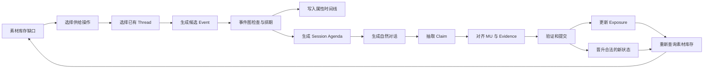

# 长期记忆 Benchmark 设计主线：从素材缺口到可出题状态链

> 本文是对 `Long-Term-Memory-Benchmark-Construction-v4.md` 的补充说明，不替代原方案。
>
> 本文只解决一个问题：**一条人物世界线究竟如何被规划、生成、更新，并最终变成可出题素材。**

---

## 1. 一句话设计主线

整个系统只沿着下面这条主线运行：

```text
题型配额
  → 推导需要哪些“可出题结构”
  → 计算素材库存缺口
  → 从现有故事线程中选择自然的发展方向
  → 生成候选事件并组成时间事件图
  → 事件写入人物属性时间线
  → 通过对话暴露事件和状态
  → 从对话中抽取 Claim、MU 和 Evidence
  → 验证并原子提交
  → 重新查询素材库存
  → 库存不足则继续下一章
  → 库存达标后统一出题
```

最重要的边界是：

1. **素材库存决定“缺什么结构”，不直接决定具体剧情。**
2. **故事线程决定剧情如何自然发展。**
3. **事件决定世界状态是否变化。**
4. **对话只负责暴露事实，不能绕过事件直接修改世界。**
5. **素材库存是数据库查询结果，不是 LLM 主观填写的数字。**

---

## 2. 系统同时维护的五本账

如果只维护“对话历史”，后续很难判断当前状态、历史版本和事实是否冲突。因此系统至少需要五种彼此分开的记录。

### 2.1 故事线程 Thread

Thread 表示一条可以跨章节发展的生活故事。

```yaml
thread_id: T-WORK-01
domain: career
topic: company_status
title: 创业公司的经营危机
phase: crisis
status: active
started_at: C1
last_event: EV-038
open_loops:
  - 公司是否能够获得新融资
  - 如果融资失败，小林的收入怎么办
linked_threads:
  - T-FINANCE-01
  - T-COMMUTE-01
```

Thread 主要回答：

- 这段故事在讲什么；
- 当前发展到哪个阶段；
- 还有哪些悬而未决的问题；
- 它可能影响哪些其他故事线。

Thread 不直接修改人物属性。

### 2.2 时间事件图 Event Graph

事件图记录世界中真实发生的事情，以及事件之间的因果、依赖和冲突。

```text
EV-030 融资失败
  └─causes→ EV-038 公司破产
                  ├─causes→ EV-039 收入中断
                  ├─causes→ EV-041 卖车
                  │            └─causes→ EV-044 改坐地铁
                  └─causes→ EV-046 消费偏好改变
```

事件图主要回答：

- 什么事情发生了；
- 什么时候发生；
- 为什么发生；
- 必须先发生什么；
- 哪些候选事件不能同时成立。

### 2.3 属性时间线 State Timeline

属性时间线记录事件对人物长期状态造成的写入。

```text
career.company_status：
正常经营 → 融资困难 → 破产

finance.income：
稳定 → 下降 → 中断

belongings.car：
无 → 特斯拉 Model 3 → 已卖

commute.mode：
地铁 → 开车 → 地铁

pref.consumption：
追求品质 → 更看重性价比
```

属性时间线回答：

- 人物过去是什么状态；
- 当前是什么状态；
- 什么时候发生变化；
- 哪个事件造成了变化。

### 2.4 对话可知记录 Claim / Evidence / Exposure

世界中已经发生的事，不等于助手已经知道。

例如：

```text
2026-05-12：小林已经卖车
2026-05-18：小林第一次在对话中告诉助手
```

在 5 月 12 日到 5 月 18 日之间：

- 世界当前状态：已经没有车；
- 助手最后已知状态：仍然拥有车；
- 普通可回答题：不能直接用“已经卖车”作为答案；
- 可以等待后续暴露，或者构造“根据已有对话无法确认”的拒答题。

### 2.5 素材库存 Inventory

素材库存不是一批文本，而是一批满足查询条件的结构。

例如：

```yaml
chains_with_2_exposed_versions: 11
chains_with_exposed_reason: 5
changed_preferences: 2
cross_session_entities: 7
dated_exposed_events: 13
reserved_unknowns: 4
```

库存回答：

- 当前已经有多少条真正可出题的状态链；
- 哪类结构不足；
- 下一章应优先补充什么；
- 是否可以停止生成，进入出题阶段。

---

## 3. 五本账之间的关系



这张图中只有两种情况可以改变属性时间线：

1. 已经规划并通过检查的世界事件；
2. 对话中自然出现、经过检查并被晋升为派生事件的新状态。

不能因为一句对话“听起来像新信息”，就直接覆盖当前状态。

---

## 4. 从题型配额反推素材需求

### 4.1 先定义“题型需要什么结构”

不要在生成阶段直接规划题目，而要定义每种题型需要的结构。

例如：

```yaml
question_type: knowledge_update_current
requires:
  - one mutable path
  - at least 2 exposed versions
  - latest version has valid evidence
distractor:
  - evidence from an older version
answer:
  - latest observable version
```

```yaml
question_type: transition_reason
requires:
  - one state transition
  - transition event is exposed
  - cause event is exposed
  - transition and cause are supported by different sessions
answer:
  - cause_of_transition
```

```yaml
question_type: temporal_interval
requires:
  - two exposed events
  - both have resolvable dates
  - events occur in different sessions
answer:
  - date_difference
```

### 4.2 再把题目数量换算成库存目标

假设需要 30 道知识更新题，并规定：

```text
每条状态链最多出 2 道知识更新题
候选题预计淘汰 30%
```

最低状态链数量约为：

```text
30 ÷ 2 = 15 条
15 ÷ 0.7 ≈ 22 条候选状态链
```

因此目标不是“生成 30 个问句”，而是先形成至少约 22 条符合条件的状态链。

### 4.3 库存必须使用集合计数

错误做法：

```text
本章提到老周两次，所以跨 Session 实体库存 +2。
```

正确做法：

```text
查询所有出现在至少两个不同 Session 中的 entity_id，
然后对 entity_id 去重计数。
```

每项库存都必须明确：

- 查询对象；
- 成立条件；
- 去重键；
- 是否要求已暴露；
- 是否要求有效 Evidence；
- 是否允许一条结构服务多个题型。

---

## 5. 一章应该如何规划

每章约覆盖人物世界中的 1–2 个月，包含若干 Session。章节规划分为六步。

### 5.1 第一步：读取当前快照

输入至少包括：

```yaml
current_state:
  career.company_status: financing_difficulty
  finance.income: declining
  belongings.car: owned
  commute.mode: car
  pref.consumption: quality_oriented

active_threads:
  - T-WORK-01
  - T-FINANCE-01
  - T-COMMUTE-01

inventory_gap:
  chains_with_2_exposed_versions: 12
  chains_with_exposed_reason: 8
  changed_preferences: 5
  cross_session_entities: 4
  dated_exposed_events: 7
```

### 5.2 第二步：把库存缺口转换成供给操作

例如：

```yaml
required_operations:
  - op: advance_chain
    count: 2
  - op: explain_change
    count: 1
  - op: shift_preference
    count: 1
  - op: revisit_entity
    count: 1
  - op: timed_event
    count: 2
```

供给操作只说明希望生产哪种结构，还没有决定具体故事。

### 5.3 第三步：从活跃 Thread 中寻找自然落点

候选发展必须优先来自：

1. 未关闭的 `open_loops`；
2. 已经进入 developing 或 crisis 阶段的 Thread；
3. 已有事件的自然后果；
4. 当前人物时间和季节合理的活动；
5. 能连接其他已有 Thread 的事件。

不应该为了库存缺口突然引入毫无铺垫的重大剧情。

例如人物已经处于“融资困难”，可以自然提出：

```text
候选 A：融资成功，公司恢复经营
候选 B：融资失败，公司裁员
候选 C：融资失败，公司破产
```

不能直接提出：

```text
候选 D：人物突然结婚
候选 E：人物突然患重病
```

因为 D、E 与当前 Thread 和库存需求都没有自然联系。

### 5.4 第四步：候选事件先过硬约束

候选事件必须全部通过：

```text
H1. 前置状态符合 expected_before
H2. 属性本体允许这种变化
H3. 不否认已发生事件
H4. 不修改已确定的历史细节
H5. 不造成同一有效时间内的状态重叠
H6. 不泄漏保留空白
H7. 不依赖尚未发生的未来事件
H8. 日期和人物年龄、季节、地点合理
H9. 高风险变化有足够铺垫
```

任何硬约束失败，候选直接淘汰，不进入评分。

### 5.5 第五步：对合法候选进行软评分

建议使用明确评分，而不是只让 LLM 判断“是否自然”。

```text
总分 =
  库存贡献 × 0.40
  Thread 连贯性 × 0.25
  因果自然度 × 0.20
  领域多样性 × 0.10
  对话可承载性 × 0.05
```

每项按 0–100 分计算。

示例：

```yaml
candidate: 公司破产后卖车
scores:
  inventory_contribution: 95
  thread_continuity: 90
  causal_naturalness: 88
  domain_diversity: 80
  conversational_fit: 85
total: 90.45
```

评分只能在候选都符合逻辑之后使用，不能用高库存贡献掩盖世界线矛盾。

### 5.6 第六步：限制章节变化密度

即使每个事件单独合理，集中发生也可能不自然。

建议限制：

```text
每章显著长期状态变化：2–5 个
每章新 Thread：不超过 2 个
每章主 Thread：1 个
每章副 Thread：1–2 个
同一属性相邻两次变化：通常至少间隔 1 章
高风险事件：每章通常不超过 1 个
```

---

## 6. 多个 Thread 究竟怎样进入同一条时间线

这一节先给出明确结论：

> **每个人物只有一条全局世界日历。**
>
> Thread 不是各自生成的一条时间线，也不是几段独立故事写完以后再拼起来。Thread 只是对事件的故事归属、上下文和未完成问题进行管理。所有被选中的事件最终都必须进入同一张全局日历，然后才生成对话。

一章的正确生成顺序是：

```text
确定本章时间窗（例如 2026-05-01～2026-06-30）
  → 各个活跃 Thread 提出“下一步候选事件”
  → 选择一个主推进方向
  → 推导它对其他 Thread 的影响
  → 把全部入选事件合并成一张事件 DAG
  → 对 DAG 做拓扑排序并分配具体日期
  → 得到本章唯一的世界事件日历
  → 根据事件日历安排若干 Session 日期和 Agenda
  → 按日期顺序逐个生成 Session
  → 每生成一个 Session，就更新可知状态和当前快照
```

因此，对“是否先安排好一个月时间线”的回答是：

> **是。生成本章对话前，先安排好这一章约 1～2 个月的主要世界事件和 Session 骨架；但是只冻结已经生成过的过去，尚未生成的未来部分允许因合法的新状态而局部重排。**

不是一次规划人物一生，也不是每生成一句对话就临时编后面的世界。

### 6.1 Thread 到底是什么

假设小林同时存在五个 Thread：

```yaml
T-WORK-01:
  title: 创业公司的融资危机
  phase: crisis
  open_loop: 融资能否成功

T-FINANCE-01:
  title: 个人收支管理
  phase: developing
  open_loop: 收入下降后怎样控制开支

T-CAR-01:
  title: 车辆持有与处置
  phase: stable
  open_loop: 是否继续承担车辆成本

T-COMMUTE-01:
  title: 日常通勤方式
  phase: stable
  open_loop: 当前开车上班

T-SOCIAL-01:
  title: 与同事老周的关系
  phase: stable
  open_loop: 老周是否会离开公司
```

这些 Thread 此时都**没有各自独立的日期表**。它们只保存：

- 之前发生过哪些相关事件；
- 当前处于什么阶段；
- 下一步可能发生什么；
- 哪些状态和实体与它有关；
- 哪些问题尚未解决。

例如 `T-CAR-01` 可以提出几个下一步候选：

```text
继续持有车辆
因为维护费用高而考虑出售
发生故障后维修
换一辆便宜的车
```

但在候选被章节规划器选中之前，这些都不是世界事实，也没有日期。

### 6.2 先选主 Thread，再让其他 Thread 响应

每章只选择一个主 Thread 发生明显推进。其他 Thread 不单独抢着编故事，而是分为三类：

```text
因果响应 Thread：
主事件确实会影响它，必须产生后续变化。

陪伴 Thread：
在同一 Session 中自然被提到，但不一定发生状态变化。

独立背景 Thread：
本章可以有自己的小事件，但不能干扰主线，也不必强行建立因果。
```

例如本章选择 `T-WORK-01` 作为主 Thread：

```text
主事件候选：公司融资失败后宣布破产
```

规划器读取当前状态：

```yaml
career.company_status: financing_difficulty
finance.income: declining
belongings.car: owned
commute.mode: car
pref.consumption: quality_oriented
```

再判断哪些 Thread 会被真实影响：

```text
T-FINANCE-01：
公司破产会导致收入中断，属于直接因果响应。

T-CAR-01：
收入中断后可能卖车，但不是必然，需要人物预算和动机支持。

T-COMMUTE-01：
只有卖车真的发生后，通勤方式才可能改变。

T-SOCIAL-01：
老周也是公司同事，可以参与车辆交易，但不是必须。
```

于是得到候选跨 Thread 事件链：

```text
公司破产
  → 收入中断
  → 考虑缩减大额支出
  → 决定卖车
  → 老周买车
  → 改坐地铁
```

这里不是把五条 Thread “融合成一条新 Thread”，而是选出几个属于不同 Thread 的事件，并把它们放入同一张事件图。

### 6.3 一个事件如何属于多个 Thread

事件只能创建一次，但可以关联多个 Thread。

```yaml
event_id: EV-041
date: 2026-05-12
description: 小林把车卖给同事老周
primary_thread: T-CAR-01
related_threads:
  - thread_id: T-FINANCE-01
    relation: motivated_by
  - thread_id: T-COMMUTE-01
    relation: affects
  - thread_id: T-SOCIAL-01
    relation: involves_entity
caused_by:
  - EV-039
writes:
  - path: belongings.car
    before: owned
    after: sold
```

不能在不同 Thread 中分别创建：

```text
车辆线的“卖车事件”
财务线的“卖车省钱事件”
社交线的“卖给老周事件”
```

它们其实是同一件事。重复创建会造成日期、价格、买家漂移。

正确做法是：

```text
一个 EV-041
多个 thread_links
多个状态或关系影响
```

### 6.4 从候选事件合并成唯一的全局日历

假设本章时间窗为：

```text
2026-05-01～2026-05-31
```

各 Thread 提交的候选不是完整故事，而是下一步事件提案：

```yaml
T-WORK-01:
  - 公司宣布破产

T-FINANCE-01:
  - 收入停止
  - 重新制定三个月预算

T-CAR-01:
  - 考虑卖车
  - 完成卖车

T-COMMUTE-01:
  - 改坐地铁

T-SOCIAL-01:
  - 老周提出买车
```

章节规划器先去重，再建立依赖：

```text
EV-038 公司宣布破产
  ├─causes→ EV-039 收入停止
  │             └─enables→ EV-040 考虑卖车
  │                            └─requires→ EV-041 老周买下车辆
  │                                           └─causes→ EV-044 改坐地铁
  └─enables→ EV-043 重新制定预算
```

然后执行拓扑排序：

```text
第一层：EV-038
第二层：EV-039
第三层：EV-040、EV-043
第四层：EV-041
第五层：EV-044
```

最后才分配日期：

```text
2026-05-02  EV-038 公司宣布破产
2026-05-02  EV-039 收入停止
2026-05-05  EV-040 小林开始考虑卖车
2026-05-08  EV-043 小林整理预算
2026-05-10  EV-042 老周得知小林准备卖车
2026-05-12  EV-041 老周买下车辆
2026-05-13  EV-044 小林开始改坐地铁
```

这份列表才是本章的**唯一世界时间线**。

Thread 自己不再各持一份可能互相冲突的日期。

### 6.5 为什么先建 DAG，再分配日期

如果先让每个 Thread 自己选日期，可能出现：

```text
车辆 Thread：5 月 5 日已经卖车
工作 Thread：5 月 10 日公司才破产
财务 Thread：5 月 12 日才开始缺钱
```

这与“公司破产导致卖车”的设定冲突。

先建依赖图以后，调度器知道：

```text
公司破产 < 收入中断 < 考虑卖车 < 完成卖车 < 改坐地铁
```

具体日期可以变化，但这个顺序不能被破坏。

### 6.6 世界事件日历排好后，再安排 Session

世界事件和对话不是同一张表。

上面的世界事件日历排好后，再决定用户什么时候和助手聊天：

```text
世界事件：
05-02 公司破产、收入停止
05-05 开始考虑卖车
05-08 整理预算
05-12 卖车给老周
05-13 改坐地铁

Session：
05-03 S31 修改给客户的告别邮件
05-08 S32 询问三个月预算怎么调整
05-11 S33 普通 Excel 公式问题
05-18 S34 重新计算固定支出，并告诉助手车已经卖了
05-25 S35 规划周末出行，提到现在坐地铁
```

两张表的对应关系为：

```text
S31 暴露 EV-038：公司已经破产
S32 暴露 EV-039、EV-040：收入停止，正在考虑卖车
S33 不连接世界事件：纯工具型对话
S34 暴露 EV-041，并回顾 EV-038：车卖给老周，因为破产后缺钱
S35 暴露 EV-044：现在改坐地铁
```

注意：

- 事件可以发生后过几天才被说出；
- 一个 Session 可以暴露多个已经发生的事件；
- Session 不能暴露其日期之后才会发生的事件；
- 普通 Session 可以不推进任何 Thread。

### 6.7 具体到一个月：到底先生成什么

本章开始时，先生成的是下面两层骨架。

第一层：世界事件骨架。

```yaml
chapter_world_schedule:
  window: 2026-05-01/2026-05-31
  events:
    - {date: 2026-05-02, event: EV-038}
    - {date: 2026-05-02, event: EV-039}
    - {date: 2026-05-05, event: EV-040}
    - {date: 2026-05-08, event: EV-043}
    - {date: 2026-05-12, event: EV-041}
    - {date: 2026-05-13, event: EV-044}
```

第二层：Session 骨架。

```yaml
chapter_session_schedule:
  - session_id: S31
    date: 2026-05-03
    primary_task: 修改客户告别邮件
    reveal_events: [EV-038]

  - session_id: S32
    date: 2026-05-08
    primary_task: 调整三个月预算
    reveal_events: [EV-039, EV-040]

  - session_id: S33
    date: 2026-05-11
    primary_task: 解释 Excel 公式
    reveal_events: []

  - session_id: S34
    date: 2026-05-18
    primary_task: 重新计算固定支出
    reveal_events: [EV-041]
    callback_events: [EV-038]

  - session_id: S35
    date: 2026-05-25
    primary_task: 规划周末出行
    reveal_events: [EV-044]
```

此时还没有生成自然语言对话，只确定：

- 哪天发生什么；
- 哪天聊什么任务；
- 每次对话必须暴露哪些事实；
- 哪些未来事实当时禁止说。

然后才按 `S31 → S32 → S33 → S34 → S35` 的顺序逐个生成对话。

### 6.8 逐个生成 Session 时读取什么状态

生成每个 Session 前，必须根据它的日期建立快照。

生成 S31（05-03）时：

```text
已经发生：公司破产、收入停止
尚未发生：考虑卖车、完成卖车、改坐地铁
允许说出：公司破产
禁止说出：已经卖车、已经改坐地铁
```

生成 S32（05-08）时：

```text
已经发生：公司破产、收入停止、开始考虑卖车、整理预算
尚未发生：完成卖车、改坐地铁
允许说出：收入停止、考虑卖车
禁止说出：车已经卖给老周
```

生成 S34（05-18）时：

```text
已经发生：本章所有 05-18 之前的事件
允许说出：已经卖车、买家、价格、卖车原因、改坐地铁
Agenda 要求：本次至少暴露卖车及原因
```

这就是为什么对话必须按日期顺序生成。否则后生成的早期 Session 可能错误引用晚期状态。

### 6.9 一个 Session 如何包含多个 Thread

一个 Session 不需要“把几条 Thread 都讲一遍”。它只需要一个自然任务入口。

例如 S34 的入口是：

```text
重新计算未来三个月固定支出
```

这个任务自然需要读取：

```text
财务 Thread：收入已经中断
车辆 Thread：车辆已经卖掉
工作 Thread：公司破产是收入中断的原因
社交 Thread：买家是同事老周
```

最终对话可能只有一句：

```text
“公司倒了以后收入断了，车上周也卖给老周了。你帮我把未来
三个月的固定支出重新算一下吧。”
```

这不是把四条故事硬拼在一起，而是一个现实任务同时引用了四条线上的相关事实。

建议每个 Session 限制为：

```text
1 个 primary task
1 个主要 Thread
0～2 个关联 Thread
1～3 个必须暴露的 MU
```

如果一个 Session 为了“融合”同时塞入工作、旅行、健康、宠物、恋爱五条无关线，应判定为不自然并重新生成。

### 6.10 独立 Thread 必须强行融合吗

不需要。

例如同一个月还存在旅行 Thread：

```text
05-22 朋友邀请小林端午节去杭州
```

它可以作为独立背景事件进入同一全局日历：

```text
05-02 公司破产
05-05 考虑卖车
05-12 完成卖车
05-13 改坐地铁
05-22 收到杭州旅行邀请
```

它与公司破产没有因果关系，就不要编造：

```text
“因为公司破产，所以朋友邀请他去杭州。”
```

“同处一条全局时间线”不代表“所有事件彼此有因果”。

系统只需要保证：

- 日期不冲突；
- 状态读取正确；
- 人物当月活动密度合理；
- 如果两个事件确实有关，就显式连接；
- 如果无关，就作为并行背景事件保留。

### 6.11 对话产生计划外新状态时怎么办

一章提前排好事件，不意味着未来完全不能变化。

假设生成 S32 时，用户自然说：

```text
“我打算先把健身房会员停掉。”
```

验证器抽取出一个计划外状态提案。处理分三类。

#### A. 低风险，且不影响后续事件

例如：

```text
今天有点累
这周减少外卖
```

可以登记临时 MU，不修改本章排期。

#### B. 合理的新长期状态，会影响尚未生成的未来

例如：

```text
05-08 决定取消健身房会员
```

如果检查通过：

```text
1. 创建派生事件 EV-D-S32-01；
2. 插入全局日历的 05-08；
3. 更新状态时间线；
4. 重新检查 S32 之后尚未生成的事件和 Session；
5. 必要时只重排未来部分。
```

已经提交的 S31、S32 不重写；尚未生成的 S33～S35 可以调整。

#### C. 高风险、矛盾或破坏整个排期

例如：

```text
05-08 用户突然说自己昨天已经移民加拿大
```

这会影响工作、住房、通勤和后续全部事件，又没有铺垫。默认回滚当前 Session，修改 Agenda 后重新生成，而不是接受以后再修补。

### 6.12 哪些部分冻结，哪些部分可以重排

使用“滚动冻结”规则：

```text
已经发生且已经提交的过去：
完全冻结，不能修改日期和值。

已经安排但尚未生成对话的未来：
可以因新事件局部重排。

候选池中尚未入选的事件：
可以随时替换或删除。

当前正在生成但尚未提交的 Session：
验证失败时整体回滚。
```

例如当前已经完成 S32：

```text
冻结区：
05-01～05-08 的事件、状态版本和 S31/S32

可重排区：
05-09～05-31 的未生成事件与 S33～S35
```

这能同时保证：

- 过去不会被后续生成偷偷改写；
- 对话仍可自然地产生合理的新发展；
- 不必因为一个小变化重做整个人物世界线。

### 6.13 全过程伪代码

```python
def generate_chapter(person, start_date, end_date):
    # 一、先规划本章唯一的世界日历
    snapshot = load_state_before(start_date)
    gaps = query_inventory_gaps(person)
    active_threads = load_active_threads(person)

    proposals = []
    for thread in active_threads:
        proposals += propose_next_events(thread, snapshot, gaps)

    selected = select_main_and_supporting_events(proposals)
    event_dag = merge_and_deduplicate_events(selected)
    validate_dependencies(event_dag, snapshot)
    world_schedule = assign_dates(event_dag, start_date, end_date)

    # 二、再规划 Session 骨架
    session_schedule = plan_sessions(
        world_schedule=world_schedule,
        exposure_gaps=gaps,
        normal_task_ratio=0.3,
    )

    # 三、严格按日期生成对话
    for session_plan in sort_by_date(session_schedule):
        session_snapshot = materialize_world_at(session_plan.date)
        agenda = build_agenda(session_plan, session_snapshot)
        draft = generate_dialogue(agenda)
        result = validate_dialogue(draft, agenda, session_snapshot)

        if result.has_accepted_emergent_event:
            commit_emergent_event(result.event)
            reschedule_unfrozen_future_only()

        if result.pass_all_checks:
            atomic_commit(result)
        else:
            rollback_and_regenerate(session_plan)

    # 四、全章完成后重新查询库存
    audit_chapter()
    return query_inventory(person)
```

### 6.14 最容易混淆的四句话

```text
Thread 不是时间线；
它只是管理一组相关事件的发展上下文。

事件图还不是最终日历；
它先表达因果和依赖，再由调度器分配日期。

世界事件日历不是对话日历；
事件先发生，之后才决定何时通过 Session 暴露。

Session 不是按 Thread 分别生成再拼接；
它按全局日期顺序生成，并从当日状态快照中取材。
```

---

## 7. 如何决定是否更新状态

这是整个系统最容易混乱的地方。

### 7.1 先区分三种“更新”

#### 世界状态更新

真实状态发生改变，例如：

```text
有车 → 已卖
住北京 → 住苏州
喜欢辣 → 不再吃辣
```

需要新事件和新属性版本。

#### 可知状态更新

世界状态早已改变，但用户现在才告诉助手。

```text
世界中：5 月 12 日已经卖车
对话中：5 月 18 日第一次提到卖车
```

这里只新增 Claim、Evidence 和 Exposure，不再创建一次卖车事件。

#### 素材库存更新

提交数据后重新执行库存查询。它是统计结果，不是世界事实。

### 7.2 Claim 分类决策树

```text
收到一个新 Claim
  │
  ├─ 是否匹配已经存在的事件或 MU？
  │    ├─ 是，首次说出 → 增加 Claim / Evidence / Exposure
  │    └─ 是，重复说出 → confirm，增加新 Evidence
  │
  ├─ 是否只是事件细节？
  │    └─ 是 → 新建或匹配 event_detail MU，不更新长期属性
  │
  ├─ 是否是短期情绪或低风险临时状态？
  │    └─ 是 → 临时 MU，默认不进入长期状态链
  │
  ├─ 是否是含糊、弱证据的偏好？
  │    └─ 是 → 候选偏好，不替换当前版本
  │
  ├─ 是否是未来意图？
  │    └─ 是 → 计划状态 schedule，不当成已经完成
  │
  ├─ 是否明确表达已生效的新长期状态？
  │    └─ 是 → 生成 Emergent State Proposal，检查后决定晋升
  │
  └─ 是否与历史冲突或提前泄漏未来？
       └─ 是 → 回滚，除非是预先登记的设计冲突
```

### 7.3 允许更新长期状态的七个条件

一个对话中的新说法，只有同时满足以下条件才允许晋升：

1. **值明确**：不是“可能”“也许”“感觉还行”；
2. **已经生效**：不是未来计划或假设；
3. **时间可确定**：至少能归一化到合理日期或区间；
4. **属性可变**：本体允许对应写操作；
5. **有合理来源**：存在原因、决定或执行事件；
6. **历史一致**：不否认过去，也不修改已确定细节；
7. **证据可定位**：能精确定位到用户 turn 和文本片段。

### 7.4 常见说法的处理示例

```text
“车已经卖了。”
→ 若卖车事件已存在：只暴露现有版本。
→ 若事件不存在：生成 emergent proposal，检查后建立卖车事件。

“车卖了 12 万。”
→ “已卖”可能更新车辆状态；
→ “12 万”只是事件细节 MU。

“以后可能重新买车。”
→ 建立弱计划，不把 car 更新为 owned。

“我决定下个月买车。”
→ 建立 scheduled plan，当前仍然无车。

“我昨天提车了。”
→ 若检查通过：complete 计划，并创建 car 新版本。

“今天有点累。”
→ 临时 MU，不进入长期状态链。

“这家餐厅还行。”
→ 弱偏好候选，不更新稳定偏好。

“我现在完全不想吃辣了，胃不舒服后一直都在避免。”
→ 可以创建偏好变化候选，并检查健康事件及有效时间。

“我从来没买过车。”
→ 与既有购车事件冲突，回滚。
```

### 7.5 状态写操作如何选择

```text
create：
此前没有该属性或实体，现在首次建立。

supersede：
新值取代旧值，例如北京 → 苏州。

end：
持续状态结束，但没有替代值，例如有车 → 当前无车。

append：
向历史集合添加新记录，例如新增一次旅行。

remove：
从当前集合中移除一项，例如取消一个订阅。

strengthen / weaken：
偏好方向不变，但强度改变。

confirm：
值没有变化，只增加证据。

correct_claim：
纠正过去的错误说法，不改变真实世界。

schedule / complete / cancel：
推进计划状态机。
```

特别注意：

```text
“卖车给老周”
```

至少会产生：

```text
状态写入：car ownership → sold
事件细节：buyer = 老周
事件细节：price = 12 万
事件细节：feeling = 舍不得
关系：老周 colleague_of 小林
```

不能把买家、价格、感受都当成长期属性版本。

---

## 8. 对话在系统中的职责

### 8.1 对话不是世界线本身

事件可以发生但尚未进入对话；对话也可以只是普通任务，不产生新事件。

允许三种映射：

```text
一个事件 → 多个 Session
多个事件 → 一个 Session
一个 Session → 没有世界事件
```

### 8.2 每个 Session 需要明确 Agenda

```yaml
session_id: S34
date: 2026-05-18
task_frame: 用户请助手调整未来三个月预算
threads:
  - T-FINANCE-01
  - T-COMMUTE-01
linked_events:
  - EV-038
  - EV-041
expected_units:
  required:
    - MU-4101  # 车已卖
    - MU-4104  # 卖车原因
  optional:
    - MU-4102  # 买家
    - MU-4103  # 价格
expected_state_delta:
  - expose belongings.car@v2
forbidden:
  - future events
  - reserved facts
  - unplanned high-risk facts
```

Agenda 只规定必须承载的信息，不应该硬编码整段对话。

### 8.3 一个自然对话示例

```text
用户：公司月初彻底撑不下去了。我把车也卖给老周了，
      12 万，手头紧只能先这样。你帮我重新算一下未来
      三个月的固定支出吧。
```

这个 turn 可以抽取：

```text
Claim 1：公司已经破产
Claim 2：车辆已经卖掉
Claim 3：买家是老周
Claim 4：价格是 12 万
Claim 5：卖车原因是现金紧张
Claim 6：用户需要重新安排预算
```

但只有 Claim 2 会直接造成或暴露车辆状态版本。其他内容分别属于原因、事件细节或任务意图。

---

## 9. 素材库存如何更新

### 9.1 不采用“写时手工加一”

不推荐：

```python
inventory["chains_with_2_versions"] += 1
```

原因是：

- Session 可能回滚；
- 同一状态链可能被重复提及；
- Evidence 可能验证失败；
- 一个新版本可能尚未暴露；
- 后续修正可能让候选失效。

正确做法是：**每次提交后，从正式数据重新查询。**

### 9.2 “已暴露多版本链”的查询定义

伪代码：

```python
result = set()

for path in mutable_paths:
    exposed_versions = valid_versions(path).filter(
        has_accepted_user_evidence=True
    )

    if count(exposed_versions) >= 2:
        result.add(path)

inventory["chains_with_2_exposed_versions"] = len(result)
```

去重键是 `path`，不是 Evidence 数量，也不是 Session 数量。

### 9.3 “原因已暴露的变化链”的查询定义

```python
result = set()

for transition in state_transitions:
    if not transition.new_version.has_accepted_evidence:
        continue

    cause = transition.source_event.caused_by
    if cause and cause.has_accepted_evidence:
        result.add(transition.id)

inventory["transitions_with_exposed_reason"] = len(result)
```

这里要求：

- 新状态已被用户说出；
- 变化原因也已被用户说出；
- 两者都有通过验证的 Evidence。

### 9.4 “跨 Session 实体”的查询定义

```python
result = set()

for entity in entities:
    sessions = accepted_user_evidence_sessions(entity)
    if len(sessions) >= 2:
        result.add(entity.id)

inventory["cross_session_entities"] = len(result)
```

同一个 Session 提到老周五次，仍然只算一个 Session。

### 9.5 “明确日期事件”的查询定义

```python
result = set()

for event in events:
    if event.normalized_date is None:
        continue
    if not event.has_accepted_evidence:
        continue
    result.add(event.id)

inventory["dated_exposed_events"] = len(result)
```

### 9.6 库存更新的具体例子

章节开始前：

```yaml
chains_with_2_exposed_versions: 11/45
transitions_with_exposed_reason: 5/25
changed_preferences: 2/14
cross_session_entities: 7/18
dated_exposed_events: 13/35
```

本章生成：

```text
S31：暴露 5 月 2 日公司破产
S34：暴露 5 月 12 日把车卖给老周，并说明现金紧张
S40：暴露卖车后改坐地铁
```

重新查询后可能得到：

```yaml
chains_with_2_exposed_versions: 13/45
transitions_with_exposed_reason: 6/25
changed_preferences: 2/14
cross_session_entities: 8/18
dated_exposed_events: 15/35
```

解释：

```text
车辆链：owned → sold，增加 1 条多版本链。
通勤链：car → metro，增加 1 条多版本链。
卖车变化及破产原因都已暴露，原因链增加 1。
老周此前在其他 Session 出现过，现在满足跨 Session，增加 1。
破产和卖车都有明确日期且已暴露，增加 2。
```

如果 S34 只说“最近手头有点紧”，但没有把现金紧张和卖车建立清晰联系：

```text
transitions_with_exposed_reason 不增加。
```

如果老周第一次出现：

```text
cross_session_entities 不增加。
```

如果“更看重性价比”只在一句话中被弱暗示：

```text
changed_preferences 不增加。
```

---

## 10. 一个贯穿多章的完整例子

人物：小林，创业公司产品经理。

初始状态：

```yaml
career.company_status: operating
finance.income: stable
belongings.car: none
commute.mode: metro
pref.consumption: quality_oriented
```

### 10.1 第一章：建立状态链起点

供给缺口：

```text
缺少新的可变状态起点
缺少有日期的大额购买事件
```

选择已有 Thread：

```text
T-COMMUTE-01：通勤时间较长
T-FINANCE-01：收入稳定，有一定储蓄
```

事件：

```text
EV-010 比较购车方案
  └─enables→ EV-015 购买特斯拉
```

状态写入：

```text
belongings.car：none → owned
commute.mode：metro → car
```

对话：

```text
S05：“上周刚提了辆特斯拉 Model 3，以后上班不用挤地铁了。”
```

库存变化：

```text
新增状态链起点：car、commute
新增明确日期事件：买车
尚未形成版本≥2的链
```

### 10.2 第二章：重复确认并建立干扰证据

本章没有必要强行改变状态。

对话：

```text
S12：“今天开车去公司，路上堵了一个小时。”
```

处理：

```text
car = owned：confirm
commute = car：confirm
新增 Evidence，不产生新版本
```

这条证据以后会成为知识更新题的旧版本干扰项。

### 10.3 第三章：推进工作危机

已有 open loop：

```text
公司是否能完成新一轮融资
```

事件：

```text
EV-030 融资谈判失败
```

状态写入：

```text
career.company_status：operating → financing_failed
finance.income：stable → uncertain
```

对话：

```text
S25：“融资没谈下来，公司让大家先控制项目开支。”
```

### 10.4 第四章：跨线因果交织

当前库存缺口：

```text
缺版本≥2的状态链
缺已暴露原因
缺偏好变化
缺跨 Session 实体
```

候选事件图：

```text
EV-030 融资失败
  └─causes→ EV-038 公司破产
                  ├─causes→ EV-039 收入中断
                  └─enables→ EV-041 卖车给老周
                                  └─causes→ EV-044 改坐地铁
```

为什么选择这组事件：

```text
库存贡献高；
延续了融资失败的 open loop；
工作、财务、车辆、通勤之间因果自然；
老周可以复用已有同事实体；
没有引入无铺垫的新高风险事实。
```

状态写入：

```text
career.company_status：financing_failed → bankrupt
finance.income：uncertain → interrupted
belongings.car：owned → sold
commute.mode：car → metro
```

事件细节 MU：

```text
buyer = 老周
price = 12 万
sale_reason = 公司破产后现金紧张
feeling = 舍不得
```

对话安排：

```text
S31：暴露公司破产
S34：暴露卖车、买家、价格和原因
S40：回顾以前开车，并确认现在坐地铁
```

### 10.5 对话中自然出现新状态

假设 S34 中用户又说：

```text
“以后先坐地铁吧，暂时也不考虑再买车。”
```

系统抽取：

```yaml
path: commute.mode
before: car
after: metro
effective_time: 2026-05-18
reason_event: EV-041
```

检查结果：

```text
属性允许变化：通过
原因合理：通过
时间不冲突：通过
历史未被否认：通过
风险较低：通过
```

因此晋升为：

```text
EV-D-S34-01 决定改坐地铁
commute.mode@v2 = metro
MU-D-3401
Evidence = S34 对应文本片段
EV-041 causes EV-D-S34-01
```

如果用户说的是：

```text
“以后可能坐地铁。”
```

则只建立计划或候选状态，不立即将当前通勤方式更新为地铁。

### 10.6 最终可生成的问题

当前状态：

```text
小林现在有车吗？
答案：没有，已经卖掉。
```

变化原因：

```text
小林为什么卖车？
答案：公司破产后现金紧张。
```

时间间隔：

```text
小林买车多久后卖掉？
答案：根据两个事件日期计算。
```

多跳状态：

```text
公司发生什么变化后，小林重新开始坐地铁？
答案：公司破产导致收入中断并卖车。
```

信息抽取：

```text
小林把车卖给了谁？
答案：同事老周。
```

个性化推荐：

```text
小林周末想去郊外，应该如何出行？
评分约束：不能默认他仍可自驾。
```

---

## 11. 每章执行流程

### 11.1 章节开始

```text
1. 读取最新世界状态
2. 读取最终可知状态
3. 读取活跃 Thread 和 open loops
4. 运行库存查询
5. 计算各项缺口
```

### 11.2 章节规划

```text
6. 将缺口转换成供给操作
7. 为供给操作寻找已有 Thread 落点
8. 生成多个候选事件链
9. 执行硬约束检查
10. 对合法候选评分
11. 控制事件密度并选择本章事件
12. 排入时间事件图
```

### 11.3 Session 生成

```text
13. 将事件拆成状态写入和 MU
14. 决定哪些 MU 必须暴露
15. 为每个 Session 创建 Agenda
16. 生成自然对话
17. 逐 turn 抽取 Claim
18. Claim 对齐 MU
19. 为未规划的新说法建立 Emergent Proposal
```

### 11.4 验证与提交

```text
20. 检查世界一致性
21. 检查时间一致性
22. 检查实体一致性
23. 检查 required MU
24. 检查保留空白和未来泄漏
25. 判断 emergent proposal 是否晋升
26. 原子提交 Session、Claim、MU、Evidence 和状态版本
```

### 11.5 章节结束

```text
27. 重新扫描所有库存查询
28. 进行跨 Session 全量审计
29. 更新 Thread 阶段和 open loops
30. 保存 Current State Snapshot
31. 库存不足则规划下一章
32. 库存达标则停止生成并统一出题
```

---

## 12. 实现时必须固定的决策边界

为了避免不同模块各自理解，以下规则应写入配置或代码，而不是只留在提示词中。

### 12.1 必须由程序完成

```text
库存查询和去重
属性版本有效期检查
事件拓扑排序
日期和相对时间归一化
状态写入合法性检查
保留空白检查
Evidence 完整性检查
实体唯一 ID 管理
配额和复用上限
原子提交与回滚
```

### 12.2 可以由 LLM 提议，但必须验证

```text
候选故事发展
事件细节
自然对话表达
Claim 抽取
弱偏好识别
事件之间的候选因果关系
Emergent State Proposal
```

### 12.3 不应该交给 LLM 自行决定

```text
库存是否真的增加
最终状态版本覆盖
历史事实删除
冲突是否可以忽略
题目正确答案
证据是否存在
事件日期计算结果
```

---

## 13. 最小可运行版本建议

第一版实现不必立即支持所有复杂情况，可以先限制为：

```text
属性类型：
- mutable_state
- preference
- plan
- historical_event

事件边：
- causes
- requires
- conflicts_with

状态写操作：
- create
- supersede
- end
- confirm
- schedule
- complete
- cancel

MU 类型：
- state_version
- event_detail
- relation

库存指标：
- 已暴露版本≥2的状态链
- 原因已暴露的变化链
- 跨 Session 实体
- 有明确日期的已暴露事件
- 已暴露偏好
- 保留空白
```

等主流程稳定后，再增加：

```text
设计冲突
第三方说法
弱偏好置信度
复杂作用域
多来源事实
更细的关系状态链
开放域推荐约束
```

---

## 14. 最终检查：是否真正沿着主线工作

每生成一个新事实，都应当能够回答：

```text
1. 它属于哪个 Thread？
2. 它来自哪个 Event？
3. Event 的前置条件和原因是什么？
4. 它是否写入某条属性时间线？
5. 如果不写入，它属于哪个 MU？
6. 它在哪个用户 turn 被暴露？
7. Evidence 的精确文本片段是什么？
8. 它增加了哪项库存？
9. 库存查询为什么会把它计入？
10. 它最终可以支持哪类题型？
```

如果某项回答不了，说明链路中仍有断层。

整套方案可以最终压缩为：

```text
库存告诉系统“缺什么”
Thread 告诉系统“从哪里继续”
Event 告诉系统“发生什么”
事件图告诉系统“为什么以及先后关系”
属性时间线告诉系统“状态如何变化”
对话告诉助手“哪些事实已经可知”
Evidence 证明“用户在哪里说过”
库存查询判断“现在是否真的可以出题”
```
