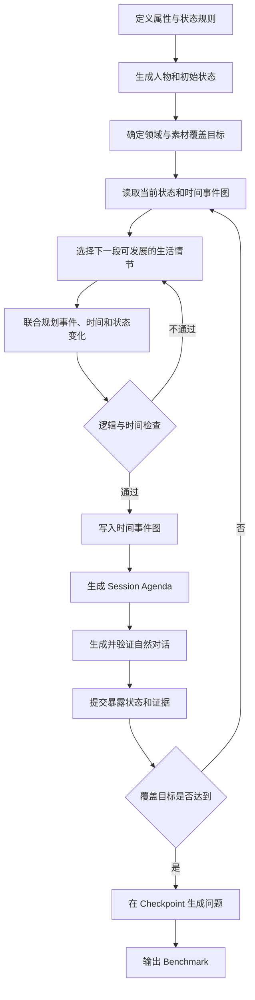

# 长期记忆 Benchmark 构造框架：时间事件图驱动

> 本文给出一套精简、可执行的长期记忆 Benchmark 构造方法。
>
> 核心思想是：
>
> **先确定需要覆盖的领域和状态，再结合人物当前状态与已有时间事件图，编排下一段合理事件；状态变化必须由时间线中的事件推动，不能脱离时间线独立发生。**

---

## 1. 要解决的问题

长期记忆 Benchmark 不能只是把很多独立对话拼接在一起。它需要模拟同一个用户在数月或数年中的持续生活：

- 用户会讨论不同领域；
- 同一话题会跨多个 Session 继续；
- 用户状态会随事件改变；
- 旧状态仍然是历史事实；
- 助手只能知道用户已经说过的内容；
- 最后的问题需要有明确答案和证据。

构造过程最容易出现的问题是：

```text
先随机选择“买车”
过几轮又随机选择“卖车”
最后把两个变化分别塞进时间线
```

虽然“无车 → 有车 → 无车”在状态层面合法，但如果没有需求、决策、使用和出售原因，整个对话历史就会显得突兀。

因此，本文采用：

> **覆盖目标决定希望出现什么类型的状态素材，时间事件图决定这个变化是否应该发生、何时发生以及如何发生。**

---

## 2. 核心原则

### 2.1 状态变化必须由事件驱动

状态不能无理由翻转。

```text
错误：
无车 → 买车 → 卖车

合理：
通勤变远
→ 比较交通方案
→ 决定买车
→ 完成购车
→ 使用一段时间
→ 收入下降
→ 考虑降低开支
→ 决定卖车
→ 完成出售
```

“买车”和“卖车”是状态变化，“通勤变远”“收入下降”等事件提供原因和上下文。

### 2.2 状态目标不是必须立即执行的命令

Benchmark 可能希望获得一条多版本车辆状态链，但这只是覆盖目标：

```yaml
desired_material:
  domain: transport
  state_path: belongings.car.ownership
  desired_versions: 3
```

它不表示规划器必须在下一章立刻买车或卖车。

规划器需要读取已有时间事件图，再决定：

- 当前是否有自然的变化动机；
- 是否需要先铺垫；
- 变化应发生在几周还是几个月以后；
- 是否应暂缓或放弃这条变化；
- 是否有其他领域事件可以自然推动它。

### 2.3 时间事件图是世界线的编排核心

所有真正发生的事情都进入统一的时间事件图。

事件图同时表达：

- 事件发生时间；
- 前置条件；
- 因果关系；
- 先后依赖；
- 影响的状态；
- 所属话题线程；
- 是否已经在对话中暴露。

状态表记录“人物在某个时间点是什么样”，事件图解释“人物为什么变成这样”。

### 2.4 世界事实和助手已知事实分开

必须同时维护两种状态：

```text
World State：
世界中截至当前时间真正发生的事情。

Exposed State：
截至当前 Session，用户已经向助手有效表达的事情。
```

例如，用户 5 月 10 日已经卖车，但直到 5 月 18 日才在对话中提到：

```text
5 月 10 日之后：
World State = 已卖车
Exposed State = 仍只知道以前有车

5 月 18 日对话之后：
World State = 已卖车
Exposed State = 已卖车
```

普通记忆题只能依据已经暴露的证据回答，不能使用生成器掌握但助手不知道的信息。

### 2.5 先生成世界线，再基于证据出题

对话生成阶段不提前写具体问题。

生成阶段只维护需要的素材覆盖，例如：

- 有多个版本的状态链；
- 跨 Session 重复出现的实体；
- 明确日期事件；
- 偏好与约束；
- 计划的完成或取消；
- 合法的信息纠正；
- 可用于多跳推理的事件链。

完成一段世界线后，再从状态版本、事件关系和对话证据中生成问题。

---

## 3. 最小数据模型

本框架只保留六类核心对象。

```text
Persona
State
Thread
Event
Session
Evidence / Question
```

### 3.1 Persona：人物边界

Persona 描述相对稳定的人物设定：

```yaml
persona_id: P01
name: 林晓
age: 29
occupation: 产品经理
current_city: 苏州
personality:
  - 理性
  - 谨慎消费
speaking_style:
  - 表达简洁
  - 经常说明预算
```

Persona 只定义世界线的起点和行为边界，不应提前写入未来剧情。

### 3.2 State：版本化人物状态

状态按属性路径保存：

```yaml
residence.current_city: 苏州
career.company_status: 正常经营
finance.income_level: 正常
belongings.car.ownership: none
commute.mode: metro
preference.travel.style: 城市观光
```

状态变化时创建新版本，不覆盖历史：

```text
belongings.car.ownership

V1  2026-01-01 ~ 2026-02-19  none
V2  2026-02-20 ~ 2026-08-11  owned
V3  2026-08-12 ~ present     sold
```

### 3.3 Thread：长期话题线程

Thread 是会跨多个 Session 发展的生活主题：

```text
T-CAR：通勤与车辆
T-WORK：公司经营和收入
T-TRAVEL：旅行经历与偏好
T-FITNESS：健身安排
```

Thread 不是固定剧本，只记录：

- 当前进展；
- 未完成计划；
- 最近一次推进时间；
- 与其他 Thread 的关系；
- 可以自然继续的方向。

### 3.4 Event：时间事件图节点

Event 是世界中发生的事情：

```yaml
event_id: EV-021
event_type: state_transition
description: 林晓完成购车
time:
  start: 2026-02-20
  end: 2026-02-20
threads:
  - T-CAR
preconditions:
  - commute.need == high
  - car.purchase_decision == confirmed
effects:
  - path: belongings.car.ownership
    before: none
    after: owned
status: occurred
exposure_status: unexposed
```

常用事件关系只保留以下几类：

```text
A causes B       A 是 B 的原因
A requires B     A 必须在 B 已成立时才能发生
A enables B      A 让 B 变得可能
A follows B      A 在时间上晚于 B
A conflicts B    A 与 B 不能同时成立
A relates B      A 与 B 属于同一生活片段
```

### 3.5 Session：一次自然交互

Session 是用户与助手的一次对话。它可以：

- 暴露一个已经发生的事件；
- 讨论一个尚未决定的计划；
- 回访旧话题；
- 完成普通任务；
- 自然连接两个相关 Thread；
- 不产生任何状态变化。

Event 和 Session 不是一一对应关系：

```text
一个事件可以跨多个 Session 被讨论；
多个相关事件可以在一个 Session 中被提到；
一个 Session 也可以没有世界状态变化。
```

### 3.6 Evidence 和 Question

Evidence 指向对话中的具体文本，并说明它支持哪个事实：

```yaml
evidence_id: EVD-104
session_id: S18
speaker: user
text: 上周我已经把车卖给老周了。
supports:
  event_id: EV-047
  state_path: belongings.car.ownership
  value: sold
```

Question 在 Checkpoint 基于已有 Evidence 生成：

```yaml
question: 林晓现在还有车吗？
query_time: 2026-08-20
answer_policy: latest_exposed_value
answer: 没有，他已经把车卖了。
evidence:
  - EVD-104
```

---

## 4. 总体构造流程



这不是“先生成全部状态变化，再统一安排时间”的流程，而是一个循环：

```text
查看已经发生了什么
→ 决定接下来什么发展最自然
→ 编排一小段事件
→ 生成对应对话
→ 更新世界线
→ 再规划下一段
```

---

## 5. 第一步：定义属性和变化规则

每个状态属性至少需要定义：

```yaml
path: belongings.car.ownership
class: mutable_state
value_type: enum
allowed_values:
  - none
  - planned
  - owned
  - sold
allowed_transitions:
  - none -> planned
  - planned -> owned
  - planned -> none
  - owned -> sold
risk_level: low
```

属性可以分为：

1. 基本身份：姓名、出生日期等，通常不允许随意变化；
2. 当前状态：居住地、工作、设备、车辆等；
3. 偏好：旅行、饮食、回答风格等；
4. 计划：考虑中、已决定、已安排、已完成、已取消；
5. 关系：家人、同事、朋友、宠物；
6. 历史事件：已经发生的经历，只能补充或纠正，不能无理由抹除。

这一层只负责定义什么变化合法，不负责决定变化何时发生。

---

## 6. 第二步：生成人物和初始状态

先生成 Persona，再展开为初始状态 `S0`。

```yaml
worldline_id: WL-P01-01
start_time: 2026-01-01

initial_state:
  residence.current_city: 苏州
  career.job: 产品经理
  career.company_status: 正常经营
  finance.income_level: 正常
  belongings.car.ownership: none
  commute.mode: metro
  preference.travel.style: 城市观光
```

同时建立初始已知状态 `C0`。默认情况下，Persona 和 S0 中的信息不一定都已被助手知道。

---

## 7. 第三步：确定领域和素材覆盖目标

### 7.1 选择领域

领域用于约束世界线的大方向，例如：

- 工作；
- 财务；
- 居住；
- 出行；
- 健康；
- 旅行；
- 兴趣；
- 家庭和社交；
- 设备与消费。

不需要一开始写出完整剧情，只需要选择若干可以长期发展的领域。

### 7.2 选择希望覆盖的状态

例如：

```yaml
coverage_targets:
  - state_path: belongings.car.ownership
    target_shape: at_least_2_exposed_versions

  - state_path: preference.travel.style
    target_shape: preference_changed_with_reason

  - state_path: plan.travel
    target_shape: plan_completed_or_cancelled

  - target_shape: cross_session_entity
    minimum_count: 5

  - target_shape: dated_event_pair
    minimum_count: 8
```

这里只选择“希望最终获得什么形状的数据”，不直接指定：

- 必须在第几天变化；
- 必须通过哪个具体事件变化；
- 必须在下一轮完成；
- 必须使用哪一种原因。

### 7.3 覆盖目标的作用

覆盖目标负责告诉规划器：

```text
目前缺少哪些可用于评测的素材？
```

时间事件图负责回答：

```text
在人物当前生活阶段，怎样自然地产生这些素材？
```

二者共同决定下一步，但时间逻辑和人物合理性优先于机械补齐配额。

---

## 8. 第四步：基于时间事件图规划下一段发展

这是整个框架最关键的一步。

### 8.1 每轮规划必须读取的内容

```yaml
planning_context:
  current_world_time: 2026-05-01
  current_world_state: ...
  current_exposed_state: ...
  recent_events: ...
  active_threads: ...
  pending_plans: ...
  unresolved_causes: ...
  coverage_gaps: ...
  pacing_constraints: ...
```

规划器不能只读取“需要让车辆状态变化”，还必须看到：

- 用户现在是否有车；
- 车是什么时候买的；
- 最近是否讨论过通勤；
- 是否存在经济压力；
- 是否有未完成的卖车计划；
- 最近是否已经发生过太多重大变化；
- 其他 Thread 中是否有可以产生影响的事件。

### 8.2 先选择生活情节，再确定状态转移

每轮规划先提出一个“小情节”，通常覆盖几天到几个月：

```yaml
episode_proposal:
  domain: finance
  related_threads:
    - T-WORK
    - T-CAR
  premise: 公司融资失败，用户开始控制支出
  possible_state_impacts:
    - career.company_status
    - finance.income_level
    - belongings.car.ownership
  estimated_duration: 6_to_10_weeks
```

然后把情节展开为事件链：

```text
公司融资失败
→ 公司开始缩减业务
→ 用户收入下降
→ 用户盘点固定支出
→ 用户开始考虑卖车
→ 比较保留车辆和公共交通的成本
→ 决定卖车
→ 完成出售
→ 改为地铁通勤
```

最终状态变化由这条事件链自然产生。

### 8.3 时间和状态要联合规划

不能先固定状态变化，再随便找一个空日期。

规划时需要同时决定：

```yaml
event_id: EV-047
description: 林晓把车卖给同事老周
time_window:
  earliest: 2026-07-20
  latest: 2026-08-20
must_follow:
  - EV-041  # 收入下降
  - EV-044  # 决定卖车
minimum_gap:
  from_car_purchase: 90d
effects:
  - belongings.car.ownership: owned -> sold
```

时间窗口、依赖关系和状态变化是同一次规划的结果。

### 8.4 允许只铺垫，不立即改变状态

一轮规划可以只生成：

- 讨论；
- 比较；
- 犹豫；
- 收集信息；
- 暂时搁置；
- 回访；
- 普通任务。

例如：

```text
S06：用户抱怨通勤时间变长；
S09：用户比较打车、租车和买车成本；
S12：用户表示还没有决定。
```

此时 `belongings.car.ownership` 仍然是 `none`。只有购车事件真正发生后才更新状态。

### 8.5 允许规划器拒绝不自然的覆盖目标

如果世界线中没有合理条件，规划器应输出：

```yaml
decision: defer
target: belongings.car.ownership
reason: 用户刚搬到公共交通便利区域，目前没有自然购车动机
reconsider_after:
  - commute_need_changes
  - family_transport_need_appears
```

这样可以避免为了配额强行制造剧情。

---

## 9. 第五步：检查并写入时间事件图

### 9.1 时间检查

需要检查：

- 原因是否早于结果；
- 计划是否早于执行；
- 取消是否发生在完成之前；
- 回忆的事件是否已经发生；
- 同一属性是否在同一时间拥有冲突值；
- 重大变化是否过于密集；
- 事件间隔是否符合常识。

### 9.2 状态检查

需要检查：

- 前置状态是否成立；
- 状态转移是否被 ontology 允许；
- 是否错误修改稳定身份属性；
- 旧版本是否被保留；
- 是否存在没有事件来源的状态变化。

### 9.3 因果与人物合理性检查

需要检查：

- 事件是否有足够动机；
- 行为是否符合人物预算、性格和生活阶段；
- 跨领域影响是否显式连接；
- 后续事件是否真正读取了正确的状态版本；
- 是否为了生成题目而出现明显的人为剧情。

### 9.4 节奏检查

建议设置软约束：

- 同一属性的两次重大变化之间保留合理间隔；
- 每月重大生活变化数量有限；
- 连续 Session 不应全部更新人物状态；
- 一个 Session 主要推进一个话题；
- 不相关 Thread 可以交错，但不能互相破坏因果。

检查通过后，事件才能写入统一时间事件图。

---

## 10. 第六步：从事件图生成 Session Agenda

时间事件图描述世界发生了什么，Session Agenda 描述用户为什么在这次对话中提到它。

```yaml
session_id: S18
timestamp: 2026-08-18
primary_topic: 控制每月支出
user_goal:
  description: 请助手重新制定通勤预算

events_to_reveal:
  - EV-047

facts_user_may_reveal:
  - 上周已经把车卖给老周
  - 以后主要坐地铁
  - 卖车是因为收入下降后想减少固定支出

history_callbacks:
  - 以前买车是因为通勤变远

facts_forbidden_to_change:
  - current_city
  - current_job

session_end:
  - 得到新的月度通勤预算
```

Agenda 只规定边界，不预先写死完整台词。

### 10.1 让事件以自然任务为入口

用户不需要像汇报数据库一样说：

```text
我的车辆状态已经从 owned 更新为 sold。
```

更自然的表达是：

```text
我上周把车卖给老周了。最近收入少了一些，养车开销又不低。
你能按以后主要坐地铁的情况，帮我重新算一下每月通勤预算吗？
```

状态变化被嵌入真实任务中，对话才会连贯。

### 10.2 普通 Session 是必要的

不是每次对话都要推进人生剧情。应加入：

- 文本修改；
- 信息解释；
- 临时建议；
- 对旧话题的简单回访；
- 与长期状态无关的小任务。

普通 Session 可以控制剧情密度，也可以形成真实的检索干扰。

---

## 11. 第七步：生成对话并提交状态

每个 Session 按以下顺序处理：

```text
读取 Session 开始前的 World State
→ 读取助手可知的 Exposed State
→ 根据 Agenda 生成对话
→ 检查用户是否真的表达了目标事实
→ 抽取 Evidence
→ 更新 Exposed State
→ 必要时提交新的世界状态版本
```

### 11.1 谁可以创建用户事实

- 用户明确陈述：可以成为证据；
- 用户确认助手总结：可以成为证据；
- 工具返回并被用户接受：按来源规则登记；
- 助手自行猜测：不能成为用户事实；
- 助手提出建议：不能自动改变用户状态。

### 11.2 对话没有实现 Agenda 时怎么办

如果对话没有自然表达目标事件或表达发生冲突：

1. 本次提交整体回滚；
2. 保留失败原因；
3. 重新生成对话或修改 Agenda；
4. 不能出现“对话已保存，但状态和证据没有同步”的情况。

---

## 12. 第八步：在 Checkpoint 生成评测问题

到达一个 Checkpoint 后，从以下内容中选择可出题素材：

```text
Checkpoint 之前的对话
已暴露的状态版本
事件时间和关系
Evidence
当前覆盖配额
```

### 12.1 常见题型

#### 信息抽取

```text
问：林晓把车卖给了谁？
答：同事老周。
```

#### 知识更新

```text
问：林晓现在还有车吗？
答：没有，已经卖掉了。
```

#### 历史状态

```text
问：林晓在改坐地铁之前主要如何通勤？
答：开车。
```

#### 时间推理

```text
问：从买车到卖车大约过了多久？
答：约六个月。
```

#### 因果推理

```text
问：林晓为什么决定卖车？
答：公司经营变化导致收入下降，他希望减少固定开支。
```

#### 个性化应用

```text
问：结合林晓目前的情况，推荐更合适的周末出行方式。
答题要求：使用当前无车、预算下降和偏好安静自然等已暴露信息。
```

#### 拒答

如果卖车事件已经发生，但用户尚未告诉助手：

```text
问：林晓现在还有车吗？
答：根据已有对话无法确认。
```

### 12.2 每道题必须保存

```yaml
question_id: Q-031
checkpoint_time: 2026-08-20
question_type: knowledge_update
query_time: 2026-08-20
answer_policy: latest_exposed_value
answer: 当前没有车
evidence_ids:
  - EVD-104
distractor:
  source: stale_state
  value: owned
```

---

## 13. 一个完整的车辆状态示例

### 13.1 覆盖目标

```yaml
domain: transport
state_path: belongings.car.ownership
target_shape: three_version_chain
```

目标希望获得：

```text
none → owned → sold
```

这只是最终素材目标，不是三个可以直接执行的状态写操作。

### 13.2 时间事件图

```text
2026-01-08  公司搬到更远的办公地点
      ↓ causes
2026-01-15  用户抱怨地铁通勤时间过长
      ↓ enables
2026-01-28  用户比较打车、租车和买车
      ↓
2026-02-05  用户决定买车
      ↓ requires
2026-02-20  用户完成购车
      ↓ state: none → owned

2026-05-10  公司融资失败
      ↓ causes
2026-05-25  公司缩减业务
      ↓ causes
2026-06-10  用户收入下降
      ↓
2026-06-22  用户开始控制固定开支
      ↓
2026-07-03  用户考虑卖车
      ↓
2026-07-18  用户比较养车和地铁成本
      ↓
2026-07-26  用户决定卖车
      ↓ requires
2026-08-12  用户把车卖给老周
      ↓ state: owned → sold
2026-08-18  用户重新制定地铁通勤预算
```

### 13.3 Session 分布

```text
S03：抱怨新办公室太远，请助手比较通勤方式
S06：询问几款车型的差异
S08：告诉助手已提车，请助手整理保养清单
S14：提到公司融资不顺，请助手修改工作邮件
S16：收入下降后，请助手分析每月固定支出
S17：讨论是否应卖车，但尚未决定
S18：告诉助手已经卖车，请助手重做通勤预算
S21：回忆以前开车通勤，并询问周末出行方案
```

### 13.4 为什么这条世界线自然

- 买车前有真实通勤需求；
- 从需求到购买经历了讨论、比较和决定；
- 买车后保持了数月稳定状态；
- 卖车由工作和财务事件推动；
- 卖车前有考虑和成本比较；
- 卖车后产生了新的通勤任务；
- 后续回忆旧状态不会与当前状态冲突。

---

## 14. 每轮规划的推荐输出

规划器每次只生成一小段可验证的发展：

```yaml
planning_round: R07
current_time: 2026-06-15

selected_domain:
  primary: finance
  secondary:
    - transport

coverage_target:
  target: belongings.car.ownership
  desired_shape: add_new_version
  priority: medium

timeline_reasoning:
  relevant_history:
    - 用户在 2 月买车
    - 公司在 5 月融资失败
    - 用户在 6 月收入下降
  natural_next_step:
    - 盘点固定支出
    - 评估车辆成本
  rejected_steps:
    - step: 立即卖车
      reason: 缺少考虑和决策过程

proposed_events:
  - event: 盘点每月固定支出
    window: 2026-06-20 ~ 2026-06-30
  - event: 开始考虑是否卖车
    window: 2026-07-01 ~ 2026-07-10
    follows:
      - 盘点每月固定支出

state_effect:
  immediate: none
  pending:
    - belongings.car.ownership may change later
```

这个输出明确允许“本轮还不改变车辆状态”。

---

## 15. 简化算法

```text
初始化 Persona、S0、C0、Thread 和覆盖目标

while 覆盖目标未达到:
    读取当前时间、当前状态和已有时间事件图
    计算素材缺口

    选择一个适合继续发展的领域或 Thread
    结合最近事件提出下一段生活情节
    联合生成：
        事件
        时间窗口
        依赖关系
        可能的状态变化

    检查：
        时间是否合法
        因果是否充分
        状态转移是否合法
        人物行为是否自然
        事件密度是否合理

    如果不通过:
        修改或放弃该情节
        重新规划

    如果通过:
        写入时间事件图
        生成 Session Agenda
        生成并验证对话
        提交 Evidence 和状态版本

在多个 Checkpoint：
    从已有证据和状态版本中生成问题
    计算标准答案
    验证问题没有引用未来信息
```

---

## 16. 推荐的文件组织

```text
worldline/
├── persona.yaml
├── ontology.yaml
├── coverage_targets.yaml
├── states.jsonl
├── threads.jsonl
├── events.jsonl
├── event_edges.jsonl
├── sessions.jsonl
├── evidence.jsonl
├── checkpoints.jsonl
└── questions.jsonl
```

其中：

- `states.jsonl` 保存版本化状态；
- `events.jsonl` 保存带时间的事件节点；
- `event_edges.jsonl` 保存因果和依赖；
- `sessions.jsonl` 保存自然对话；
- `evidence.jsonl` 连接对话文本与事实；
- `questions.jsonl` 保存问题、答案和证据。

---

## 17. 质量验收标准

一条世界线至少通过以下检查。

### 17.1 时间一致性

- 所有事件日期有效；
- 先因后果；
- 计划、执行、取消顺序合理；
- 不引用尚未发生的经历。

### 17.2 状态一致性

- 每个状态版本都有来源事件；
- 每次变化都符合允许的状态转移；
- 旧版本没有被删除；
- 当前值可以由事件日志重放得到。

### 17.3 对话一致性

- 用户表达与世界事件一致；
- 助手没有泄漏未来信息；
- 助手推测没有被错误提交为用户事实；
- 每个关键答案都有可定位的用户证据。

### 17.4 叙事自然性

- 重大变化有动机和铺垫；
- 不会突然买车、突然卖车；
- 同一话题会被自然回访；
- 不同领域可以产生合理的跨线程影响；
- 普通任务与状态变化 Session 比例合理。

### 17.5 评测有效性

- 问题只使用 Checkpoint 之前的信息；
- 当前状态题与历史状态题明确区分；
- 旧值可以作为干扰，但不能当作当前答案；
- 无证据问题必须拒答；
- 标准答案由结构化状态和证据计算，而不是由模型猜测。

---

## 18. 最小可行版本

第一版不需要一次实现所有复杂机制，可以只实现：

```yaml
persona_count: 5
domains_per_persona: 3
threads_per_persona: 4
sessions_per_worldline: 20
state_chains_per_worldline: 5
checkpoints:
  - session_10
  - session_20
```

最小版本需要支持：

1. 可变状态的版本记录；
2. 事件节点及 `causes`、`requires`、`follows` 三类边；
3. 基于已有时间事件图的逐轮规划；
4. World State 与 Exposed State 分离；
5. Session 级证据抽取；
6. 信息抽取、知识更新、时间、因果和拒答题；
7. 时间、状态和证据一致性校验。

暂时可以不实现：

- 大规模候选事件池；
- 复杂图数据库；
- 过多操作类型；
- 一开始就支持全部题型；
- 为每种题型建立独立生成流程。

---

## 19. 最终总结

本框架的主线可以压缩成：

```text
选择领域和状态覆盖目标
→ 读取当前状态与已有时间事件图
→ 编排下一段自然事件
→ 由事件推动状态变化
→ 将事件转成自然 Session
→ 从对话中提交证据和已知状态
→ 在 Checkpoint 基于证据生成问题
```

其中最重要的约束是：

> **状态变化不能先被孤立决定，再机械地插入时间线。规划器必须结合已经发生的事件、当前时间、人物状态和未完成计划，联合决定下一个事件及其可能造成的状态变化。**

覆盖目标保证 Benchmark 拥有足够的评测素材；时间事件图保证这些素材来自一条有逻辑、流畅且可追踪的用户世界线。
